

  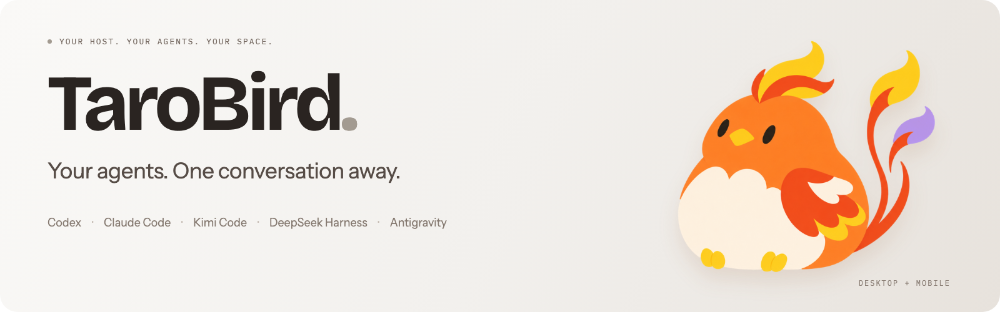

<h3 align="center">Your AI agents, running on your own computers. The same conversations on desktop and phone.</h3>

  Codex · Claude Code · Kimi Code · DeepSeek Harness · Antigravity

  <a href="https://github.com/cloveric/tarobird/releases"><b>Download</b></a> &nbsp;·&nbsp;
  <a href="https://testflight.apple.com/join/ByFWEfFW"><b>iOS TestFlight beta</b></a> &nbsp;·&nbsp;
  <a href="#quick-start"><b>Quick start</b></a> &nbsp;·&nbsp;
  <a href="#connection-options">Connection options</a> &nbsp;·&nbsp;
  <a href="docs/details.md">Details</a> &nbsp;·&nbsp;
  <a href="docs/README.en.md">Docs</a> &nbsp;·&nbsp;
  <a href="README.zh-CN.md">中文</a>

https://github.com/user-attachments/assets/6cd6e2a9-92c9-47e5-96f1-8b0a02df69a7

57-second product overview · <a href="https://www.youtube.com/watch?v=R0WvfGiIFiw">YouTube</a> · <a href="assets/product/demo-en.gif">Animated overview</a>

TaroBird is a self-hosted workspace for AI agents. It brings command-line agents such as Codex and Claude Code, running on your computers or servers, into a single conversation interface: assign tasks, answer questions, follow each run and receive deliverables from desktop or phone. Bots, conversations and files stay on your own hosts.

<table>
  <tr>
    <td width="33%" valign="top"><b>Native engines</b> Runs the official CLIs and keeps each engine's native agent capabilities.</td>
    <td width="33%" valign="top"><b>Desktop and phone</b> macOS, Windows and mobile share the same Bots and conversations, so work continues anywhere.</td>
    <td width="33%" valign="top"><b>Multi-host network</b> Each computer joins your private network with its own Bots.</td>
  </tr>
  <tr>
    <td valign="top"><b>Groups and collaboration</b> Multi-Bot groups with topics, plus visual workflows with Agent Bus.</td>
    <td valign="top"><b>Cross-host tasks</b> Bots hand tasks, files and results to one another across hosts.</td>
    <td valign="top"><b>ADHD mode</b> Up to 12 desktop conversations side by side, each moving independently.</td>
  </tr>
</table>

<h3 align="center">Desktop</h3>

macOS · Windows Organize work by Bot or by conversation, inspect each run, and review replies and files.

  <a href="assets/product/desktop-en.png">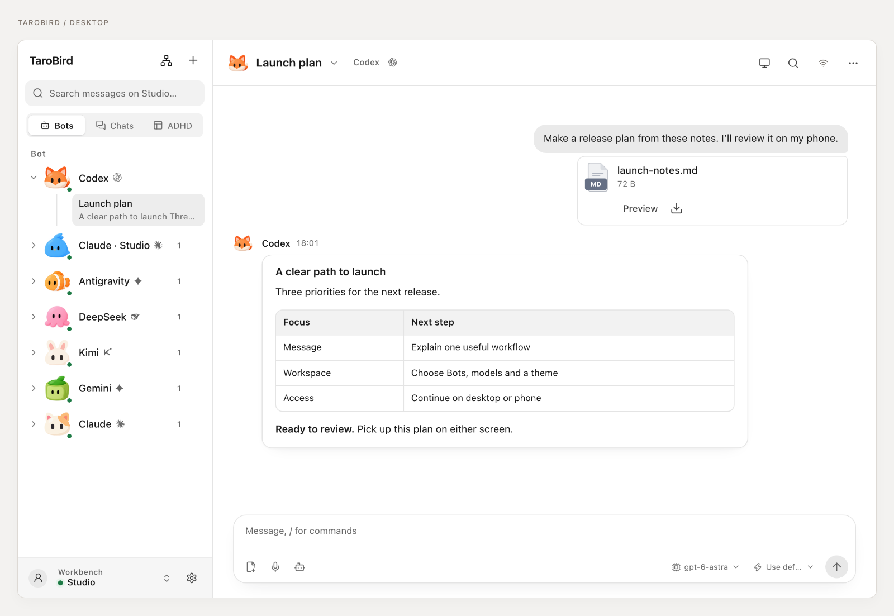</a>

<h3 align="center">Mobile</h3>

Start on your computer. Continue on your phone. Read replies, answer questions and receive files in the same conversations.

  <a href="assets/product/phone-pair-en.png">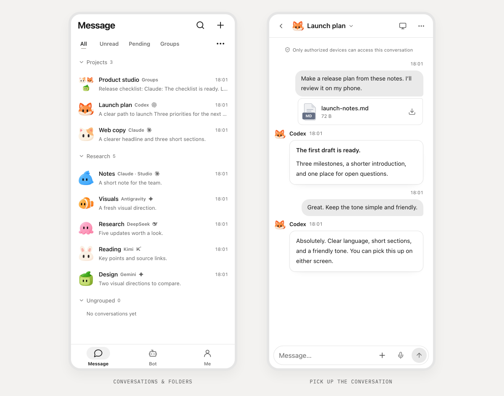</a>

<a href="assets/product/mobile-en.png">Full-size inbox</a> · <a href="assets/product/mobile-chat-en.png">Full-size chat</a>

<h3 align="center">ADHD · Parallel conversation workspace</h3>

Keep several Bot conversations in view, each moving independently. Switch to ADHD beside Bots / Chats, then select the chats for your board.

  <a href="assets/product/adhd-en.png">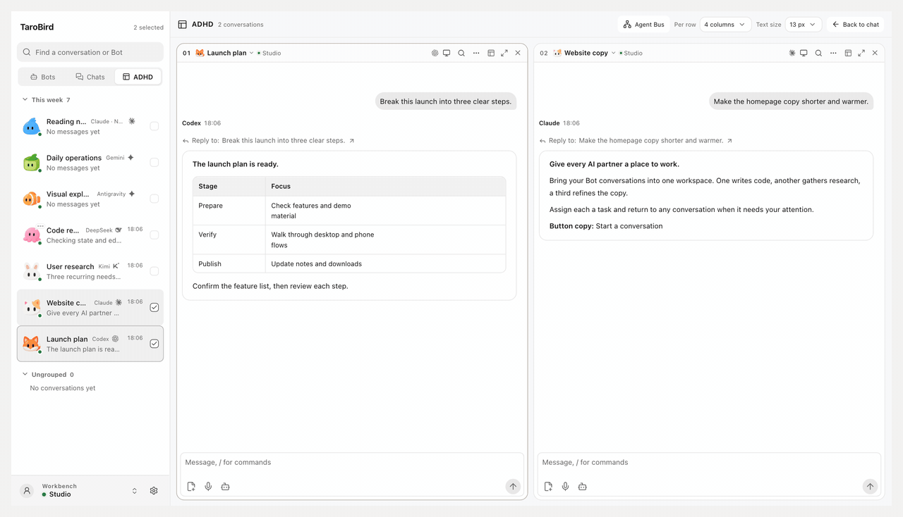</a>

Desktop only · macOS / Windows · Recorded from the real interface with demonstration data · <a href="assets/product/adhd-en.png">Full-size view</a>

- **Work in parallel.** Select up to 12 chats across hosts. Each pane keeps its own messages, draft and input; removing a pane neither closes the conversation nor stops its running task.
- **Flexible layout.** Use automatic layout or 2–6 columns, resize the sidebar, reorder panes or expand one to focus. ADHD text size is adjustable from 11 to 16 px.
- **Actions in place.** Questions, replies and files stay in their own conversations, and the board layout is saved on this device.

<h3 align="center">Agent Bus · Visual multi-Bot collaboration</h3>

Assign a task to each step and see how work moves between Bots. Open a saved Bus from the sidebar to view member conversations alongside the workflow.

  <a href="assets/product/agent-bus-en.png">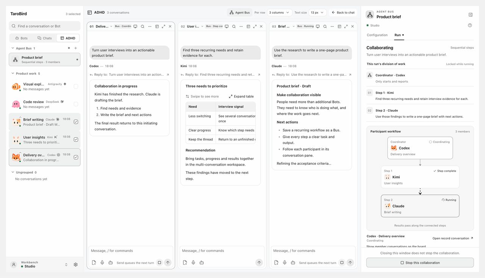</a>

Desktop only · macOS / Windows · Real interface with demonstration data and a simulated run status · <a href="assets/product/agent-bus-en.png">Full-size workflow</a> · <a href="assets/product/agent-bus-setup-en.png">Member configuration</a>

- **Orchestrate the workflow.** Choose delegation, parallel work, sequential steps, verification or a research crew, and bind each step to a Bot and a result conversation with its own task.
- **Progress at a glance.** The flow shows the status of every step while the panes show its output. Saved Buses are reusable, and closing the panel does not stop a running collaboration.
- **Runs within one host.** Members work in independent sessions and record their results in the bound conversations. [Design and operation](docs/client/agent-bus-workspace-2026-10-18.md) · [Per-step tasks](docs/client/agent-bus-stage-tasks-2026-10-19.md)

Actual UI with demonstration data · <a href="assets/product/README.md">Screenshot provenance</a> · <a href="docs/client/adhd-board-2026-10-17.md">ADHD design and verification</a>

<h3 align="center">Groups and topics · Bring your Bots into one conversation</h3>

Put research, writing and review Bots in one group to work through the same question. Join the group from desktop or phone, and organize each project or question into its own topic.

  <a href="assets/product/feature-groups-en.png">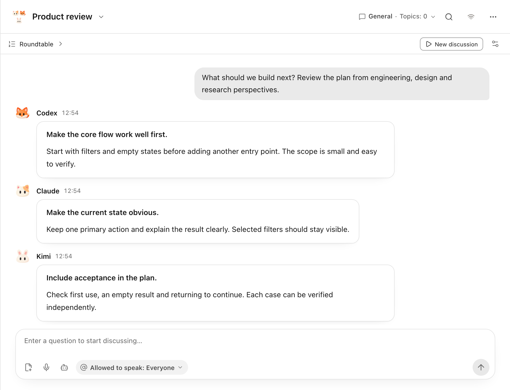</a>

Actual UI with demonstration data; replies are illustrative, not model execution · Group members currently belong to one host · <a href="assets/product/feature-group-modes-en.png">Discussion settings</a> · <a href="docs/client/group-discussion-2026-10-20.md">Group guide</a>

- **Choose who replies.** In ordinary group chat, select or @ the Bots you want to answer. Switch to parallel replies for everyone to answer independently.
- **Keep topics separate.** Create topics within the group for different projects or questions. Topics use the same group members and keep their own conversation history.
- **Choose a discussion mode.** Use group chat, parallel replies, roundtable or independent review. Automatic discussions support speaking order and round limits, with controls to pause, resume or end a discussion.

<h3 align="center">Connected Bots · One team across your computers</h3>

Give one Bot a goal. Let authorized Bots on other computers contribute their part. Tasks, files and results travel between Bots; each machine runs its own work.

  <a href="assets/product/bot-team-en.png">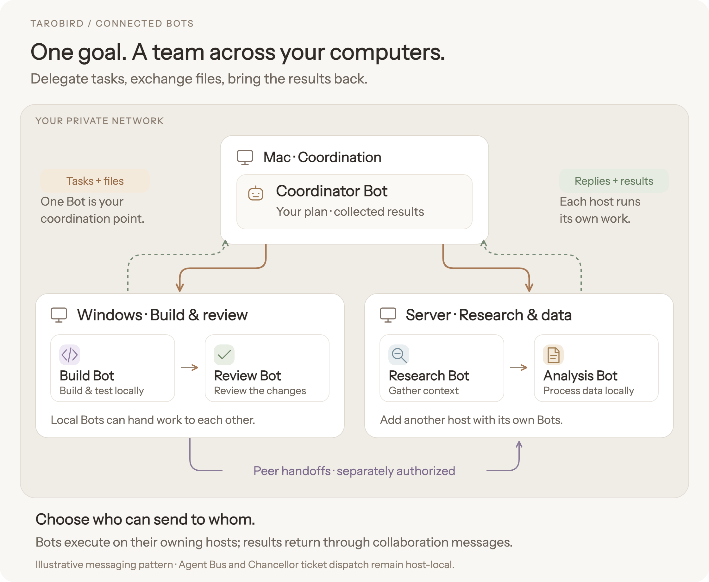</a>

Illustrative messaging pattern, not a live run · Each task direction needs permission

> “Ask the Windows Bot to build and test this change, and the server Bot to analyze the data. Bring their reports and files back here.”

- **One Bot can coordinate several machines.** In one task, tell a Bot which parts to send to which hosts. It acts as your point of contact, collects those replies and combines the results. Each receiving Bot works through its own engine and permissions on its host.
- **Peers can help one another.** A review Bot can ask a research Bot for context, or a coding Bot can hand a change to a test Bot. The same message flow works within one host and across hosts; a central Bot is optional.
- **Bring another computer's Bots into the team.** Connect the joining computer to an existing host, then confirm joining under **Settings → Network & connections → My network**. Authorized desktop and phone clients can access its Bots. Hosts must be online and mutually reachable for a handoff.
- **Keep the work traceable.** Dedicated collaboration conversations retain tasks and replies, and the recipient sees the source host and Bot. Files you hand off are copied to the receiving host; joining a network does not merge workspaces or grant access to every Bot.

**Choose who can communicate.** Manage same-host access in **Settings → Bot message permissions**. From 1.2.0, the receiving host’s owner can use its **Cross-host** tab to select a source host/Bot and receiving Bot, then allow or revoke by direction. Joining the network does not authorize messages. Replies to the original task do not need a reverse grant.

  <a href="assets/product/bot-permissions-en.png">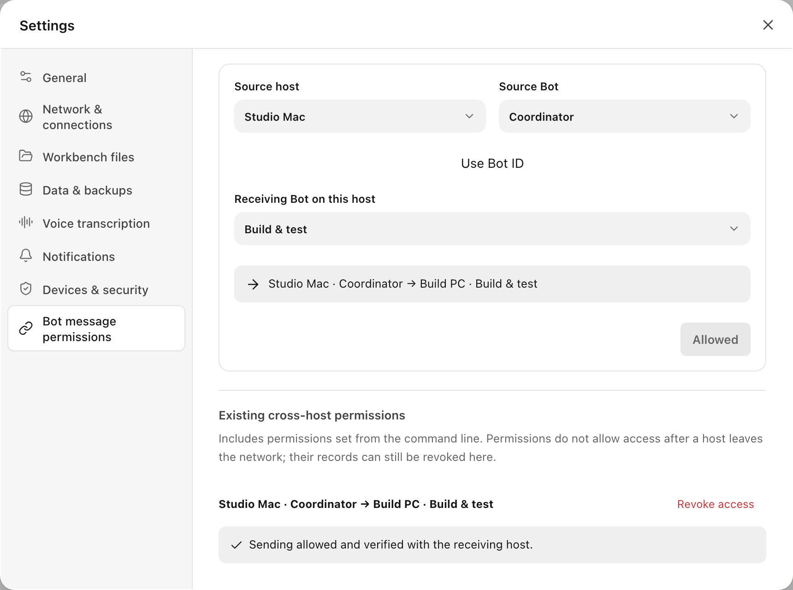</a>

App permission UI in 1.2.0 · Real settings and signed authorization with disposable hosts and fictional data; no model ran · Also available through <a href="docs/details.md#bot-to-bot-tasks-across-hosts">CLI authorization</a>

This is a foundation for a coordinating Bot or a network of collaborating peers. Automatic host selection, cross-host scheduling and shared ticket tracking are future possibilities, not built-in capabilities today. **Agent Bus, groups and Chancellor ticket dispatch currently stay within one host**; cross-host work uses direct Bot messages.

[Permissions and recovery](docs/client/cross-host-message-permissions.md) · [Network setup](docs/details.md#private-network) · [Commands and delivery guarantees](docs/details.md#bot-to-bot-tasks-across-hosts)

<h3 align="center">Discuss, visualize and review</h3>

Group discussions, interactive replies, change review and voice transcription.

  <a href="assets/product/features-en.png">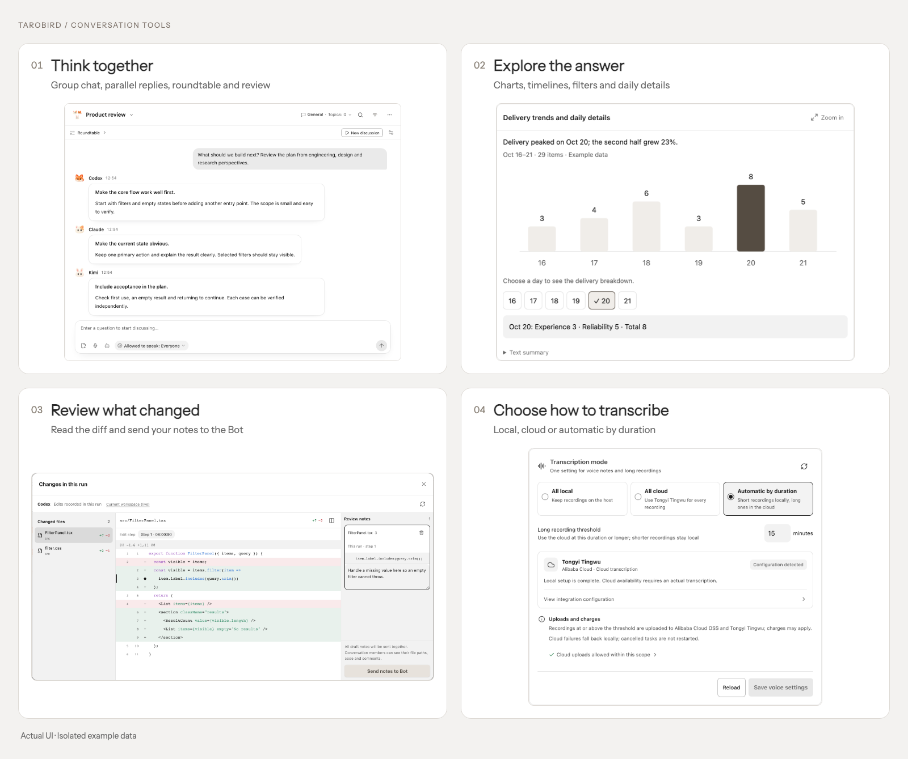</a>

Full-size views: <a href="assets/product/feature-groups-en.png">Group chat</a> · <a href="assets/product/feature-group-modes-en.png">Discussion modes</a> · <a href="assets/product/feature-visual-en.png">Interactive report</a> · <a href="assets/product/feature-changes-en.png">Run changes</a> · <a href="assets/product/feature-voice-en.png">Voice settings</a>

- **Interactive replies.** Bots can present charts, timelines and filters directly in a reply, with an expanded view and history. [Interactive replies](docs/client/inline-widgets-2026-10-22.md)
- **Change review.** Step through the files each reply edited; on desktop, comment on lines and send them back to the Bot. [Recorded changes](docs/client/run-diff-2026-10-20.md)
- **Voice transcription.** Choose all-local, all-cloud or automatic routing by duration for each host. [Voice settings](docs/client/voice-transcription-settings-2026-10-21.md)

<h3 align="center">Workbench · Keep references and creative work beside the chat</h3>

Web browsing, canvas, whiteboard, Markdown notes and PPT in one workspace. Each conversation keeps its own Workbench, in the side panel or expanded into the main area.

<h3 align="center">Canvas · Turn an idea into something you can edit</h3>

Create pages, posters and visual drafts with your Bot. Double-click text to edit and refine the result as you go.

  <a href="assets/product/workbench-canvas-en.png">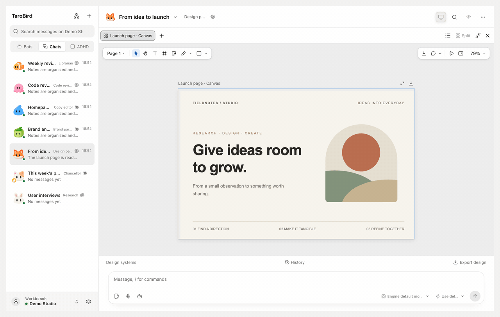</a>

Recorded from the real interface with demonstration content · <a href="assets/product/workbench-canvas-en.png">Full-size view</a> · <a href="docs/client/workbench-design.md">Canvas guide</a>

<h3 align="center">Browser · Web pages inside the App</h3>

Open a web page in the conversation's Workbench; the Bot in that conversation can observe and operate the page within its limits. Page tools include find, zoom, size preview, print to PDF, screenshots and downloads.

  <a href="assets/product/workbench-browser-en.png">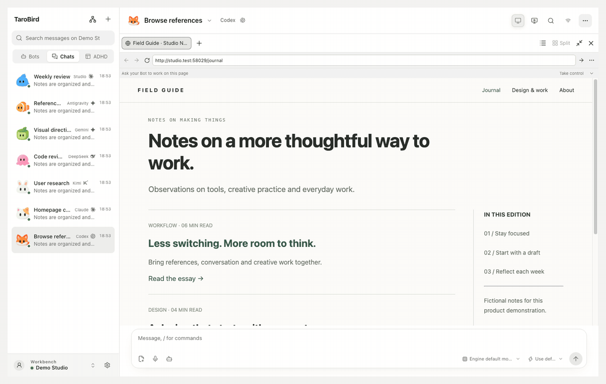</a>

Desktop App only · Actual UI with demonstration data · <a href="docs/client/browser-page-tools-2026-10-31.md">Page tools</a>

<h3 align="center">Whiteboard and notes · Sketch ideas, keep decisions</h3>

Draw shapes, text, connectors and images on a whiteboard, and write Markdown notes with preview and autosave. Edits from you and the Bot share the same versions and undo.

  <a href="assets/product/workbench-whiteboard-en.png">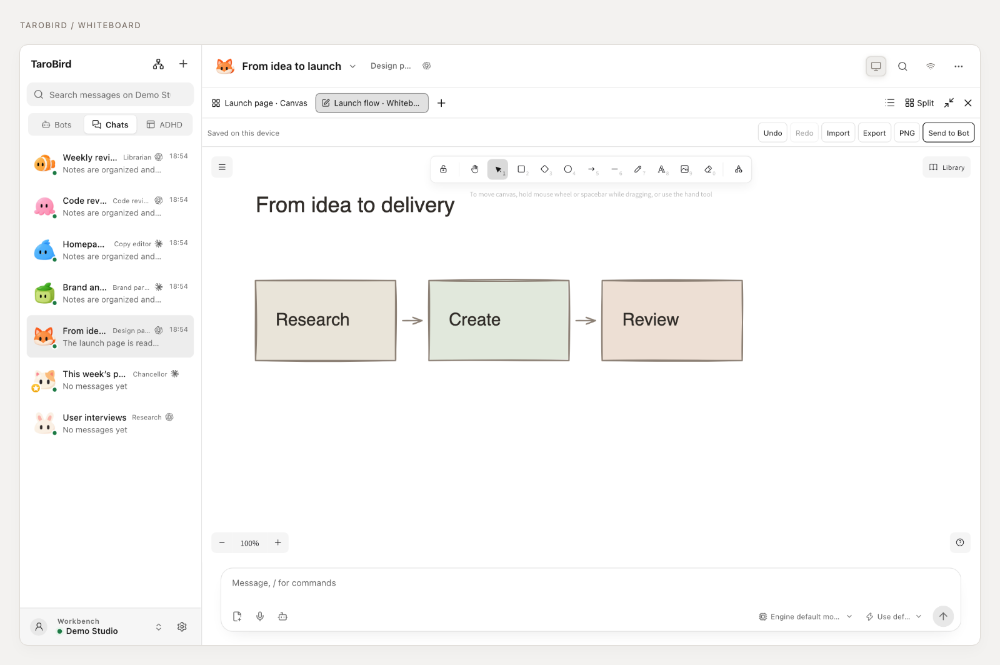</a>

  <a href="assets/product/workbench-notes-en.png">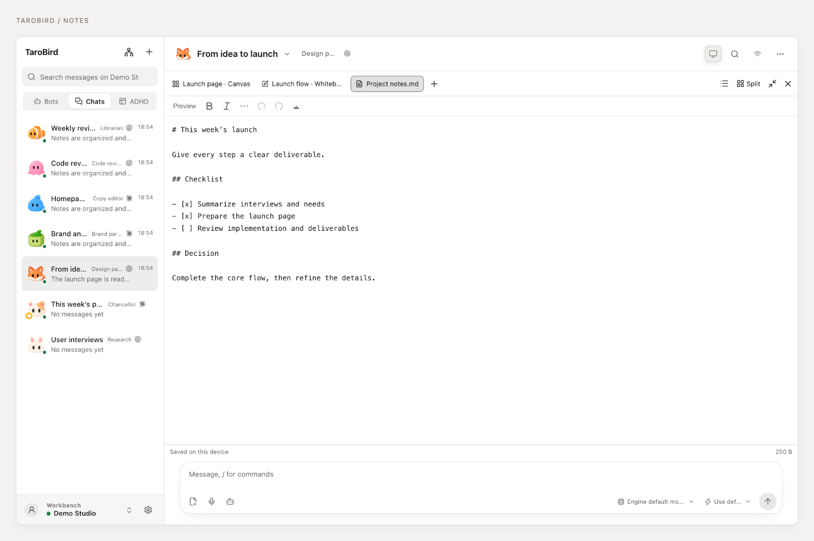</a>

Actual UI with demonstration data · Whiteboard by Excalidraw · Notes by Vditor · <a href="docs/client/conversation-workbench-2026-10-30.md">Workbench guide</a>

<h3 align="center">Side panel · Chat and Workbench side by side</h3>

Workbench opens to the right of the conversation, so you can keep chatting while you work. Resize the panel, show two to four tabs together with Split, or expand one tab to focus.

  <a href="assets/product/workbench-side-en.png">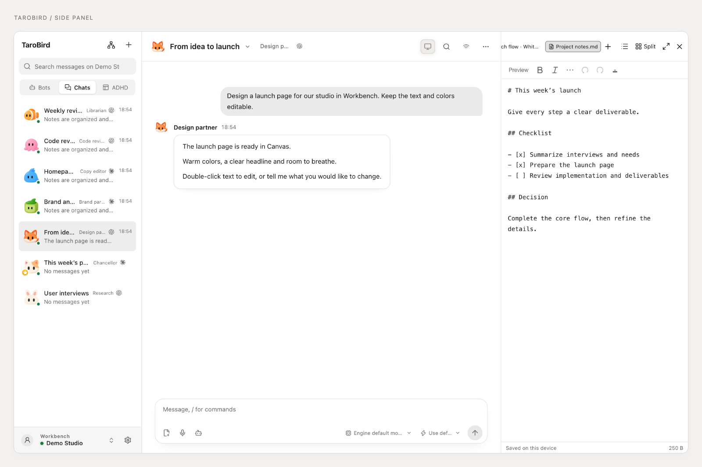</a>

Actual UI with demonstration data · Each conversation keeps its own Workbench · Content stays on this device; export a project to move or back it up

<h3 align="center">Screen control · View and operate another Mac</h3>

Open an authorized Mac's screen from the desktop App. It starts in view mode; choose Start control to operate it, then Stop control or return to your local chat to release it.

  <a href="assets/product/remote-screen-en.png">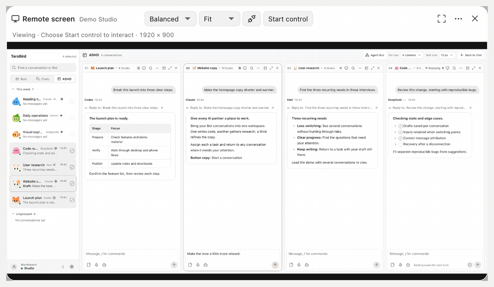</a>

Desktop App · requires access and macOS permissions on the target Mac · real viewer with a simulated frame and connection in this recording · <a href="docs/client/remote-screen-2026-10-31.md">Controls and permissions</a>

<h3 align="center">Chancellor · One goal, tracked as tickets</h3>

Choose Make it a Chancellor when creating a Bot, then describe the goal in its conversation. It splits the work into tickets, runs each with an engine CLI on this host and reports back.

  <a href="assets/product/chancellor-en.png">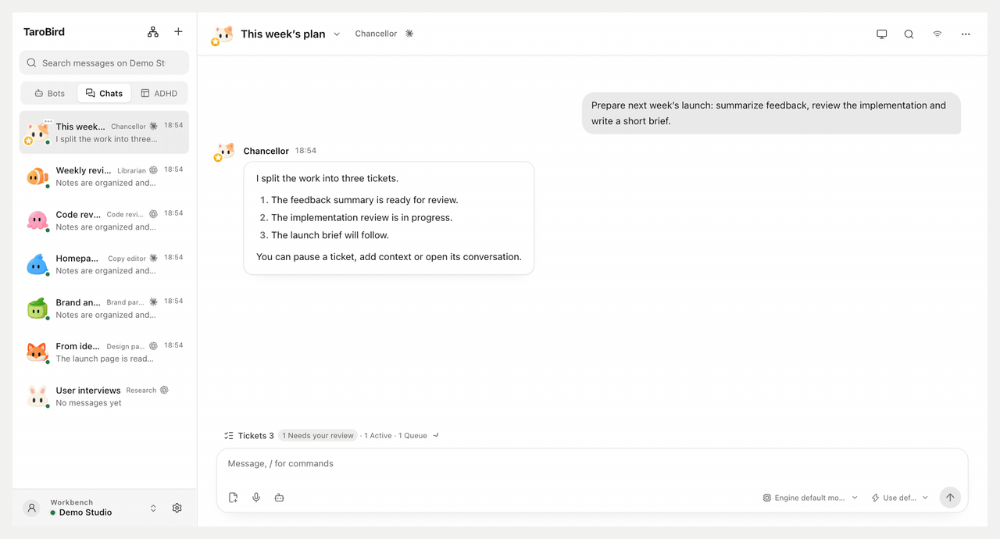</a>

Actual UI with demonstration data; ticket states are illustrative and no model ran · <a href="docs/client/dispatcher-bot-2026-11-01.md">Chancellor guide</a>

- **Visible tickets.** See queued, active, waiting and ready-for-review tickets, and open any ticket's worker conversation.
- **You set the pace.** Approve each plan or let it dispatch on its own; choose the allowed engines and how many tickets run at once. Pause, cancel or add context at any time.
- **Pick the right tool.** A Chancellor plans and delegates; Agent Bus runs a workflow you define; ADHD keeps several conversations in view.

See the complete [feature list](docs/details.md#features).

<b>More views: themes, folders and list options</b>

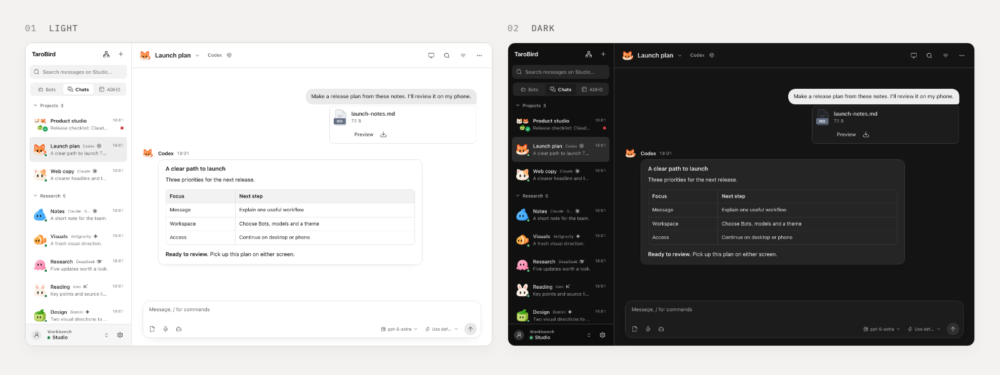
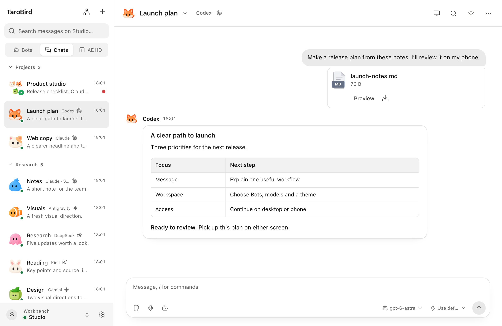

Right-click a folder name or an empty area of the desktop list to group by host, show disconnected Bots or manage folders.

<a href="assets/product/list-options-en.png">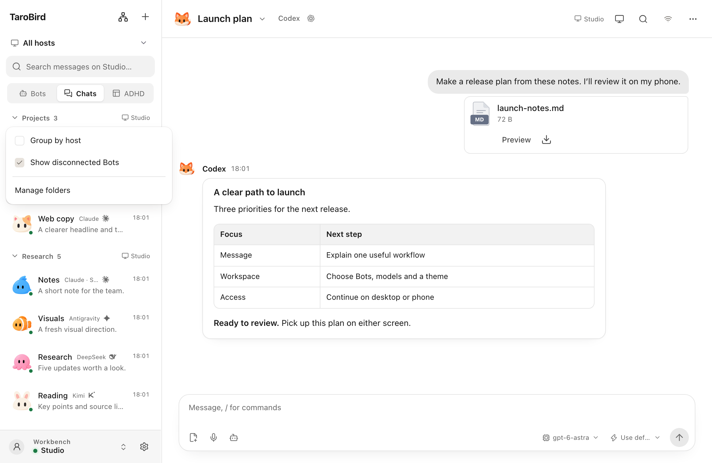</a>

## Supported engines

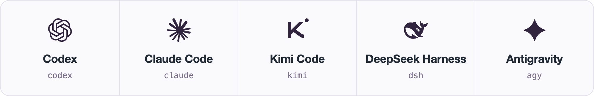

**Built on official native CLIs.** TaroBird does not reimplement agents. It runs the official command-line tools of Codex, Claude Code, Kimi Code, DeepSeek Harness and Antigravity. A harness is the execution system around a model — its agent loop, tool use, context and session management — and the harness a provider builds and tunes for its own model brings out the best in it. TaroBird adds desktop and phone access, multi-Bot collaboration and a unified workspace on top.

**Improves as the CLIs evolve.** When a host's CLI is updated, its gains in execution, context handling and reliability carry straight into TaroBird's Bots. Available capabilities depend on the installed CLI, account and adapter, and new interfaces may require further TaroBird adaptation. [Engine capabilities](docs/client/capability-map.md)

Install and sign in to any one engine on the computer that runs your Bots to get started; TaroBird does not include AI engines, model accounts or credits. See the [engine comparison](docs/details.md#engine-comparison) for adapter differences.

> [!IMPORTANT]
> Most engines default to full access. Adjust this in the Bot's **Permissions & approvals**. See [Engines and permissions](docs/details.md#engines-and-permissions) for models, effort and permission details.

## Quick start

<table>
  <tr>
    <td width="33%" valign="top"><b>01 · Install the host</b> Install TaroBird on your computer, make it a host and create a Bot.</td>
    <td width="33%" valign="top"><b>02 · Pair your phone</b> Scan the QR code on your phone, then approve its 8-digit code.</td>
    <td width="33%" valign="top"><b>03 · Connect from anywhere</b> Reach your Bots over Tailscale or a VPS relay.</td>
  </tr>
</table>

### 01 · Install the host

1. Install the desktop App. On macOS, drag **TaroBird.app** into Applications; the App is notarized by Apple. On Windows, run the installer. The installer is not yet code-signed, so if SmartScreen appears, choose **More info → Run anyway**. Existing Mac users should use **Settings → General → App updates** to keep their current installation location; do not keep both TaroBot.app and TaroBird.app. For a manual upgrade, follow the [rename transition](docs/client/artifact-branding-2026-11-05.md#upgrading-an-existing-mac).
2. On first launch, choose **Use this computer as a host** and name the computer.
3. Create a Bot with an engine installed on this computer.

### 02 · Pair your phone

1. Install TaroBird on your phone. **iOS:** install Apple’s TestFlight app, then [join the TaroBird public beta](https://testflight.apple.com/join/ByFWEfFW). **Android:** use the APK from [Releases](https://github.com/cloveric/tarobird/releases).
2. On the computer, open **Settings → Network & connections → Add device**, choose a [connection option](#connection-options) and generate the QR code. The host restarts briefly the first time, so let current tasks finish first.
3. On the phone, open TaroBird and tap **Scan connection QR code**, or use **Import a QR image** or **Paste connection details**.
4. The phone displays an **8-digit pairing code**, valid for 5 minutes. Enter it on the computer and click **Approve pairing**; the phone then opens your chats automatically.

### 03 · Connect from anywhere

**Connection options**

Each row is a different route to the **same computer running your Bots**.

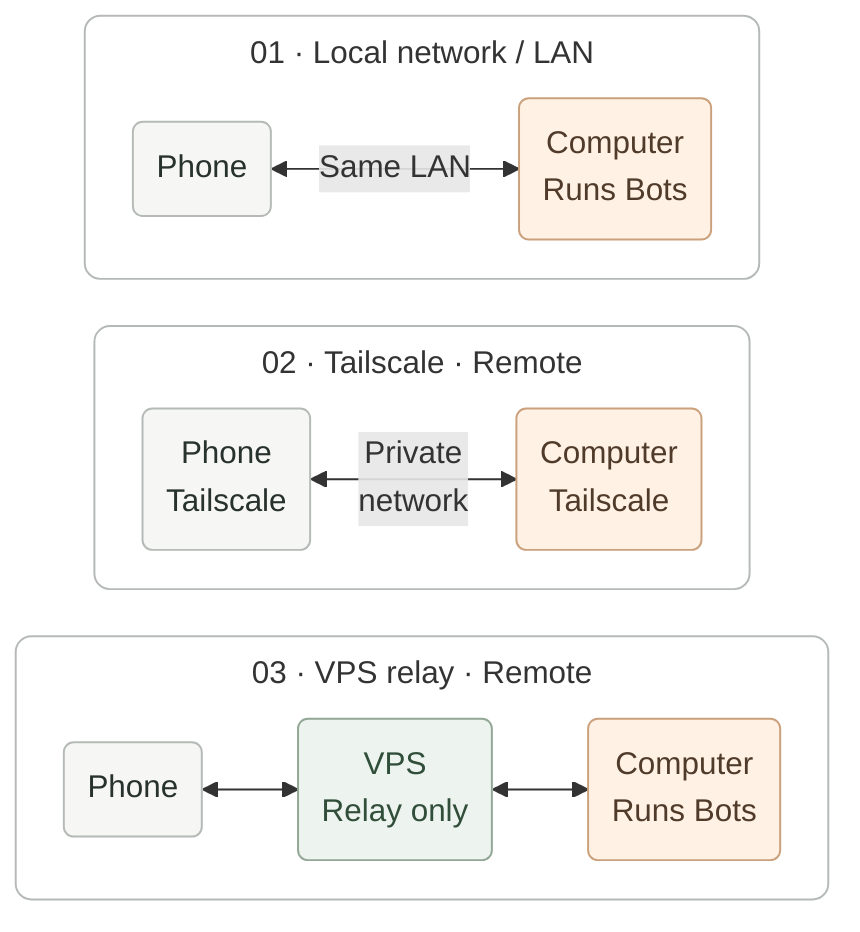

| Option | Best for | What you need |
| :--- | :--- | :--- |
| **Local network (LAN)** | Phone and computer on the same Wi-Fi or reachable local network | No extra network service; devices must be able to reach each other |
| **Remote access with Tailscale** | Away from home, with Tailscale on both devices | Both devices in the same Tailscale network; no VPS of your own required |
| **VPS relay** | Away from home, with no VPN on the phone | A cloud server; we recommend letting an AI deploy it |

> [!TIP]
> **Let your own agent set up the VPS relay.** Give Codex, Claude Code or another agent the [ready-to-use setup instructions](docs/client/remote-access.en.md#ask-an-agent-to-configure-it), and ask it to follow the project documentation to deploy and verify the relay. The agent needs terminal access on your host computer and authorized SSH access to your VPS.

With every option above, Bots run on your computer, and chats, files and sign-ins stay there, so keep the computer on and online. **The VPS relay only forwards connections; it does not run your Bots.** To keep Bots working while the computer is off, see [running a full host on a VPS](docs/client/host-deployment.md).

**Option 1 · Tailscale**

1. Install [Tailscale](https://tailscale.com/download) on the computer and the phone, sign in, and join the same Tailscale network.
2. On the computer, open **Settings → Network & connections → Add device**, choose **Remote access with Tailscale** and click **Generate Tailscale QR code**. TaroBird detects the computer's Tailscale address automatically.
3. Scan and approve as in [Pair your phone](#02--pair-your-phone). A phone that is already paired can open **Me → Connection status & routes** and tap **Scan a code to update connection** to add the Tailscale route without pairing again.

Keep Tailscale connected on both devices, and make sure your Tailscale access rules allow the phone to reach the computer.

**Option 2 · VPS relay (recommended: let an AI deploy it)**

1. On the computer, open an AI agent that can use a terminal and SSH, such as Codex or Claude Code. Give it the complete [setup prompt](docs/client/remote-access.en.md#ask-an-agent-to-configure-it) together with the VPS SSH alias and the **path** to your private key (never the key itself). It deploys the relay, issues certificates with automatic renewal, verifies the connection end to end and returns an HTTPS address. To deploy it yourself, follow the [manual guide](docs/client/vps-relay-manual.md).
2. On the computer, open **Settings → Network & connections → Connection status & routes**. Under **VPS relays for this host**, click **Add VPS relay**, enter the address and click **Verify and save relays**.
3. If an already paired phone does not receive the new route automatically, open **Me → Connection status & routes → Edit routes → Add relay**, enter the same address and tap **Save routes**. A new phone can scan the computer's QR code with **VPS relay** selected.
4. Turn off the phone's Wi-Fi and confirm that it connects over cellular data.

### Add more computers

Install TaroBird on the new computer, choose **Connect to an existing host**, then scan or paste the connection details from **Add device** on a paired device. On any paired phone or computer, open **Devices & network → Enter code to confirm** and enter the 8-digit code shown on the new computer; there is no need to be at the host. If the new computer will run its own Bots, confirm joining the network when prompted. [Private network](docs/client/private-network.md)

For a host without a desktop window, use the [TaroBird CLI](#headless-host-tarobird-cli). On first launch, macOS may ask for keychain access; choose **Always Allow** ([why](docs/client/macos-keychain-prompts.md)).

## Headless host (TaroBird CLI)

Install the TaroBird CLI on a computer or server to run a host without the desktop App; phones still connect, send tasks and receive files. Assistants that can run commands, such as Dot or Grok, can also use the CLI to put TaroBird's Bots to work. [Installation and commands (中文)](docs/host-cli.md) · [Details](docs/details.md#run-a-host-without-a-desktop-window)

## Bot isolation and sharing

One Bot can hold many independent conversations that share its persona, model and workspace. Bots pointed at the same folder read and write the same files, and Bot processes are not operating-system sandboxes. [Details](docs/details.md#bot-isolation-and-sharing)

## More resources

| Resource | Contents |
| :--- | :--- |
| [Details](docs/details.md) | Features, engines and permissions, private network, cross-host tasks, CLI, prompt queue, isolation and sharing, architecture, where data goes, updating, building from source, project status, naming and compatibility |
| [Documentation index](docs/README.en.md) | Every design, setup and verification document |
| [Releases](https://github.com/cloveric/tarobird/releases) | Installers and per-release verification records |

## Acknowledgements

Thank you to the [LINUX DO](https://linux.do/) community for supporting TaroBird.

Workbench builds on [Excalidraw](https://github.com/excalidraw/excalidraw) for whiteboards,
[Vditor](https://github.com/Vanessa219/vditor) for Markdown notes, and
[Jim Liu's baoyu-design](https://github.com/JimLiu/baoyu-design) for the canvas and slide editors and their adapted authoring skills.
Thank you to their authors and contributors. Excalidraw and Vditor use MIT. baoyu-design has [mixed licensing](client/vendor/baoyu-design/NOTICE.md), with the reconstructed editor outside its MIT grant. Original copyright, scope notices and bundled
dependency notices are retained; see [third-party notices](LICENSING.md) and the
[Design integration guide](docs/client/workbench-design.md).

## License

Copyright (c) 2026 Cloveric. TaroBird is licensed under the
[GNU Affero General Public License v3.0 only (AGPL-3.0-only)](LICENSE).
See [license scope and third-party notices](LICENSING.md).
