

  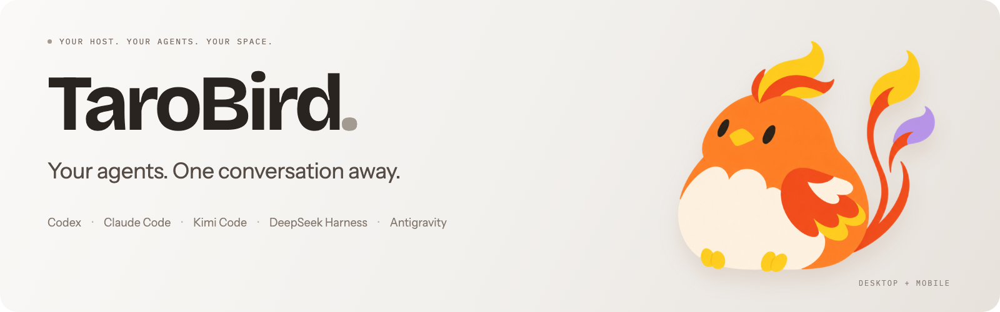

<h3 align="center">Kendi bilgisayarlarınızda çalışan yapay zeka ajanlarınız. Masaüstünde ve telefonda aynı sohbetler.</h3>

  Codex · Claude Code · Kimi Code · DeepSeek Harness · Antigravity · Pi · oh-my-pi (omp)

  <a href="https://github.com/cloveric/tarobird/releases/latest"><b>İndir</b></a> &nbsp;·&nbsp;
  <a href="https://apps.apple.com/app/tarobird/id6828071641"><b>iOS App Store</b></a> &nbsp;·&nbsp;
  <a href="https://testflight.apple.com/join/ByFWEfFW"><b>iOS TestFlight beta</b></a> &nbsp;·&nbsp;
  <a href="docs/client/web-client.md"><b>Web</b></a> &nbsp;·&nbsp;
  <a href="#hızlı-başlangıç"><b>Hızlı başlangıç</b></a> &nbsp;·&nbsp;
  <a href="#connection-options">Bağlantı seçenekleri</a> &nbsp;·&nbsp;
  <a href="docs/details.md">Ayrıntılar</a> &nbsp;·&nbsp;
  <a href="docs/README.en.md">Belgeler</a> &nbsp;·&nbsp;
  <a href="README.md">English</a> &nbsp;·&nbsp;
  <a href="README.zh-CN.md">中文</a>

https://github.com/user-attachments/assets/6cd6e2a9-92c9-47e5-96f1-8b0a02df69a7

57 saniyelik ürün özeti · <a href="https://www.youtube.com/watch?v=R0WvfGiIFiw">YouTube</a> · <a href="assets/product/demo-en.gif">Animasyonlu özet</a>

TaroBird, yapay zeka ajanları için kendi sunucunuzda barındırabileceğiniz bir çalışma alanıdır. Bilgisayarlarınızda veya sunucularınızda çalışan Codex ve Claude Code gibi komut satırı ajanlarını tek bir sohbet arayüzünde bir araya getirir: masaüstünden veya telefondan görev atayın, soruları yanıtlayın, her çalıştırmayı takip edin ve çıktıları teslim alın. Botlar, sohbetler ve dosyalar kendi ana bilgisayarlarınızda kalır.

<table>
  <tr>
    <td width="33%" valign="top"><b>Yerel motorlar</b> Resmi CLI'ları çalıştırır ve her motorun kendi yerel ajan yeteneklerini korur.</td>
    <td width="33%" valign="top"><b>Masaüstü ve telefon</b> macOS, Windows ve mobil aynı Botları ve sohbetleri paylaşır, böylece iş her yerde devam eder.</td>
    <td width="33%" valign="top"><b>Çoklu ana bilgisayar ağı</b> Her bilgisayar kendi Botlarıyla özel ağınıza katılır.</td>
  </tr>
  <tr>
    <td valign="top"><b>Gruplar ve iş birliği</b> Konulu çoklu Bot grupları ve Agent Bus ile görsel iş akışları.</td>
    <td valign="top"><b>Ana bilgisayarlar arası görevler</b> Botlar görevleri, dosyaları ve sonuçları ana bilgisayarlar arasında birbirine aktarır.</td>
    <td valign="top"><b>ADHD modu</b> Her biri bağımsız ilerleyen en fazla 12 masaüstü sohbeti yan yana.</td>
  </tr>
</table>

<h3 align="center">Masaüstü</h3>

macOS · Windows Çalışmaları Bota veya sohbete göre düzenleyin, her çalıştırmayı inceleyin ve yanıtları ve dosyaları gözden geçirin.

  <a href="assets/product/desktop-en.png">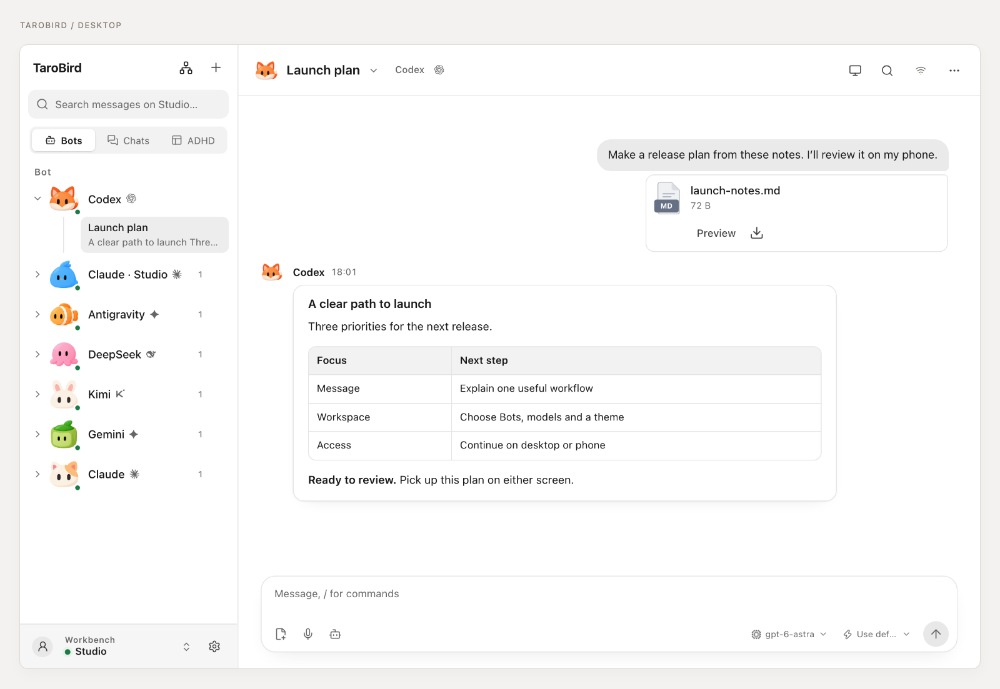</a>

<h3 align="center">Mobil</h3>

Bilgisayarınızda başlayın. Telefonunuzda devam edin. Aynı sohbetlerde yanıtları okuyun, soruları cevaplayın ve dosyaları alın.

  <a href="assets/product/phone-pair-en.png">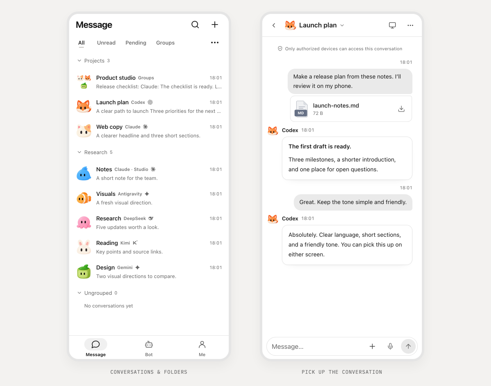</a>

<a href="assets/product/mobile-en.png">Tam boyutlu gelen kutusu</a> · <a href="assets/product/mobile-chat-en.png">Tam boyutlu sohbet</a>

<h3 align="center">ADHD · Paralel sohbet çalışma alanı</h3>

Her biri bağımsız ilerleyen birden fazla Bot sohbetini aynı anda görün. Bots / Chats yanındaki ADHD'ye geçin, ardından panonuz için sohbetleri seçin.

  <a href="assets/product/adhd-en.png">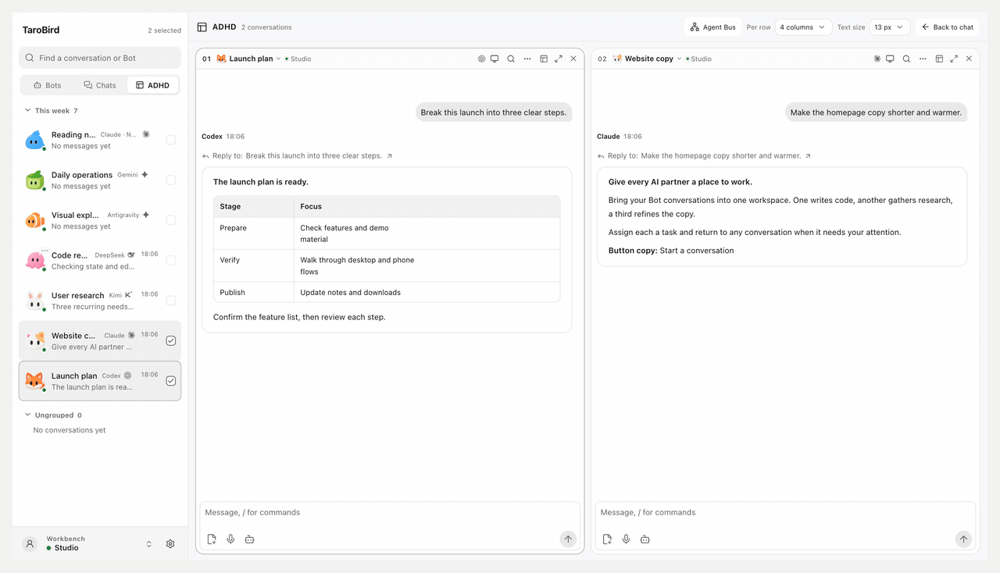</a>

Yalnızca masaüstü · macOS / Windows · Gösterim verileriyle gerçek arayüzden kaydedildi · <a href="assets/product/adhd-en.png">Tam boyutlu görünüm</a>

- **Paralel çalışın.** Ana bilgisayarlar genelinde en fazla 12 sohbet seçin. Her bölme kendi mesajlarını, taslağını ve giriş alanını korur; bir bölmeyi kaldırmak ne sohbeti kapatır ne de çalışan görevi durdurur.
- **Esnek düzen.** Otomatik düzeni veya 2–6 sütunu kullanın, kenar çubuğunu yeniden boyutlandırın, bölmeleri yeniden sıralayın veya odaklanmak için birini genişletin. ADHD metin boyutu 11 ile 16 px arasında ayarlanabilir.
- **Yerinde işlemler.** Sorular, yanıtlar ve dosyalar kendi sohbetlerinde kalır ve pano düzeni bu cihazda kaydedilir.

<h3 align="center">Agent Bus · Görsel çoklu Bot iş birliği</h3>

Her adıma bir görev atayın ve işin Botlar arasında nasıl aktığını görün. İş akışının yanında üye sohbetlerini görüntülemek için kenar çubuğundan kayıtlı bir Bus açın.

  <a href="assets/product/agent-bus-en.png">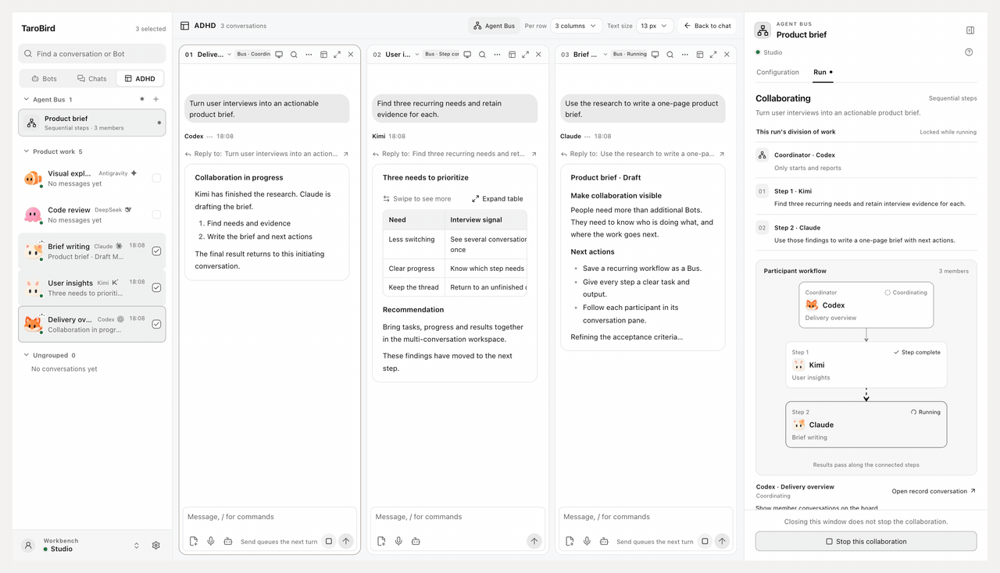</a>

Yalnızca masaüstü · macOS / Windows · Gösterim verileri ve simüle edilmiş çalıştırma durumu ile gerçek arayüz · <a href="assets/product/agent-bus-en.png">Tam boyutlu iş akışı</a> · <a href="assets/product/agent-bus-setup-en.png">Üye yapılandırması</a>

- **İş akışını yönetin.** Yetkilendirme, paralel çalışma, sıralı adımlar, doğrulama veya araştırma ekibi seçin ve her adımı kendi görevine sahip bir Bota ve sonuç sohbetine bağlayın.
- **Bir bakışta ilerleme.** Akış her adımın durumunu gösterirken bölmeler çıktısını gösterir. Kayıtlı Bus'lar yeniden kullanılabilir ve paneli kapatmak çalışan bir iş birliğini durdurmaz.
- **Tek bir ana bilgisayar içinde çalışır.** Üyeler bağımsız oturumlarda çalışır ve sonuçlarını bağlı sohbetlere kaydeder. [Tasarım ve işletim](docs/client/agent-bus-workspace-2026-10-18.md) · [Adım bazlı görevler](docs/client/agent-bus-stage-tasks-2026-10-19.md)

Gösterim verileriyle gerçek arayüz · <a href="assets/product/README.md">Ekran görüntüsü kaynağı</a> · <a href="docs/client/adhd-board-2026-10-17.md">ADHD tasarımı ve doğrulaması</a>

<h3 align="center">Gruplar ve konular · Botlarınızı tek bir sohbette buluşturun</h3>

Aynı soru üzerinde birlikte çalışmak için araştırma, yazma ve inceleme Botlarını bir gruba koyun. Masaüstünden veya telefondan gruba katılın ve her projeyi veya soruyu kendi konusuna ayırın.

  <a href="assets/product/feature-groups-en.png">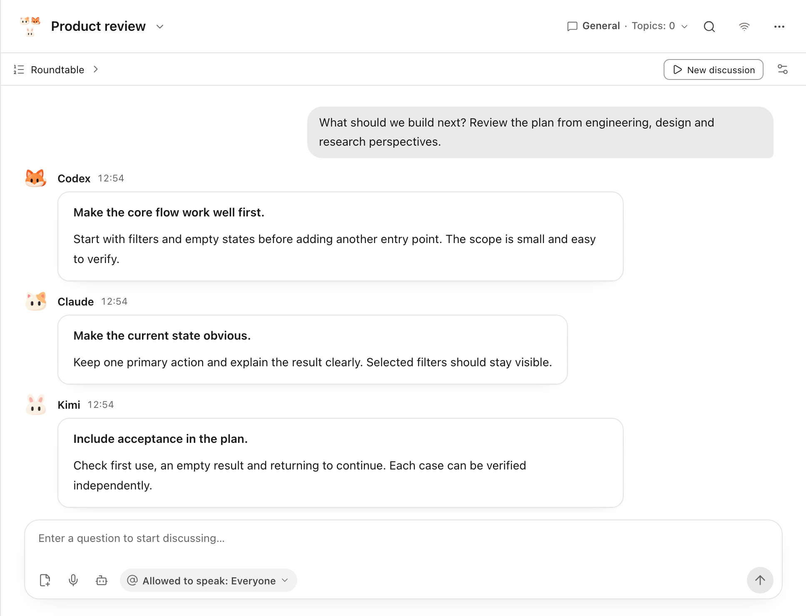</a>

Gösterim verileriyle gerçek arayüz; yanıtlar örnek niteliğindedir, model çalıştırılmamıştır · Grup üyeleri şu anda tek bir ana bilgisayara aittir · <a href="assets/product/feature-group-modes-en.png">Tartışma ayarları</a> · <a href="docs/client/group-discussion-2026-10-20.md">Grup rehberi</a>

- **Kimin yanıt vereceğini seçin.** Normal grup sohbetinde yanıtlamasını istediğiniz Botları seçin veya @ ile etiketleyin. Herkesin bağımsız olarak yanıtlaması için paralel yanıtlara geçin.
- **Konuları ayrı tutun.** Farklı projeler veya sorular için grup içinde konular oluşturun. Konular aynı grup üyelerini kullanır ve kendi sohbet geçmişlerini korur.
- **Bir tartışma modu seçin.** Grup sohbeti, paralel yanıtlar, yuvarlak masa veya bağımsız inceleme kullanın. Otomatik tartışmalar konuşma sırasını ve tur sınırlarını destekler; tartışmayı duraklatma, devam ettirme veya sonlandırma kontrolleri sunar.

<h3 align="center">Bağlı Botlar · Bilgisayarlarınız genelinde tek ekip</h3>

Bir Bota hedef verin. Diğer bilgisayarlardaki yetkili Botların kendi paylarına düşeni yapmasına izin verin. Görevler, dosyalar ve sonuçlar Botlar arasında dolaşır; her makine kendi işini çalıştırır.

  <a href="assets/product/bot-team-en.png">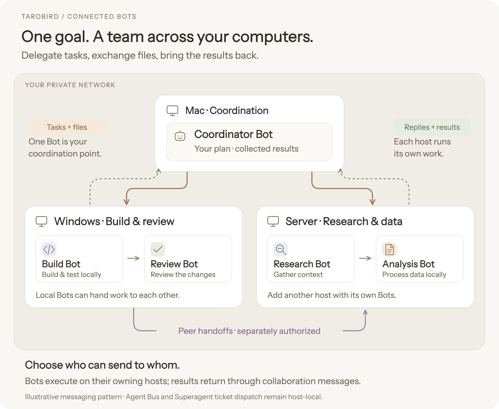</a>

Örnek mesajlaşma deseni, canlı çalıştırma değildir · Her görev yönü izin gerektirir

> “Windows Botundan bu değişikliği derleyip test etmesini, sunucu Botundan da verileri analiz etmesini iste. Raporlarını ve dosyalarını buraya geri getir.”

- **Bir Bot birden fazla makineyi koordine edebilir.** Tek bir görevde, Bota hangi parçaların hangi ana bilgisayarlara gönderileceğini söyleyin. İletişim noktanız olarak görev yapar, yanıtları toplar ve sonuçları birleştirir. Alıcı her Bot kendi ana bilgisayarında kendi motoru ve izinleriyle çalışır.
- **Eşler birbirine yardımcı olabilir.** Bir inceleme Botu araştırma Botundan bağlam isteyebilir ya da bir kodlama Botu değişikliği test Botuna devredebilir. Aynı mesaj akışı hem tek ana bilgisayar içinde hem de ana bilgisayarlar arasında çalışır; merkezi bir Bot isteğe bağlıdır.
- **Başka bir bilgisayarın Botlarını ekibe dahil edin.** Katılan bilgisayarı mevcut bir ana bilgisayara bağlayın, ardından **Settings → Network & connections → My network** altından katılımı onaylayın. Yetkili masaüstü ve telefon istemcileri Botlarına erişebilir. Aktarım için ana bilgisayarların çevrimiçi ve karşılıklı olarak erişilebilir olması gerekir.
- **İşi izlenebilir tutun.** Özel iş birliği sohbetleri görevleri ve yanıtları saklar; alıcı kaynak ana bilgisayarı ve Botu görür. Devrettiğiniz dosyalar alıcı ana bilgisayara kopyalanır; bir ağa katılmak çalışma alanlarını birleştirmez veya her Bota erişim vermez.

**Kimin iletişim kurabileceğini seçin.** Aynı ana bilgisayar erişimini **Settings → Bot message permissions** üzerinden yönetin. 1.2.0 sürümünden itibaren, alıcı ana bilgisayarın sahibi **Cross-host** sekmesini kullanarak kaynak ana bilgisayar/Bot ve alıcı Bot seçebilir, ardından yöne göre izin verebilir veya izni iptal edebilir. Ağa katılmak mesajlara izin vermez. Orijinal göreve verilen yanıtlar için ters yönde izin gerekmez.

  <a href="assets/product/bot-permissions-en.png">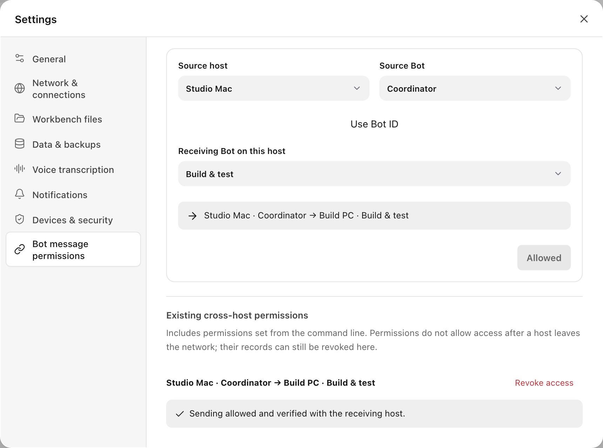</a>

1.2.0 uygulama izin arayüzü · Tek kullanımlık ana bilgisayarlar ve kurgusal verilerle gerçek ayarlar ve imzalı yetkilendirme; model çalıştırılmadı · <a href="docs/details.md#bot-to-bot-tasks-across-hosts">CLI yetkilendirmesi</a> üzerinden de kullanılabilir

Bu yapı, koordine edici bir Bot veya iş birliği yapan eşler ağı için bir temeldir. Otomatik ana bilgisayar seçimi, ana bilgisayarlar arası zamanlama ve paylaşılan bilet takibi gelecek olasılıklardır; bugün yerleşik özellikler değildir. **Agent Bus, gruplar ve Superagent bilet dağıtımı şu anda tek bir ana bilgisayar içinde kalır**; ana bilgisayarlar arası çalışma doğrudan Bot mesajlarını kullanır.

[İzinler ve kurtarma](docs/client/cross-host-message-permissions.md) · [Ağ kurulumu](docs/details.md#private-network) · [Komutlar ve teslimat garantileri](docs/details.md#bot-to-bot-tasks-across-hosts)

<h3 align="center">Tartışın, görselleştirin ve inceleyin</h3>

Grup tartışmaları, etkileşimli yanıtlar, değişiklik incelemesi ve sesli transkripsiyon.

  <a href="assets/product/features-en.png">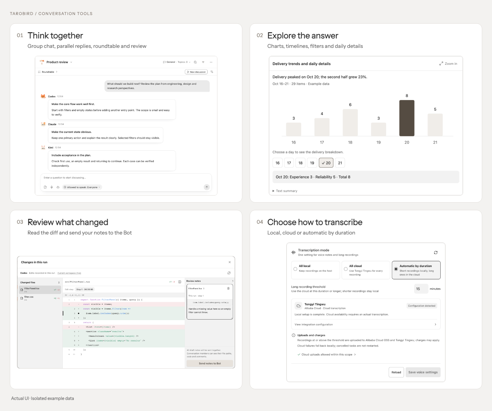</a>

Tam boyutlu görünümler: <a href="assets/product/feature-groups-en.png">Grup sohbeti</a> · <a href="assets/product/feature-group-modes-en.png">Tartışma modları</a> · <a href="assets/product/feature-visual-en.png">Etkileşimli rapor</a> · <a href="assets/product/feature-changes-en.png">Çalıştırma değişiklikleri</a> · <a href="assets/product/feature-voice-en.png">Ses ayarları</a>

- **Etkileşimli yanıtlar.** Botlar genişletilmiş görünüm ve geçmiş ile doğrudan bir yanıt içinde grafikler, zaman çizelgeleri ve filtreler sunabilir. [Etkileşimli yanıtlar](docs/client/inline-widgets-2026-10-22.md)
- **Değişiklik incelemesi.** Her yanıtın düzenlediği dosyalar arasında gezinin; masaüstünde satırlara yorum yapın ve bunları Bota geri gönderin. [Kayıtlı değişiklikler](docs/client/run-diff-2026-10-20.md)
- **Sesli transkripsiyon.** Her ana bilgisayar için tamamen yerel, tamamen bulut veya süreye göre otomatik yönlendirme seçin. [Ses ayarları](docs/client/voice-transcription-settings-2026-10-21.md)

<h3 align="center">Workbench · Referansları ve yaratıcı çalışmaları sohbetin yanında tutun</h3>

Web taraması, beyaz tahta, Markdown notları ve sunumlar tek bir çalışma alanında. Her sohbet kendi Workbench'ini yan panelde veya ana alana genişletilmiş olarak saklar.

<h3 align="center">Tarayıcı · Uygulama içinde web sayfaları</h3>

Sohbetin Workbench'inde bir web sayfası açın; o sohbetteki Bot sınırları dahilinde sayfayı gözlemleyebilir ve çalıştırabilir. Sayfa araçları bulma, yakınlaştırma, boyut önizleme, PDF'ye yazdırma, ekran görüntüsü ve indirmeleri içerir.

  <a href="assets/product/workbench-browser-en.png">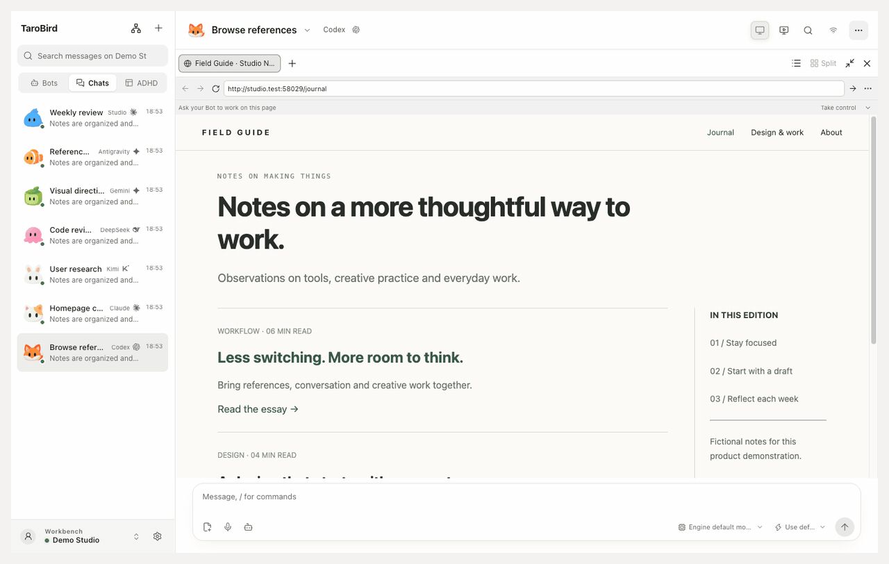</a>

Yalnızca masaüstü uygulaması · Gösterim verileriyle gerçek arayüz · <a href="docs/client/browser-page-tools-2026-10-31.md">Sayfa araçları</a>

<h3 align="center">Beyaz tahta ve notlar · Fikirleri çizin, kararları saklayın</h3>

Beyaz tahta üzerinde şekiller, metinler, bağlayıcılar ve görseller çizin; önizleme ve otomatik kaydetme ile Markdown notları yazın. Sizin ve Botun düzenlemeleri aynı sürümleri ve geri alma geçmişini paylaşır.

  <a href="assets/product/workbench-whiteboard-en.png">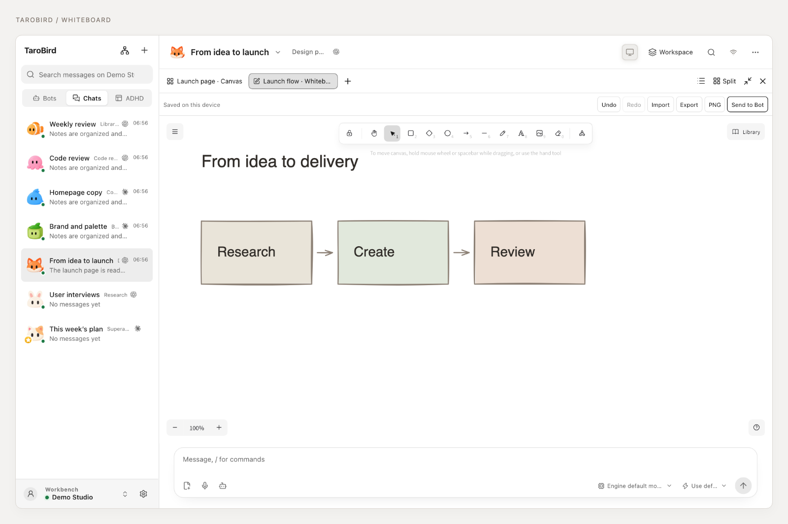</a>

  <a href="assets/product/workbench-notes-en.png">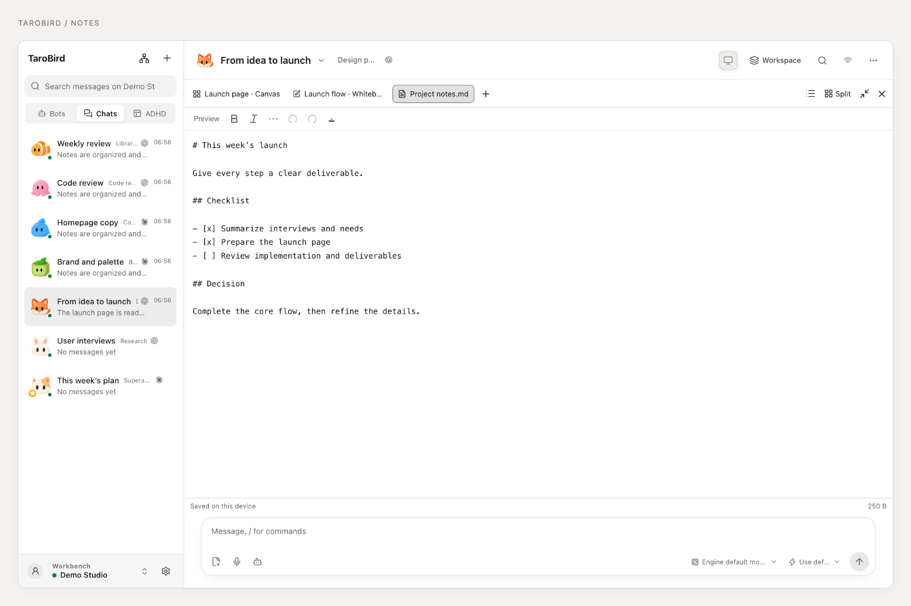</a>

Gösterim verileriyle gerçek arayüz · Beyaz tahta Excalidraw ile · Notlar Vditor ile · <a href="docs/client/conversation-workbench-2026-10-30.md">Workbench rehberi</a>

<h3 align="center">Yan panel · Sohbet ve Workbench yan yana</h3>

Workbench sohbetin sağında açılır, böylece çalışırken sohbet etmeye devam edebilirsiniz. Paneli yeniden boyutlandırın, Split ile iki ila dört sekmeyi birlikte gösterin veya odaklanmak için bir sekmeyi genişletin.

  <a href="assets/product/workbench-side-en.png">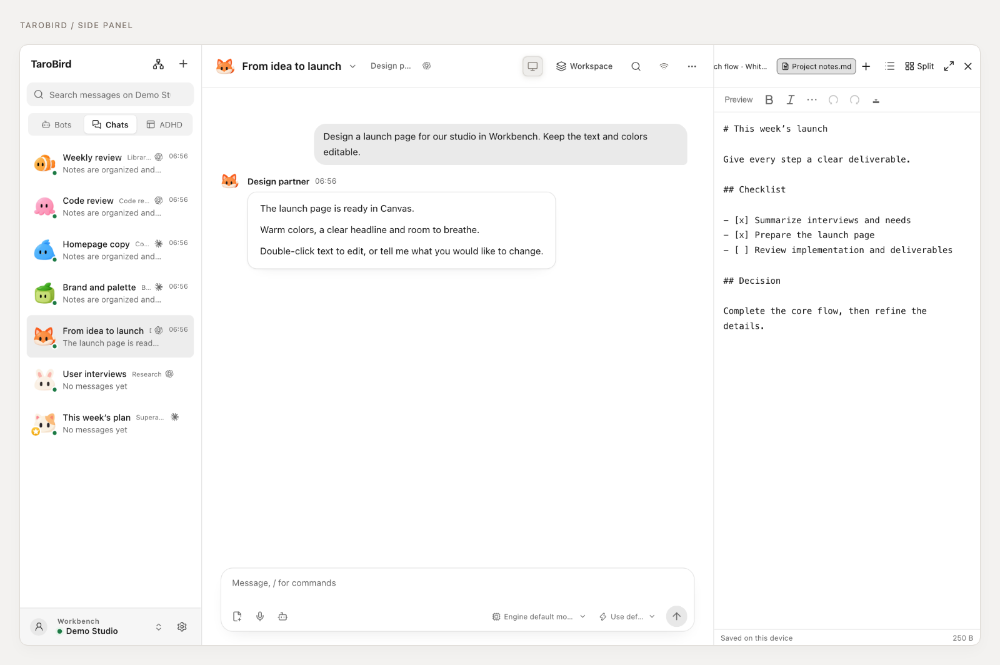</a>

Gösterim verileriyle gerçek arayüz · Her sohbet kendi Workbench'ini saklar · İçerik bu cihazda kalır; taşımak veya yedeklemek için bir projeyi dışa aktarın

<h3 align="center">Ekran kontrolü · Başka bir Mac'i görüntüleyin ve yönetin</h3>

Masaüstü uygulamasından yetkili bir Mac'in ekranını açın. Görüntüleme modunda başlar; yönetmek için Start control'ü seçin, ardından serbest bırakmak için Stop control'ü seçin veya yerel sohbetinize dönün.

  <a href="assets/product/remote-screen-en.png">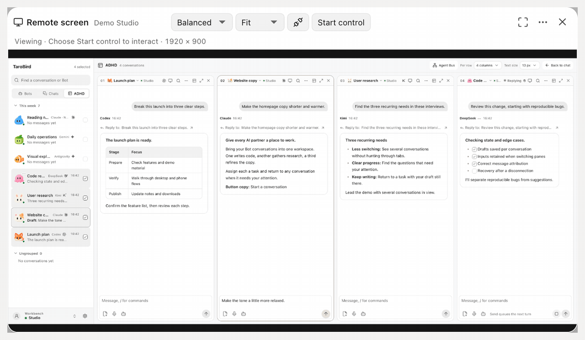</a>

Masaüstü uygulaması · hedef Mac'te erişim ve macOS izinleri gerektirir · bu kayıtta simüle edilmiş kare ve bağlantı ile gerçek görüntüleyici · <a href="docs/client/remote-screen-2026-10-31.md">Kontroller ve izinler</a>

<h3 align="center">Superagent · Tek hedef, biletler halinde takip</h3>

Bot oluştururken Make it a Superagent seçeneğini seçin, ardından sohbetinde hedefi açıklayın. İşi biletlere böler, her birini bu ana bilgisayardaki bir motor CLI ile çalıştırır ve rapor verir.

  <a href="assets/product/chancellor-en.png">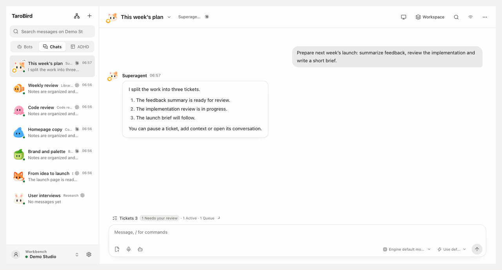</a>

Gösterim verileriyle gerçek arayüz; bilet durumları örnek niteliğindedir ve model çalıştırılmamıştır · <a href="docs/client/dispatcher-bot-2026-11-01.md">Superagent rehberi</a>

- **Görünür biletler.** Sıradaki, etkin, bekleyen ve incelemeye hazır biletleri görün ve herhangi bir biletin çalışan sohbetini açın.
- **Hızı siz belirlersiniz.** Her planı onaylayın veya kendi başına dağıtmasına izin verin; izin verilen motorları ve aynı anda kaç biletin çalışacağını seçin. İstediğiniz zaman duraklatın, iptal edin veya bağlam ekleyin.
- **Doğru aracı seçin.** Superagent planlar ve devreder; Agent Bus sizin tanımladığınız bir iş akışını çalıştırır; ADHD birden fazla sohbeti görüş alanında tutar.

Tam [özellik listesine](docs/details.md#features) bakın.

<b>Daha fazla görünüm: temalar, klasörler ve liste seçenekleri</b>

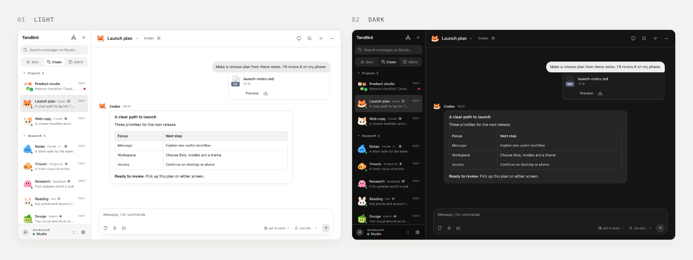
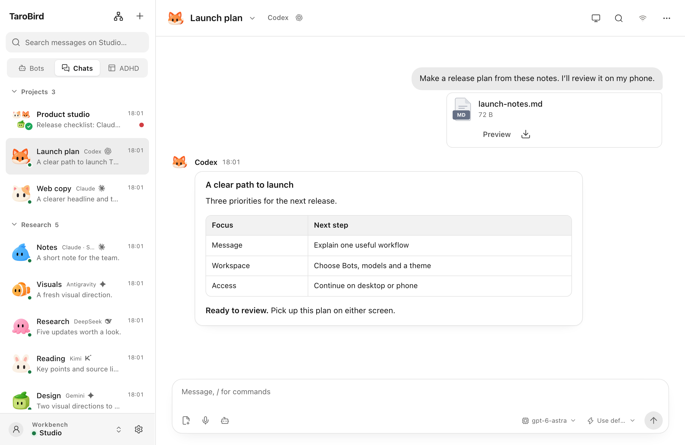

Ana bilgisayara göre gruplamak, bağlantısı kesilmiş Botları göstermek veya klasörleri yönetmek için masaüstü listesinin boş bir alanına veya bir klasör adına sağ tıklayın.

<a href="assets/product/list-options-en.png">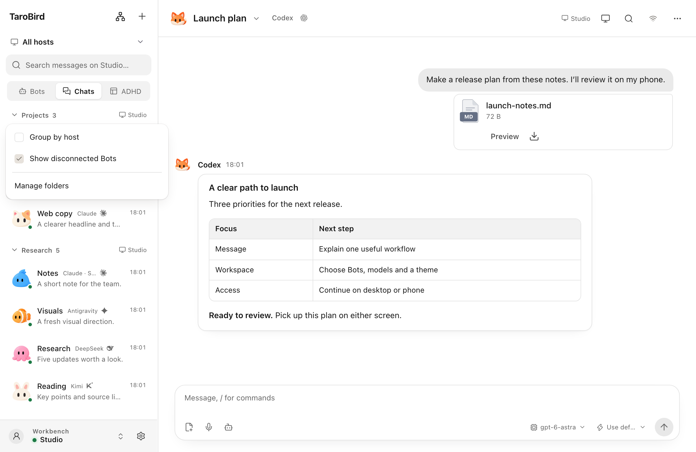</a>

## Desteklenen motorlar

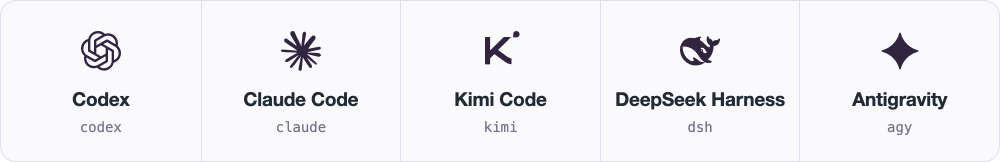

**Resmi yerel CLI'lar üzerine kurulu.** TaroBird ajanları yeniden yazmaz. Codex, Claude Code, Kimi Code, DeepSeek Harness, Antigravity ve Pi'nin resmi komut satırı araçlarını çalıştırır. Bir harness, modelin etrafındaki yürütme sistemidir — ajan döngüsü, araç kullanımı, bağlam ve oturum yönetimi — ve bir sağlayıcının kendi modeli için geliştirip ayarladığı harness, modelden en iyi sonucu alır. TaroBird bunun üzerine masaüstü ve telefon erişimi, çoklu Bot iş birliği ve birleşik bir çalışma alanı ekler.

**CLI'lar geliştikçe iyileşir.** Bir ana bilgisayarın CLI'ı güncellendiğinde, yürütme, bağlam işleme ve güvenilirlikteki kazanımları doğrudan TaroBird'ün Botlarına aktarılır. Kullanılabilir yetenekler kurulu CLI'a, hesaba ve bağdaştırıcıya bağlıdır ve yeni arayüzler ek TaroBird uyarlaması gerektirebilir. [Motor yetenekleri](docs/client/capability-map.md)

Başlamak için Botlarınızı çalıştıran bilgisayarda herhangi bir motoru kurun ve oturum açın; TaroBird yapay zeka motorları, model hesapları veya krediler içermez. Bağdaştırıcı farklılıkları için [motor karşılaştırmasına](docs/details.md#engine-comparison) bakın.

**Pi, 1.6.0'dan itibaren:** [Pi yerel entegrasyonu](docs/client/pi-engine.md) sıradan Botlar için sağlayıcıya duyarlı model seçimi ve yerel sohbet kontrolleri ekler. Pi, Superagent dağıtımından hariç tutulur.

**oh-my-pi (`omp`):** [oh-my-pi yerel entegrasyonu](docs/client/omp-engine.md), özel v2 RPC protokolü (istem başına `prompt_result` + `session_settled`, `steer` / `follow_up` / `aside` kuyrukları ve yerel alt ajan görev takibi) aracılığıyla Pi'nin yanında ayrı bir motor olarak doğrudan `omp --mode rpc-ui` ile bağlanır.

> [!IMPORTANT]
> Çoğu motor varsayılan olarak tam erişimle başlar. Bunu Botun **Permissions & approvals** bölümünden ayarlayın. Modeller, çaba ve izin ayrıntıları için [Motorlar ve izinler](docs/details.md#engines-and-permissions) belgesine bakın.

## Hızlı başlangıç

<table>
  <tr>
    <td width="33%" valign="top"><b>01 · Ana bilgisayarı kurun</b> TaroBird'ü bilgisayarınıza kurun, ana bilgisayar yapın ve bir Bot oluşturun.</td>
    <td width="33%" valign="top"><b>02 · Telefonunuzu eşleştirin</b> Telefonunuzda QR kodu tarayın, ardından 8 haneli kodu onaylayın.</td>
    <td width="33%" valign="top"><b>03 · Her yerden bağlanın</b> Botlarınıza Tailscale veya bir VPS rölesi üzerinden ulaşın.</td>
  </tr>
</table>

### 01 · Ana bilgisayarı kurun

1. Masaüstü uygulamasını kurun. macOS'ta **TaroBird.app** uygulamasını Applications klasörüne sürükleyin; uygulama Apple tarafından onaylıdır (notarized). Windows'ta yükleyiciyi çalıştırın. Yükleyici henüz kod imzalı değildir, bu nedenle SmartScreen görünürse **Ek bilgi → Yine de çalıştır**'ı seçin. Mevcut Mac kullanıcıları mevcut kurulum konumlarını korumak için **Settings → General → App updates** yolunu kullanmalıdır; TaroBot.app ve TaroBird.app'i aynı anda tutmayın. Manuel yükseltme için [yeniden adlandırma geçişini](docs/client/artifact-branding-2026-11-05.md#upgrading-an-existing-mac) izleyin.
2. İlk başlatmada **Use this computer as a host** seçeneğini seçin ve bilgisayarı adlandırın.
3. Bu bilgisayarda kurulu bir motorla bir Bot oluşturun.

### 02 · Telefonunuzu eşleştirin

1. Telefonunuza TaroBird'ü kurun. **iOS:** Kararlı uygulamayı [App Store](https://apps.apple.com/app/tarobird/id6828071641) üzerinden indirin veya Apple'ın TestFlight uygulamasını yükleyip [herkese açık betaya katılın](https://testflight.apple.com/join/ByFWEfFW). App Store kullanılabilirliği ülkeye veya bölgeye göre değişir; TaroBird şu anda Çin anakarasında listelenmemektedir. **Android:** [Releases](https://github.com/cloveric/tarobird/releases/latest) sayfasındaki APK'yı kullanın.
2. Bilgisayarda **Settings → Network & connections → Add device** yolunu açın, bir [bağlantı seçeneği](#connection-options) seçin ve QR kodu oluşturun. Ana bilgisayar ilk seferde kısa süreliğine yeniden başlatılır, bu yüzden önce mevcut görevlerin bitmesini bekleyin.
3. Telefonda TaroBird'ü açın ve **Scan connection QR code**'a dokunun veya **Import a QR image** ya da **Paste connection details**'i kullanın.
4. Telefon 5 dakika geçerli olan **8 haneli bir eşleştirme kodu** gösterir. Kodu bilgisayara girin ve **Approve pairing**'e tıklayın; telefon ardından sohbetlerinizi otomatik olarak açar.

### 03 · Her yerden bağlanın

**Bağlantı seçenekleri**

Her satır, **Botlarınızı çalıştıran aynı bilgisayara** giden farklı bir yoldur.

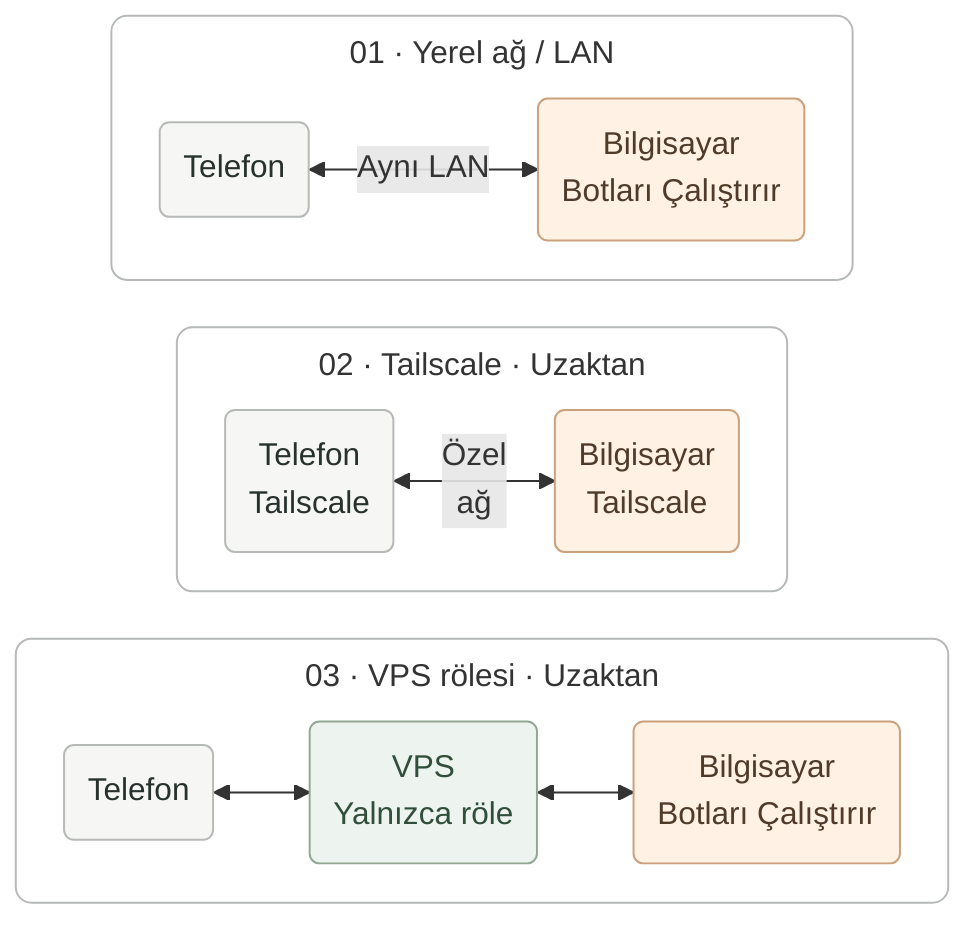

| Seçenek | En uygun olduğu durum | Gerekenler |
| :--- | :--- | :--- |
| **Yerel ağ (LAN)** | Telefon ve bilgisayar aynı Wi-Fi veya erişilebilir yerel ağdayken | Ek ağ servisi gerekmez; cihazların birbirine erişebilmesi gerekir |
| **Tailscale ile uzaktan erişim** | Ev dışındayken, her iki cihazda da Tailscale varken | Her iki cihaz da aynı Tailscale ağında; kendi VPS'iniz gerekmez |
| **VPS rölesi** | Ev dışındayken, telefonda VPN olmadığında | Bir bulut sunucusu (birkaç bilgisayar birini paylaşabilir); bir yapay zekanın kurmasını öneririz |

> [!TIP]
> **VPS rölesini kendi ajanınızın kurmasına izin verin.** Codex, Claude Code veya başka bir ajana [kullanıma hazır kurulum talimatlarını](docs/client/remote-access.en.md#ask-an-agent-to-configure-it) verin ve röleyi dağıtıp doğrulamak için proje belgelerini izlemesini isteyin. Ajanın ana bilgisayarınızda terminal erişimine ve VPS'inize yetkili SSH erişimine ihtiyacı vardır.

Yukarıdaki her seçenekte Botlar bilgisayarınızda çalışır ve sohbetler, dosyalar ve oturumlar orada kalır; bu nedenle bilgisayarı açık ve çevrimiçi tutun. **VPS rölesi yalnızca bağlantıları iletir; Botlarınızı çalıştırmaz.** Bilgisayar kapalıyken Botların çalışmaya devam etmesi için [bir VPS üzerinde tam ana bilgisayar çalıştırma](docs/client/host-deployment.md) belgesine bakın.

**Seçenek 1 · Tailscale**

1. Bilgisayara ve telefona [Tailscale](https://tailscale.com/download) kurun, oturum açın ve aynı Tailscale ağına katılın.
2. Bilgisayarda **Settings → Network & connections → Add device** yolunu açın, **Remote access with Tailscale**'i seçin ve **Generate Tailscale QR code**'a tıklayın. TaroBird bilgisayarın Tailscale adresini otomatik olarak algılar.
3. [Telefonunuzu eşleştirin](#02--telefonunuzu-eşleştirin) bölümündeki gibi tarayın ve onaylayın. Zaten eşleştirilmiş bir telefon **Me → Connection status & routes** bölümünü açıp **Scan a code to update connection**'a dokunarak yeniden eşleştirmeden Tailscale rotasını ekleyebilir.

Her iki cihazda da Tailscale'i bağlı tutun ve Tailscale erişim kurallarınızın telefonun bilgisayara ulaşmasına izin verdiğinden emin olun.

**Seçenek 2 · VPS rölesi (önerilen: bir yapay zekanın kurmasına izin verin)**

1. Bilgisayarda Codex veya Claude Code gibi terminal ve SSH kullanabilen bir yapay zeka ajanı açın. VPS SSH takma adı ve özel anahtarınızın **yolu** (asla anahtarın kendisi değil) ile birlikte eksiksiz [kurulum istemini](docs/client/remote-access.en.md#ask-an-agent-to-configure-it) verin. Röleyi dağıtır, otomatik yenilemeli sertifikalar düzenler, bağlantıyı uçtan uca doğrular ve bir HTTPS adresi döndürür. Kendiniz dağıtmak için [manuel rehberi](docs/client/vps-relay-manual.md) izleyin.
2. Bilgisayarda **Settings → Network & connections → Connection status & routes** yolunu açın. **VPS relays for this host** altında **Add VPS relay**'e tıklayın, adresi girin ve **Verify and save relays**'e tıklayın.
3. Zaten eşleştirilmiş bir telefon yeni rotayı otomatik olarak almazsa **Me → Connection status & routes → Edit routes → Add VPS relay address** yolunu açın, aynı adresi girin ve **Save routes**'a dokunun. Yeni bir telefon **VPS relay** seçiliyken bilgisayarın QR kodunu tarayabilir.
4. Telefonun Wi-Fi bağlantısını kapatın ve hücresel veri üzerinden bağlandığını doğrulayın.

**Tek bir VPS üzerinde birden fazla bilgisayar:** Tüm bilgisayarlar tek bir röle sürecini ve tek bir tünel portunu paylaşır ve her bilgisayar telefonları için yalnızca bir ek port alır. Bir sonraki bilgisayarı kurarken ajana VPS'in zaten bir röle çalıştırdığını söyleyin ve yeni bilgisayarı eklemesini isteyin; mevcut bilgisayarlar adreslerini ve yapılandırmalarını korur. [Adımlar](docs/client/vps-relay-manual.md#8-add-another-computer-to-an-existing-relay)

### Daha fazla bilgisayar ekleyin

Yeni bilgisayara TaroBird'ü kurun, **Connect to an existing host**'u seçin, ardından eşleştirilmiş bir cihazdaki **Add device** bölümünden bağlantı ayrıntılarını tarayın veya yapıştırın. Eşleştirilmiş herhangi bir telefonda veya bilgisayarda **Devices & network → Enter code to confirm** yolunu açın ve yeni bilgisayarda gösterilen 8 haneli kodu girin; ana bilgisayarın başında olmanız gerekmez. Yeni bilgisayar kendi Botlarını çalıştıracaksa, istendiğinde ağa katılmayı onaylayın. [Özel ağ](docs/client/private-network.md)

Masaüstü penceresi olmayan bir ana bilgisayar için [TaroBird CLI](#başsız-ana-bilgisayar-tarobird-cli) kullanın. İlk başlatmada macOS anahtar zinciri erişimi isteyebilir; **Always Allow**'u seçin ([neden](docs/client/macos-keychain-prompts.md)).

## Başsız ana bilgisayar (TaroBird CLI)

Masaüstü uygulaması olmadan bir ana bilgisayar çalıştırmak için bir bilgisayara veya sunucuya TaroBird CLI'ı kurun; telefonlar yine bağlanır, görev gönderir ve dosya alır. Dot veya Grok gibi komut çalıştırabilen asistanlar da TaroBird'ün Botlarını çalıştırmak için CLI'ı kullanabilir. [Kurulum ve komutlar (中文)](docs/host-cli.md) · [Ayrıntılar](docs/details.md#run-a-host-without-a-desktop-window)

## Bot yalıtımı ve paylaşımı

Bir Bot, personasını, modelini ve çalışma alanını paylaşan birçok bağımsız sohbet tutabilir. Aynı klasöre yönlendirilen Botlar aynı dosyaları okur ve yazar; Bot süreçleri işletim sistemi korumalı alanları (sandbox) değildir. [Ayrıntılar](docs/details.md#bot-isolation-and-sharing)

## Daha fazla kaynak

| Kaynak | İçerik |
| :--- | :--- |
| [Ayrıntılar](docs/details.md) | Özellikler, motorlar ve izinler, özel ağ, ana bilgisayarlar arası görevler, CLI, istem kuyruğu, yalıtım ve paylaşım, mimari, verilerin nereye gittiği, güncelleme, kaynaktan derleme, proje durumu, adlandırma ve uyumluluk |
| [Belgeler dizini](docs/README.en.md) | Her tasarım, kurulum ve doğrulama belgesi |
| [Sürümler](https://github.com/cloveric/tarobird/releases/latest) | Yükleyiciler ve sürüm notları |

## Teşekkürler

TaroBird'ü desteklediği için [LINUX DO](https://linux.do/) topluluğuna teşekkür ederiz.

Workbench; beyaz tahtalar için [Excalidraw](https://github.com/excalidraw/excalidraw),
Markdown notları için [Vditor](https://github.com/Vanessa219/vditor) ve
Workbench sunumları için [Open Artifact](https://github.com/JimLiu/open-artifact) (`@open-artifact/slides-editor`, Apache-2.0) üzerine kuruludur.
Yazarlarına ve katkıda bulunanlarına teşekkür ederiz. Excalidraw ve Vditor MIT; Open Artifact ise Apache-2.0 kullanır (LICENSE ve NOTICE `client/vendor/workbench-slides/` içinde korunmuştur). Orijinal telif hakkı, kapsam bildirimleri ve paketlenmiş bağımlılık bildirimleri korunmuştur; bkz. [üçüncü taraf bildirimleri](LICENSING.md) ve [Tasarım entegrasyon rehberi](docs/client/workbench-design.md).

## Lisans

Copyright (c) 2026 Cloveric. TaroBird,
[GNU Affero General Public License v3.0 only (AGPL-3.0-only)](LICENSE) altında lisanslanmıştır.
Bkz. [lisans kapsamı ve üçüncü taraf bildirimleri](LICENSING.md).
