

  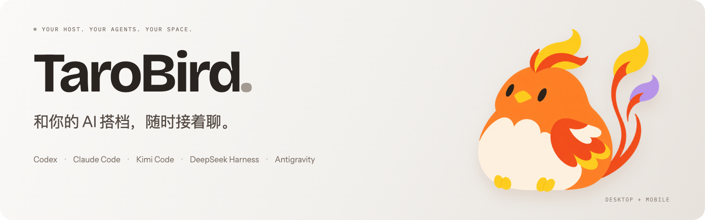

<h3 align="center">你的 AI 智能体，运行在你自己的电脑上。 桌面与手机，延续同一段对话。</h3>

  Codex · Claude Code · Kimi Code · DeepSeek Harness · Antigravity

  <a href="https://github.com/cloveric/tarobird/releases"><b>下载</b></a> &nbsp;·&nbsp;
  <a href="https://testflight.apple.com/join/ByFWEfFW"><b>iOS TestFlight 公测</b></a> &nbsp;·&nbsp;
  <a href="#快速开始"><b>快速开始</b></a> &nbsp;·&nbsp;
  <a href="#联机方式">联机方式</a> &nbsp;·&nbsp;
  <a href="docs/details.zh-CN.md">详细说明</a> &nbsp;·&nbsp;
  <a href="docs/README.md">文档</a> &nbsp;·&nbsp;
  <a href="README.md">English</a>

https://github.com/user-attachments/assets/6cd6e2a9-92c9-47e5-96f1-8b0a02df69a7

57 秒产品演示 · <a href="https://www.youtube.com/watch?v=R0WvfGiIFiw">YouTube</a> · <a href="assets/product/demo-zh.gif">原版动图</a>

TaroBird 是一款自托管的 AI 智能体工作空间。它把电脑或服务器上的 Codex、Claude Code 等命令行智能体，接入一个统一的对话界面：在桌面或手机上下达任务、回答提问、跟进执行过程、接收交付文件。Bot、对话与文件始终保存在你自己的主机上。

<table>
  <tr>
    <td width="33%" valign="top"><b>原生引擎</b> 直接运行官方 CLI，沿用各引擎原生的智能体能力。</td>
    <td width="33%" valign="top"><b>桌面与手机</b> macOS、Windows 与手机共享同一批 Bot 和对话，随时接续处理。</td>
    <td width="33%" valign="top"><b>多主机网络</b> 每台电脑携带自己的 Bot 加入私有网络，统一调度。</td>
  </tr>
  <tr>
    <td valign="top"><b>群组与多 Bot 协作</b> 多 Bot 同群、按话题讨论，也可用 Agent Bus 编排协作流程。</td>
    <td valign="top"><b>跨主机派发任务</b> Bot 之间可跨主机传递任务、文件与结果。</td>
    <td valign="top"><b>ADHD 模式</b> 桌面端最多 12 个对话同屏并行，各自独立推进。</td>
  </tr>
</table>

<h3 align="center">桌面端</h3>

macOS · Windows 按 Bot 或按对话整理工作，展开执行过程、查看回复与文件。

  <a href="assets/product/desktop-zh.png">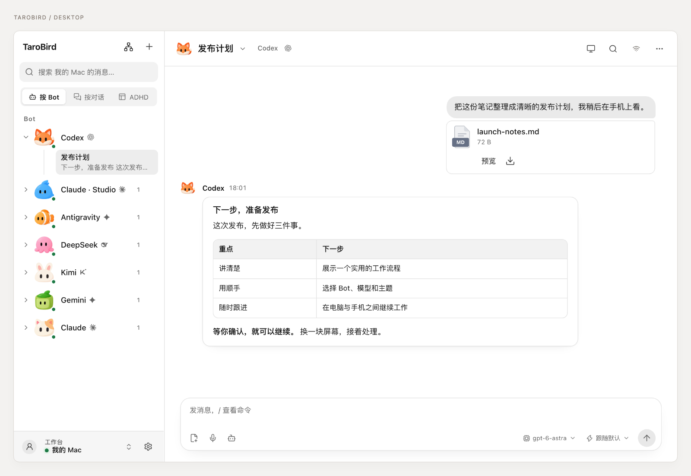</a>

<h3 align="center">手机端</h3>

在电脑上开始，在手机上继续。 随时查看回复、回答提问、接收文件，延续同一段对话。

  <a href="assets/product/phone-pair-zh.png">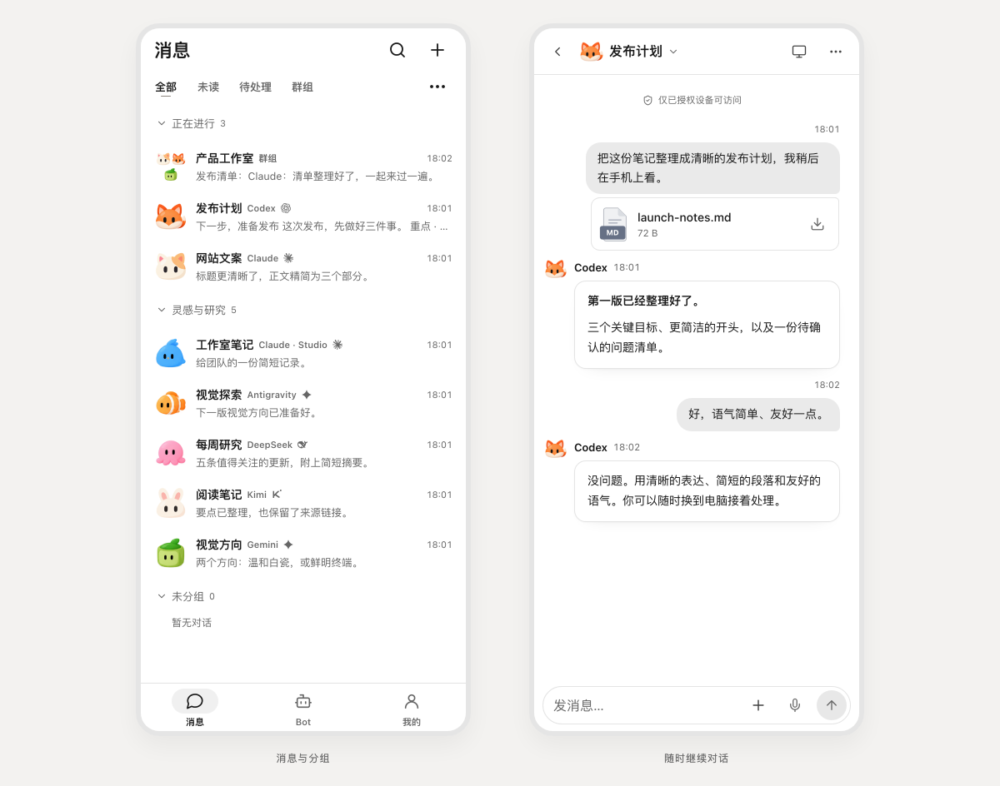</a>

<a href="assets/product/mobile-zh.png">消息列表原图</a> · <a href="assets/product/mobile-chat-zh.png">聊天界面原图</a>

<h3 align="center">ADHD · 多对话并行面板</h3>

多条 Bot 对话同屏展开，各自独立推进。 在「按 Bot / 按对话」旁切换到 ADHD，勾选对话即可加入面板。

  <a href="assets/product/adhd-zh.png">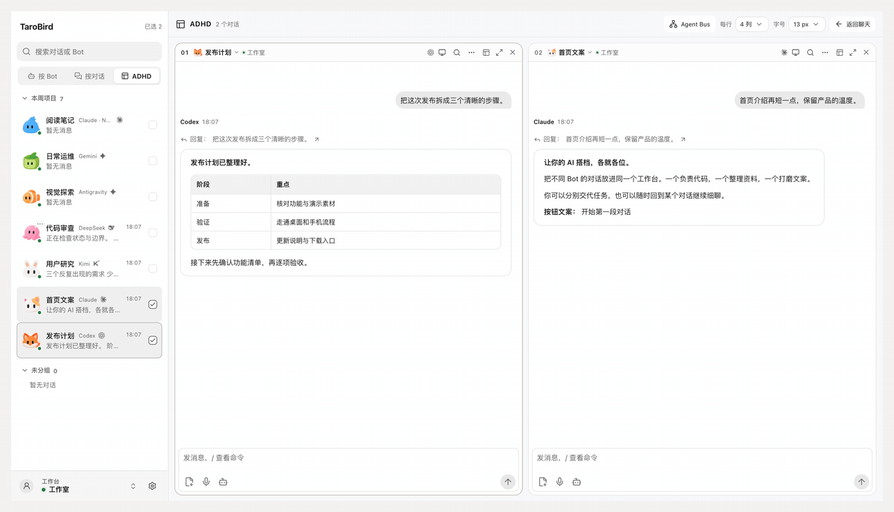</a>

桌面端专属 · macOS / Windows · 真实界面录制，使用演示数据 · <a href="assets/product/adhd-zh.png">查看原图</a>

- **并行推进。** 跨主机选取最多 12 个对话，每个面板独立保留消息、草稿与输入框；移除面板不会关闭对话，也不会中断正在执行的任务。
- **灵活布局。** 支持自动排布或每行 2–6 列，可调整侧栏、重排面板或放大单个面板；ADHD 字号可在 11–16 px 间单独设置。
- **操作就近。** 提问、回复与文件都在各自对话中处理，面板组合保存在当前设备。

<h3 align="center">Agent Bus · 可视化多 Bot 协作</h3>

为每个环节分配任务，清晰呈现 Bot 之间的接力。 从侧栏打开已保存的 Bus，成员对话与协作流程同屏呈现。

  <a href="assets/product/agent-bus-zh.png">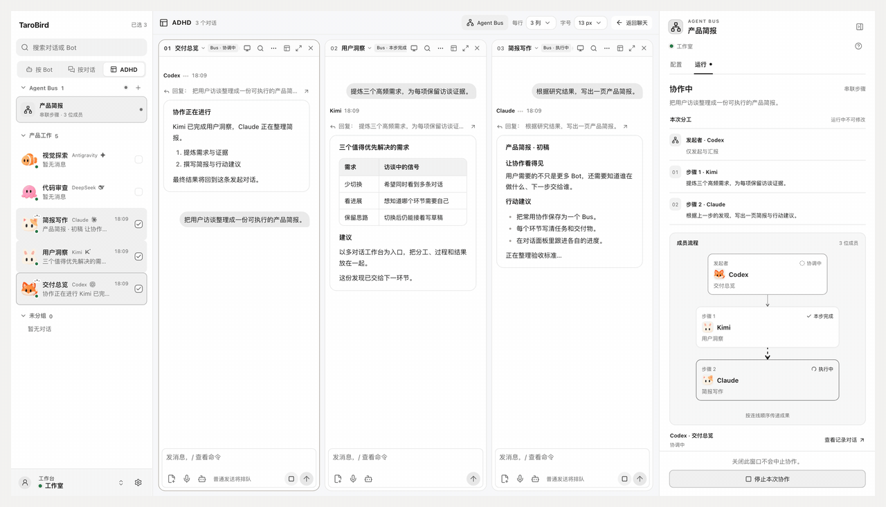</a>

桌面端专属 · macOS / Windows · 真实界面录制，使用演示数据与模拟运行状态 · <a href="assets/product/agent-bus-zh.png">查看原图</a> · <a href="assets/product/agent-bus-setup-zh.png">成员配置</a>

- **编排协作流程。** 提供单次委派、并行分工、串联步骤、交叉验证与研究团队五种模式；每个环节绑定 Bot 与记录对话，并配置独立任务。
- **进度一目了然。** 流程图实时显示各环节状态，对话面板呈现输出；保存的 Bus 可随时复用，关闭面板不会中止协作。
- **同一主机内运行。** 成员在独立会话中执行，结果写入对应对话。[设计与使用](docs/client/agent-bus-workspace-2026-10-18.md) · [分环节任务](docs/client/agent-bus-stage-tasks-2026-10-19.md)

截图为真实界面，使用演示数据 · <a href="assets/product/README.md">截图来源</a> · <a href="docs/client/adhd-board-2026-10-17.md">ADHD 设计与验证</a>

<h3 align="center">群组与话题 · 让多个 Bot 围绕同一件事交流</h3>

把研究、写作和审阅的 Bot 放进一个群，一起讨论同一个问题。 桌面和手机都可进入群组，按项目或问题划分话题，继续交流。

  

真实界面、演示数据；回复内容为示例，未运行模型 · 当前群内 Bot 来自同一台主机 · <a href="assets/product/feature-group-modes-zh.png">讨论方式设置</a> · <a href="docs/client/group-discussion-2026-10-20.md">群组说明</a>

- **指定谁回复。** 普通群聊中选择或 @ 想让它回答的 Bot；切换为并行回复，让全员分别给出自己的答案。
- **按话题整理。** 在群内为不同项目或问题新建话题，沿用群组成员，讨论记录按话题分别保留。
- **讨论方式可选。** 支持普通群聊、并行回复、轮流讨论与独立评议。自动讨论可设置发言顺序和轮数，并可暂停、恢复或结束。

<h3 align="center">Bot 联机协作 · 让多台电脑成为一个团队</h3>

把目标交给一个 Bot，让不同电脑上的 Bot 各展所长。 任务、文件与结果在 Bot 之间传递，每台机器执行自己的分工。

  <a href="assets/product/bot-team-zh.png">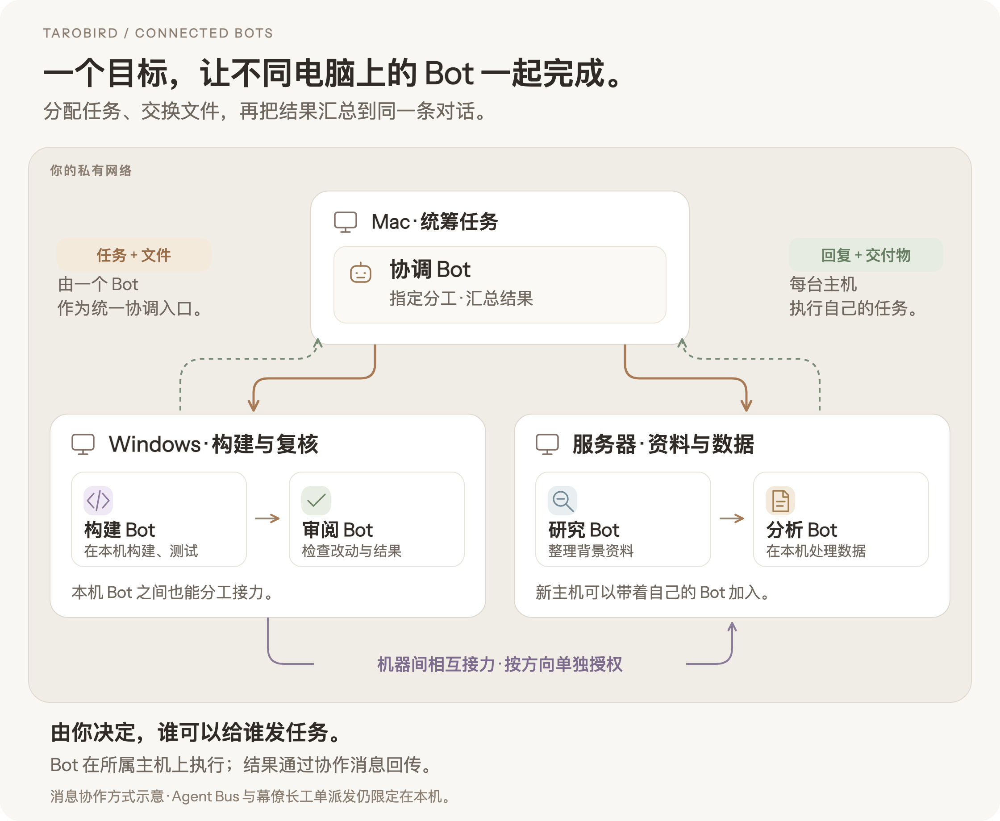</a>

消息协作方式示意，并非实时运行画面 · 每个发任务的方向均需授权

> “让 Windows 上的 Bot 构建并测试这次改动，让服务器上的 Bot 分析数据，最后把各自的报告和文件汇总回来。”

- **一个 Bot，协调多台机器。** 在一次任务里，告诉一个 Bot 哪部分交给哪台主机上的 Bot。它作为统一入口，逐一取回回复，再汇总结果。接收方通过自己主机上的引擎，在各自权限范围内执行。
- **机器之间，也能互相协作。** 审阅 Bot 可以向研究 Bot 索取背景，编程 Bot 可以把改动交给测试 Bot。同机和跨主机沿用同一套消息流程，不一定需要一个中心 Bot。
- **新电脑带着自己的 Bot 加入。** 在要加入的电脑上连接已有主机，再到 **设置 → 网络与连接 → 我的网络** 确认加入。已授权的电脑和手机可以访问它的 Bot；任务交接时，各主机需要在线且互相可达。
- **分工过程有记录。** 独立协作对话保留任务与回复，接收方能看到来源主机和 Bot。交接的文件会复制到接收主机；加入网络不会合并工作区，也不会自动开放所有 Bot 的访问权限。

**由你决定谁能通信。** 同机权限在 **设置 → Bot 消息授权** 中管理；从 1.2.0 起，接收方主机的拥有者也可以在同一页面的 **跨主机** 标签中，选择来源主机/Bot 与本机接收 Bot，再按方向允许或撤销。加入网络与消息授权分开确认；返回原任务结果无需反向授权。

  <a href="assets/product/bot-permissions-zh.png">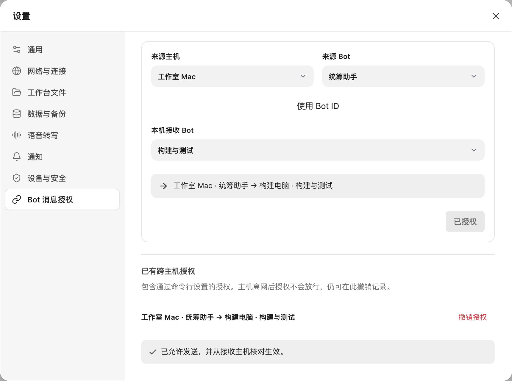</a>

1.2.0 App 授权界面 · 隔离主机上的真实设置与签名授权，使用虚构演示数据，未运行模型 · 也可通过 <a href="docs/details.zh-CN.md#bot-给-bot-派任务支持跨主机">CLI 授权</a>

这已经可以作为“一个 Bot 统筹、多台机器分工”或“Bot 彼此协作”的基础。自动选择机器、跨机调度和统一工单跟踪，是可以继续探索的方向，目前还没有内置这些能力。**当前 Agent Bus、群组与幕僚长工单派发仍限定在本机**；跨主机协作通过 Bot 直接消息完成。

[授权与恢复](docs/client/cross-host-message-permissions.md) · [组网设置](docs/details.zh-CN.md#私有网络) · [命令与投递规则](docs/details.zh-CN.md#bot-给-bot-派任务支持跨主机)

<h3 align="center">讨论、可视化与审阅</h3>

群组讨论、交互式回复、改动审阅与语音转写。

  <a href="assets/product/features-zh.png">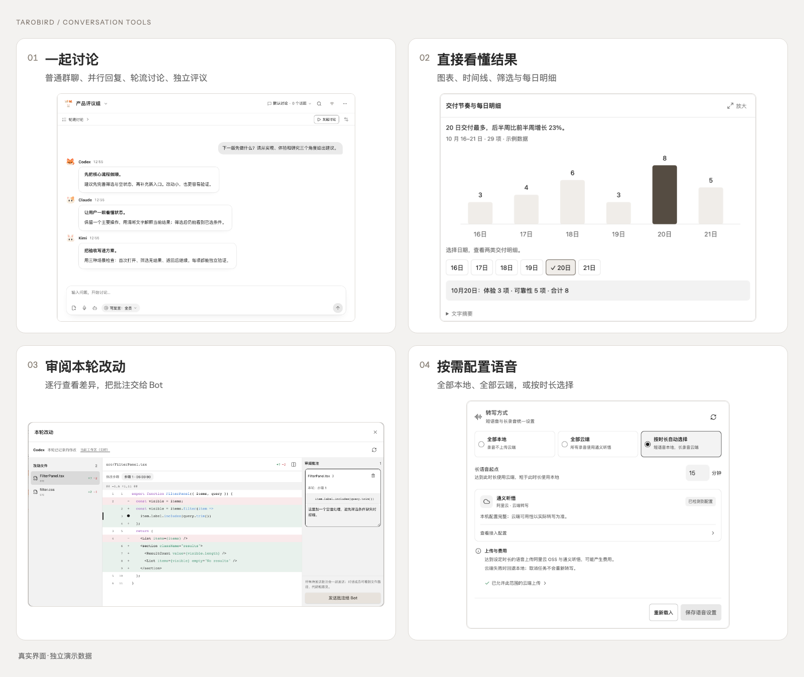</a>

查看原图：<a href="assets/product/feature-groups-zh.png">群聊</a> · <a href="assets/product/feature-group-modes-zh.png">讨论方式</a> · <a href="assets/product/feature-visual-zh.png">交互报告</a> · <a href="assets/product/feature-changes-zh.png">本轮改动</a> · <a href="assets/product/feature-voice-zh.png">语音设置</a>

- **交互式回复。** Bot 可在回复中直接呈现图表、时间线与筛选器，支持放大查看与历史回溯。[可视化回复](docs/client/inline-widgets-2026-10-22.md)
- **改动审阅。** 逐步查看每次回复修改的文件；在桌面端可对代码行添加批注并发回 Bot。[本轮改动](docs/client/run-diff-2026-10-20.md)
- **语音转写。** 每台主机可选择全部本地、全部云端或按时长自动切换。[语音设置](docs/client/voice-transcription-settings-2026-10-21.md)

<h3 align="center">工作台 · 把资料和创作放在对话旁</h3>

网页浏览、画布、白板、Markdown 笔记与 PPT，在同一个工作台切换。 每段对话保留自己的工作台，可放在侧边，也可展开到主区。

<h3 align="center">画布 · 从想法到可修改的作品</h3>

和 Bot 一起制作页面、海报或视觉草稿。 双击文字继续编辑，边看效果边完善。

  <a href="assets/product/workbench-canvas-zh.png">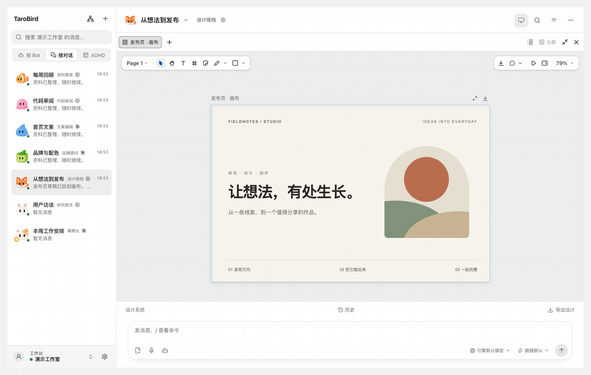</a>

真实界面录制，使用演示内容 · <a href="assets/product/workbench-canvas-zh.png">查看原图</a> · <a href="docs/client/workbench-design.md">画布说明</a>

<h3 align="center">浏览器 · 在 App 内打开网页</h3>

在对话的工作台中打开网页；该对话的 Bot 可在限定范围内查看和操作页面。 页面工具包括查找、缩放、尺寸预览、打印为 PDF、截图与下载。

  <a href="assets/product/workbench-browser-zh.png">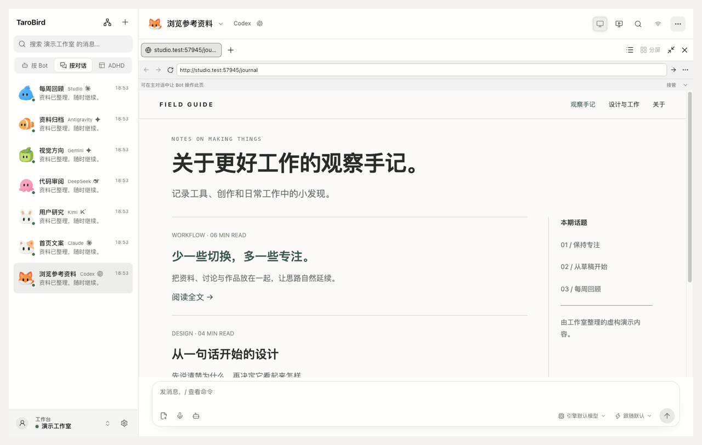</a>

仅限桌面 App · 截图为真实界面，使用演示数据 · <a href="docs/client/browser-page-tools-2026-10-31.md">页面工具</a>

<h3 align="center">白板与笔记 · 梳理思路，记下决定</h3>

在白板上画图形、写文字、连线、放图片；用 Markdown 笔记编辑，支持预览与自动保存。 你和 Bot 的修改共用同一套版本与撤销。

  <a href="assets/product/workbench-whiteboard-zh.png">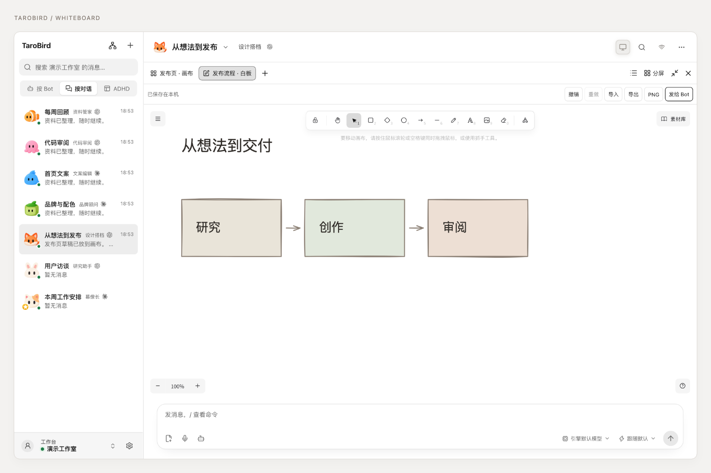</a>

  <a href="assets/product/workbench-notes-zh.png">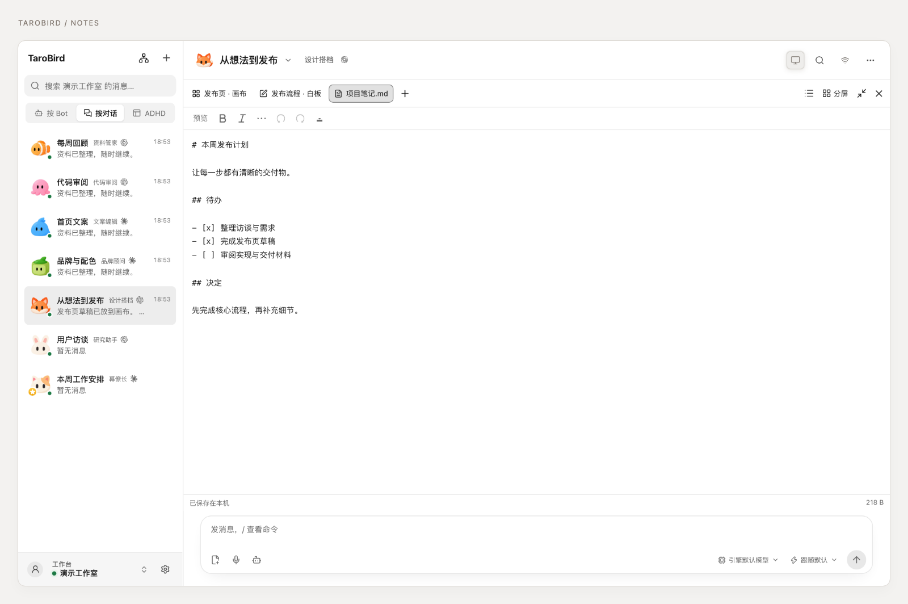</a>

截图为真实界面，使用演示数据 · 白板基于 Excalidraw · 笔记基于 Vditor · <a href="docs/client/conversation-workbench-2026-10-30.md">工作台说明</a>

<h3 align="center">侧边分屏 · 对话与工作台并排</h3>

工作台在对话右侧打开，边聊边改。 可调整侧栏宽度，用「分屏」同时显示 2–4 个标签，或放大单个标签专注处理。

  <a href="assets/product/workbench-side-zh.png">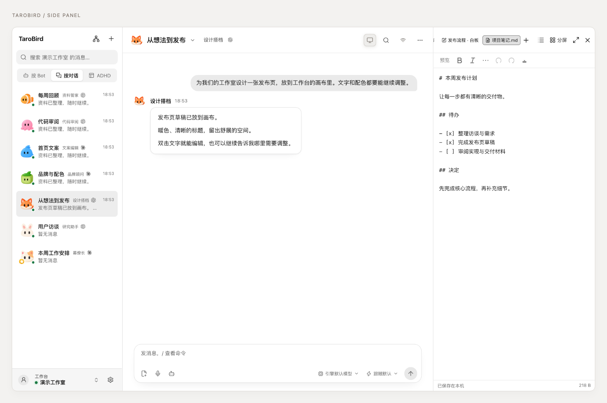</a>

截图为真实界面，使用演示数据 · 每个对话保留自己的工作台 · 内容保存在本设备，可导出项目迁移或备份

<h3 align="center">屏幕控制 · 查看并操作另一台 Mac</h3>

在桌面 App 中打开已授权 Mac 的屏幕，默认只查看； 需要操作时点击「开始控制」，点击「停止控制」或回到本地聊天即释放控制。

  <a href="assets/product/remote-screen-zh.png">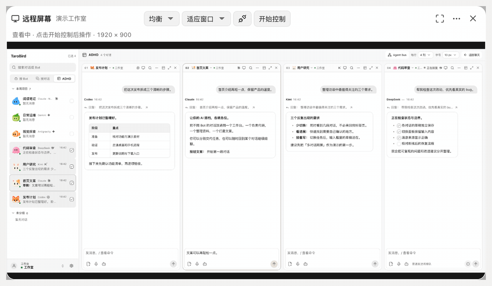</a>

桌面 App · 需在目标 Mac 上授权并开启系统权限 · 本录制使用真实查看器与模拟画面、模拟连接 · <a href="docs/client/remote-screen-2026-10-31.md">使用与权限说明</a>

<h3 align="center">幕僚长 · 一个目标，拆成可跟进的工单</h3>

新建 Bot 时选择「作为幕僚长」，在它的对话里交代目标。 它把工作拆成工单，交给本机已安装的引擎 CLI 执行，再向你汇报。

  <a href="assets/product/chancellor-zh.png">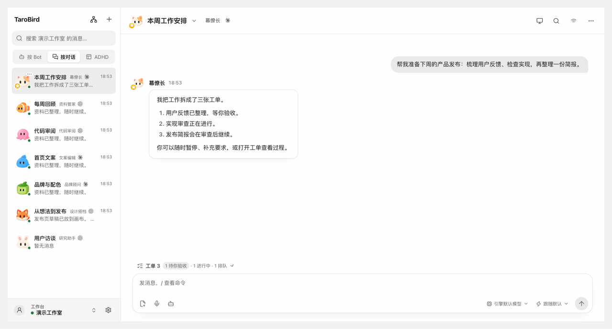</a>

截图为真实界面，使用演示数据；工单状态为示例，未运行模型 · <a href="docs/client/dispatcher-bot-2026-11-01.md">幕僚长说明</a>

- **工单可见。** 排队、进行中、待回答与待验收的工单一目了然，可打开任一工单的执行对话。
- **节奏由你定。** 先确认分工再派出，或让它自行派出；可设置允许使用的引擎和同时进行的工单上限，随时暂停、取消或补充要求。
- **各有分工。** 幕僚长负责拆解与派发；Agent Bus 执行你预先定义的流程；ADHD 用于同时查看多个对话。

完整功能请见[功能清单](docs/details.zh-CN.md#功能清单)。

<b>更多界面：主题、分组与列表选项</b>

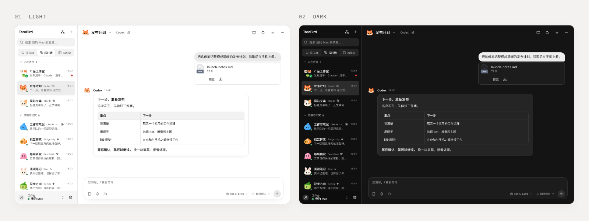
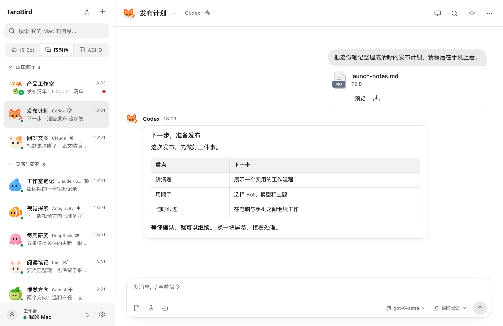

右键点击分组名称或桌面列表的空白处，可以按主机分组、显示未连接 Bot，或管理对话分组。

<a href="assets/product/list-options-zh.png">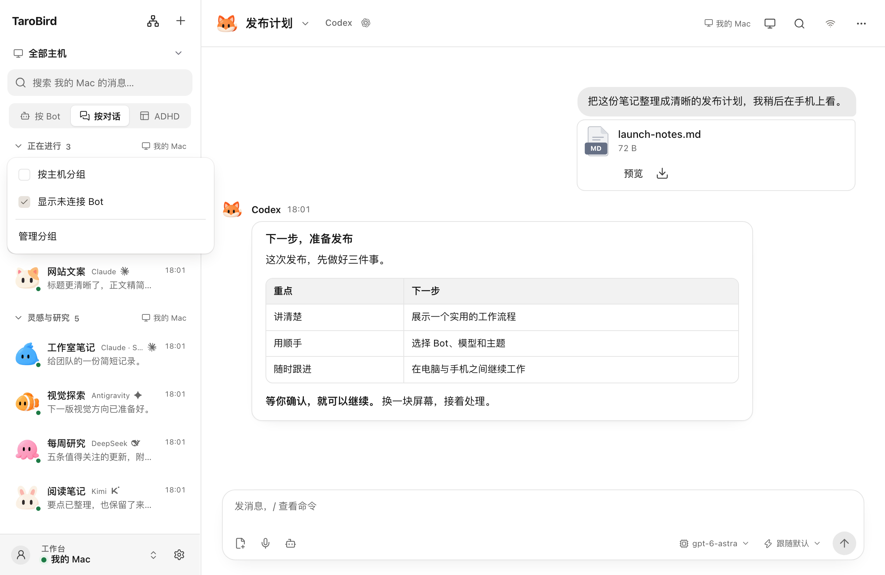</a>

## 支持的引擎

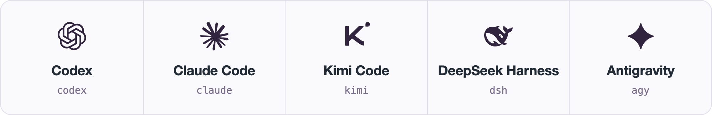

**基于官方原生 CLI 构建。** TaroBird 不重新实现智能体，而是直接调用 Codex、Claude Code、Kimi Code、DeepSeek Harness 与 Antigravity 的官方命令行工具。Harness 是模型背后的执行系统，涵盖智能体循环、工具调用、上下文与会话管理；由模型厂商亲自打磨的 harness，最能发挥模型的能力。TaroBird 在此之上提供桌面与手机入口、多 Bot 协作与统一的对话界面。

**随上游演进持续增强。** 主机上的 CLI 升级后，其在执行、上下文处理与稳定性方面的改进会直接惠及 TaroBird 中的 Bot。具体能力取决于所安装的 CLI、账号与适配器，新增接口可能需要 TaroBird 进一步适配。[引擎能力对照](docs/client/capability-map.md)

在运行 Bot 的电脑上安装并登录任意一种引擎即可开始使用；TaroBird 不附带 AI 引擎、模型账号或额度。各引擎的适配差异见[引擎对照](docs/details.zh-CN.md#引擎对照)。

> [!IMPORTANT]
> 多数引擎默认使用完全访问权限，可在 Bot 的「权限与批准」中调整。模型、effort 与权限的完整说明见[引擎与权限](docs/details.zh-CN.md#引擎与权限)。

## 快速开始

<table>
  <tr>
    <td width="33%" valign="top"><b>01 · 安装主机</b> 在电脑上安装 TaroBird，设为主机并创建 Bot。</td>
    <td width="33%" valign="top"><b>02 · 配对手机</b> 手机扫描二维码，在电脑上确认 8 位配对码。</td>
    <td width="33%" valign="top"><b>03 · 外出访问</b> 通过 Tailscale 或 VPS 中转，随时随地连接。</td>
  </tr>
</table>

### 01 · 安装主机

1. 安装桌面版。macOS 将 **TaroBird.app**拖入「应用程序」（已通过 Apple 公证）。Windows 运行安装程序；安装包暂未进行代码签名，若出现 SmartScreen 提示，请点击「更多信息 → 仍要运行」。 已安装的 Mac 用户优先在 **设置 → 通用 → 应用更新** 中原地升级，保留现有安装位置；不要同时保留 TaroBot.app 与 TaroBird.app。手动升级请按[更名过渡说明](docs/client/artifact-branding-2026-11-05.md#upgrading-an-existing-mac)操作。
2. 首次启动时选择 **将这台电脑设为主机**，并为电脑命名。
3. 新建 Bot，选择本机已安装的引擎。

### 02 · 配对手机

1. 在手机上安装 TaroBird。**iOS：**先安装 Apple 的 TestFlight App，再[加入 TaroBird 公开测试](https://testflight.apple.com/join/ByFWEfFW)。**Android：**安装 [Releases](https://github.com/cloveric/tarobird/releases) 中的 APK。
2. 在电脑上打开 **设置 → 网络与连接 → 添加设备**，选择[联机方式](#联机方式)并生成二维码。首次生成时主机会短暂重启，建议待当前任务完成后操作。
3. 在手机上打开 TaroBird，点击 **扫描连接二维码**；也可以选择 **导入二维码图片** 或 **粘贴连接信息**。
4. 手机将显示 **8 位配对码**（5 分钟内有效）。在电脑上输入该配对码并点击 **确认配对**，手机即自动进入聊天。

### 03 · 外出访问

**联机方式对比**

每一行是一种连接方案，右侧都是**同一台运行 Bot 的电脑**。

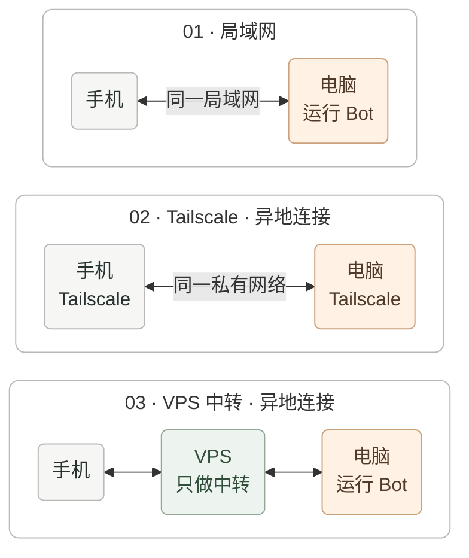

| 方式 | 适用场景 | 准备工作 |
| :--- | :--- | :--- |
| **局域网直连（LAN）** | 手机与电脑连接同一 Wi-Fi，或位于可互通的局域网 | 无需额外网络服务；两台设备需能互相访问 |
| **Tailscale 异地连接** | 外出使用，且两端均可安装 Tailscale | 电脑与手机加入同一 Tailscale 网络，无需自建 VPS |
| **VPS 中转** | 外出使用，手机无需安装 VPN | 一台云服务器，推荐交由 AI 部署 |

> [!TIP]
> **可以让你自己的 Agent 帮忙配置 VPS 中转。** 将[可直接复制的部署说明](docs/client/remote-access.md#方式一让有终端和-ssh-能力的-agent-配置)交给 Codex、Claude Code 等 Agent，让它按项目文档完成部署与连通验证。Agent 需要运行主机上的终端权限，以及你授权的 VPS SSH 访问权限。

采用上述任一种方式，Bot 都运行在你的电脑上，聊天记录、文件与登录信息也保存在电脑上，因此电脑需保持开机联网。**这里的 VPS 只做中转，不运行 Bot。** 如需在电脑关机后继续运行 Bot，请参阅[在 VPS 上运行完整主机](docs/client/host-deployment.md)。

**方式一 · Tailscale**

1. 在电脑和手机上安装 [Tailscale](https://tailscale.com/download)，登录并加入同一个 Tailscale 网络。
2. 在电脑上打开 **设置 → 网络与连接 → 添加设备**，选择 **Tailscale 异地连接**，点击 **生成 Tailscale 二维码**。TaroBird 会自动检测本机的 Tailscale 地址。
3. 按[配对手机](#02--配对手机)的步骤扫码并确认配对码。已配对的手机可在 **我的 → 连接状态与线路** 中点击 **扫描二维码更新连接**，直接添加 Tailscale 线路，无需重新配对。

两端需保持 Tailscale 在线，且 Tailscale 的访问规则需允许手机访问电脑。

**方式二 · VPS 中转（推荐交由 AI 部署）**

1. 在电脑上打开具备终端与 SSH 能力的 AI 智能体（如 Codex、Claude Code），将[部署说明](docs/client/remote-access.md#方式一让有终端和-ssh-能力的-agent-配置)完整复制给它，并提供 VPS 的 SSH 别名与私钥**路径**（请勿粘贴私钥内容）。它将完成中转部署、证书签发与自动续期，并实际验证连通性，最终返回一个 HTTPS 地址。如需手动部署，请参阅[手动部署教程](docs/client/vps-relay-manual.zh-CN.md)。
2. 在电脑上打开 **设置 → 网络与连接 → 连接状态与线路**，在「本机 VPS 中转」下点击 **添加 VPS 中转**，填入该地址后点击 **验证并保存中转**。
3. 已配对的手机若未自动获得新线路，可在 **我的 → 连接状态与线路 → 编辑线路 → 添加 VPS 中转地址** 中填入同一地址并 **保存线路**。新手机可直接扫描电脑上的二维码，连接方式选择 **VPS 中转**。
4. 关闭手机 Wi-Fi，使用蜂窝网络确认可以连接。

### 添加更多电脑

在新电脑上安装 TaroBird，选择 **连接已有主机**，扫描或粘贴已配对设备「添加设备」中的连接信息。随后在任意一台已配对的手机或电脑上打开 **设备与网络 → 输入配对码确认**，输入新电脑显示的 8 位配对码即可，无需回到主机旁操作。若新电脑也将运行自己的 Bot，连接后按提示确认加入网络。[私有网络说明](docs/client/private-network.md)

不需要桌面窗口的主机，可改用 [TaroBird CLI](#无界面主机tarobird-cli) 运行。macOS 首次启动时可能请求访问钥匙串，请选择 **始终允许**（[原因说明](docs/client/macos-keychain-prompts.md)）。

## 无界面主机（TaroBird CLI）

在电脑或服务器上安装 TaroBird CLI，无需打开桌面 App 即可作为主机运行，手机照常连接、派发任务与接收文件。Dot、Grok 等能够执行命令的助手，也可以通过 CLI 调用 TaroBird 中的 Bot 完成工作。[安装与命令](docs/host-cli.md) · [详细说明](docs/details.zh-CN.md#不开桌面窗口也可以运行主机)

## Bot 隔离与共享

同一个 Bot 可以开启多个独立对话，共享人设、模型与工作区。多个 Bot 指向同一文件夹时会读写同一批文件；Bot 进程并非操作系统级沙箱。[详细说明](docs/details.zh-CN.md#bot-隔离与共享)

## 更多资源

| 文档 | 内容 |
| :--- | :--- |
| [详细说明](docs/details.zh-CN.md) | 功能清单、引擎与权限、私有网络、跨主机任务、CLI、消息队列、隔离与共享、系统架构、数据去向、升级、源码构建、开发状态、命名与兼容 |
| [文档导航](docs/README.md) | 全部设计、配置与验证文档 |
| [Releases](https://github.com/cloveric/tarobird/releases) | 安装包下载与各版本验证记录 |

## 致谢

感谢 [LINUX DO](https://linux.do/) 社区对 TaroBird 的支持。

工作台使用 [Excalidraw](https://github.com/excalidraw/excalidraw) 提供白板、
[Vditor](https://github.com/Vanessa219/vditor) 提供 Markdown 笔记，并集成
[宝玉 Jim Liu 的 baoyu-design](https://github.com/JimLiu/baoyu-design) 提供画布、幻灯片编辑器及相应适配技能。
感谢这些项目的作者与贡献者。Excalidraw 和 Vditor 使用 MIT；baoyu-design 使用[分范围许可声明](client/vendor/baoyu-design/NOTICE.md)，重建编辑器不在其 MIT 授权内。我们保留原始版权、授权范围及依赖许可说明，
详见[第三方许可](LICENSING.md)和[设计功能说明](docs/client/workbench-design.md)。

## 许可证

Copyright (c) 2026 Cloveric。TaroBird 采用
[GNU Affero General Public License v3.0 only（AGPL-3.0-only）](LICENSE)。
详见[适用范围及第三方许可说明](LICENSING.md)。
