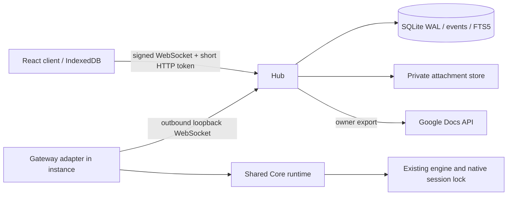
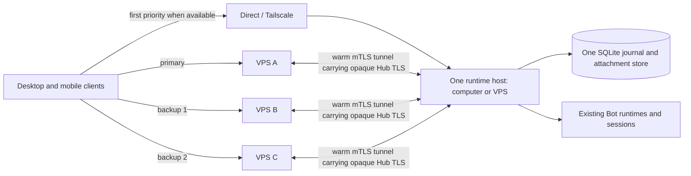

# Client architecture

The desktop/mobile App and headless CLI share one authenticated Hub. Each
supervised Bot worker runs a Gateway and the shared Core engine adapter,
session manager, native session lock, command dispatcher, usage ledger and cron
runtime. Telegram/Lark adapters are retired; retained historical identifiers
are compatibility data, not additional running transports.

## Ownership

| Area | Entry |
|---|---|
| Public protocol and validation | `src/client-protocol/index.ts`, `stream.ts` |
| Hub lifecycle and CLI | `src/hub/cli.ts`, `server.ts`, `service.ts` |
| SQLite schema, authorization, events | `src/hub/database.ts`, `store.ts` |
| Device trust and challenge proofs | `src/hub/auth.ts` |
| Resumable attachments | `src/hub/attachments.ts` |
| Consistent export, backup, orphan cleanup | `src/hub/maintenance.ts` |
| Gateway binding and compatibility shim | `src/gateway/service.ts`, `channel.ts` |
| Durable instance outbound calls and receipts | `src/gateway/transport.ts`, `receipts.ts` |
| App rendering and artifact context | `src/core/channel-profile.ts` |
| Client connection, routing, cache | `client/src/connection.ts`, `storage.ts` |
| Markdown, cards and message export | `client/src/Content.tsx` |
| Shared off-thread Markdown parsing and incremental display | `client/src/MarkdownText.tsx`, `markdown-jobs.ts`, `markdown-parser.ts` |
| Native share queue, destination pinning and bounded reads | `client/src/share-controller.ts`, `ShareInbox.tsx`, Android `ShareInboxPlugin.java`, iOS `ShareInboxStore.swift` |
| Installed-app OAuth and Google Docs CLI | `src/gdocs/` |

## Delivery and recovery

The Hub commits each message, event sequence and target delivery in one SQLite
transaction. Duplicate client message IDs return the existing message. Devices
replay from their per-conversation sequence; an event and its cursor are committed
in one IndexedDB transaction. A sequence gap forces a reconnect instead of
silently skipping content. Message versions ignore older snapshots.

Large gaps use `snapshot.v1`: one SQLite WAL read transaction supplies a stable
conversation revision, streamed as bounded message frames. Concurrent writes
continue and are replayed after the snapshot. Separate IndexedDB staging stores
keep partial downloads invisible; replacement messages, activity and the cursor
commit together after the final count is validated. Drafts and outbox entries
survive interruption. Socket writes are paced and heartbeat handling bypasses
the catch-up request queue. Old clients retain event replay.

The Hub derives versioned `message.stream` operations from its durable snapshots
for each capable connection. Text and nested card text can append without
retransmitting the existing answer. A reconnect always starts with a full base;
completion/error/deletion also carries a full snapshot. Delta application updates
the cached message, activity and event cursor atomically, and a wrong base or
invalid element path leaves the cursor unchanged for recovery. Clients without
streaming support retain full-snapshot delivery.

Card submissions save the validated, server-owned callback payload into a
durable queue before acknowledging acceptance. A bot may be offline. Its
operation receipt survives both Hub and instance restart. Completed receipts
return the previous outcome. An operation interrupted during a process crash is
reported as interrupted and requires an explicit user retry; arbitrary engine
side effects cannot safely be replayed automatically.

Instance-to-Hub RPCs are journalled before sending and replayed on reconnect.
Uploaded file chunks are fsynced, hash checked and addressable only by opaque
IDs. The final SHA-256 is checked before an attachment can appear in a message.
Client uploads reconcile the server receipts after transient transport failures,
including a chunk accepted before its HTTP response was lost. Route retirement
aborts pending requests; only the idempotent upload flow retries automatically.
A transfer holds off optional return to the preferred route, but never blocks
failover from a broken route. Revocation, permission and hash errors are terminal.
Uploads are cancellable and transient recovery is bounded to five minutes without
new progress; ordinary command/export HTTP calls are never automatically replayed.

Gateway profile is scoped with AsyncLocalStorage. Default profile is Feishu.
It disables Feishu document overflow, text/table limits and CardKit access while
reusing the actual card constructors and action handlers. Golden JSON fixtures
and contract tests guard this boundary. Visual equality requires separate
Feishu screenshot baselines; JSON snapshots do not establish it.

Native mobile shares enter an app-owned queue, not the conversation dispatcher.
After review, the client persists its selected Hub/device/conversation and text
before uploading. The same UUID becomes the client message ID on every retry.
Native files are removed only after the IndexedDB outbox accepts the message;
normal Hub acknowledgement and engine execution continue through the existing
delivery path. iOS extensions and the main app share only the bounded inbox.

## Current limits

See `implementation-status.md` for the active acceptance ledger. In particular,
macOS shell/key-storage smoke is verified locally; signed mobile shells, real
push delivery and production relay provisioning still require separate acceptance. The existing dual-route browser test uses two local
TCP paths and does not constitute a deployed Tailscale/VPS test.

## One Hub with multiple VPS relays

`RelayTunnels` maintains each configured outbound tunnel independently. The runtime host
initiates every tunnel; the diagram's bidirectional arrows represent data flow,
not inbound ports opened on the runtime host. Clients prefer their optional direct path,
then a primary and ordered backups (up to eight VPS paths). All endpoints must
pass the same pinned Hub challenge. Individual socket failures carry separate
cooldowns; stable recovery only switches back at an idle boundary. Existing
message IDs, event cursors and upload chunk receipts survive the transport change.
VPS servers have no replicated Hub state; neither their ordering nor failure
creates a new Bot/session. Each device's route preferences stay local and pairing
QR codes transfer the complete list. Remote domains, TLS/SNI certificates and web
origins require the corresponding [deployment configuration](relay-deployment.md).

The multi-route browser drills use local network faults and the tunnel tests use
real TLS/mTLS on independent local relay listeners. They do not establish cloud
network SLA, native-shell behavior or production deployment readiness.

## Runtime host and connection role

The operator added overlapping device roles on 2026-10-03: one computer can run
its own Bots while its client controls other runtime computers; one phone can
control multiple independent computers. This is an added requirement, not a
capability of the current single-identity r6 client. The
[multiple-runtime-host design](multiple-runtime-hosts.md) specifies parallel
pinned Hub connections, unified Bot/group navigation and per-Hub isolation.
It preserves the loopback-only worker boundary and distinguishes independent
runtime hosts from multiple routes to one Hub.

The runtime host may be a computer or a VPS. A VPS host can expose an explicitly
configured public HTTPS listener directly, or initiate the same outbound mTLS
tunnels to separate relay VPS servers. It can offer both paths at once.
Public listening is opt-in per listener with mandatory TLS. Worker endpoints
remain on a permitted loopback listener and keep their Bot-specific authentication.
See [host deployment](host-deployment.md) for examples and operational limits.

Pairing and connection settings explain these three deployment choices. The
optional client `deployment` description travels with connection QR codes and is
stored with that device's identity. It does not configure or migrate a server,
and old route lists never imply where the Bot runtime actually runs. `Direct`
routes remove the old assumption that every direct endpoint uses Tailscale.
No runtime failover, replica database or relay file cache is introduced.
