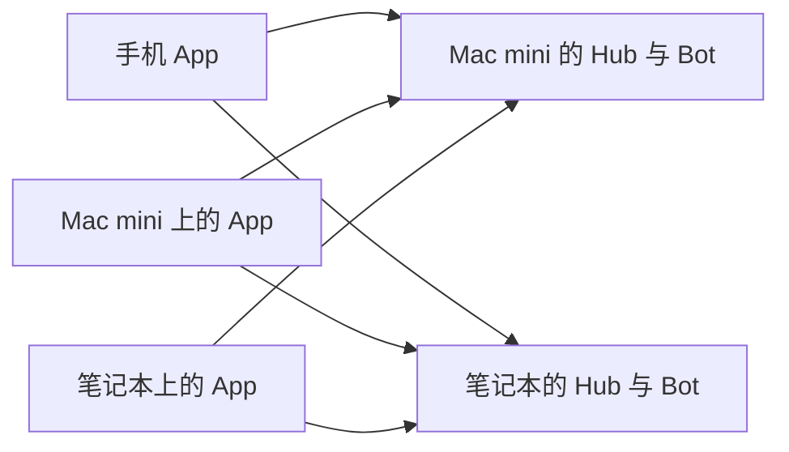

# 一台设备可以同时运行 Bot 和控制其他主机

用户在 2026-10-03 补充：一台电脑既可当运行主机，也可作为另一台电脑的客户端；
手机可以控制多台电脑。设备的角色可以重叠，不能把电脑永久分成主机和副机。
本文记录新增需求和实现边界，不代表 r6 已支持多主机。

## 用户看到的概念

- **运行主机**：运行 Bot 的 CLI、MCP 和工具，保存该 Bot 的工作区、记忆与会话。
  Mac mini、笔记本、Windows 电脑或 VPS 都可以承担这个角色。
- **客户端**：查看消息、发送任务、确认问题、停止或引导任务。手机和电脑均可承担。
- **Bot**：运行主机上的一个助手配置，一台运行主机可以有多个 Bot。
  电脑不是一个固定 Bot；Bot 内现有独立会话、群组、话题语义保持不变。
- **中转线路**：某台主机的访问路径。主备中转不等于两台独立运行主机。

同一台电脑可同时提供前两种能力，无须切换成互斥的“主机模式／副机模式”。

图中箭头表示经授权的控制连接。每条连接可以直连或走其自己的 VPS 中转。
打开其他电脑的 Bot 不会把 CLI、工作区或记忆迁移到当前电脑，也不会重建会话。

## 导航与设置方案

在用户尚未选择另一种查看方式前，采用**统一 Bot／群组列表＋按主机筛选**：

1. 左侧仍以 Bot、群组为主体，增加“全部主机／Mac mini／笔记本”筛选。
   同名 Bot 和群组必须显示主机来源，例如“研究助手 · 笔记本”。
2. 对话标题区持续显示运行位置；执行涉及文件、工具和权限的操作时来源不能消失。
3. “添加主机”走单独配对流程，保留已有主机、草稿、连接和缓存。
   不把“添加另一台电脑”塞进同一个 Hub 的备用线路列表。
4. 新建 Bot 先选择运行主机，再选择该主机实际提供的 CLI、模型、effort 和工作区。
   从某台主机的 Bot 发起新会话时，自动沿用其归属，不把设置带到另一台主机。
5. “在此电脑运行 Bot”与“连接其他主机”是两个独立入口，可以同时使用。
   “本机”标识必须来自受验证的本地服务关联，不能仅凭地址是 localhost 推断。
6. 设置按主机展示名称、状态、线路、配对和权限。改一台主机的线路或移除其连接，
   不能影响其他主机。客户端通用外观设置可以全局保存。
7. 一台主机离线只使其所属 Bot／群组离线，其他主机仍可操作。
   切换筛选或查看另一台主机不停止后台任务，也不触发重复执行。
8. 手机前台可以并行维护各主机连接，后台不依赖常驻 WebSocket；通过逐主机推送
   提醒，回到前台按各主机游标补齐。连接生命周期由主机管理层持有，不随对话组件
   卸载而关闭；“查看另一台主机”与“主动断开主机”是两种操作。

“运行主机”是客户端可编辑的显示名称；实际身份以已配对并验证的 Hub 公钥为准。
名称或地址变化不能成为跨主机信任或自动迁移数据的依据。
同一 Hub 通过新地址或另一条中转接入，应识别为同一主机，并在完成签名挑战后
才接受新路线。同一地址返回不同公钥时先拒绝连接；用户重新配对前不复用旧令牌。

## 连接与数据边界

优先扩展客户端为**多个独立 Hub 的并行连接**，每台运行主机保留自己的 Hub 和
本机 Bot 管理器。这与现有 loopback worker 接入及现有部署方式兼容，也避免为了
远程运行 Bot 而开放 `/instance`。一台主机关机不应阻止另一台主机独立提供服务。

这不是 Hub 联邦或多主机共享数据库。当前群组和话题仍明确属于一个 Hub；新建群组
只能选择该 Hub 管理的 Bot。跨主机同群协作需要另行定义路由、授权、断线与取消语义，
不能仅合并客户端列表就声称已实现。会话、记忆、system prompt、effort、工作区的
现有作用域均保持在其所属主机与 Bot 内。

实现必须包括：

- 每个 Hub 独立的配对记录、设备密钥关联、连接状态、重试、吊销与认证令牌。
- 创建 Bot、改工作区或 CLI 配置仍要求目标主机的管理权限和审计，不能因为客户端
  同时连接其他主机就继承另一台主机的 owner 权限。
- 缓存、消息、草稿、附件、问题表单、游标、搜索、未读和待发送队列按 Hub 隔离。
  相同 Bot／群组／消息 ID 不得覆盖或误送；已排队操作始终绑定创建时的目标。
- 原有单 Hub 数据原地迁移或可恢复地登记成第一个主机，不清空既有草稿与待发送消息。
- 推送、桌面通知、应用深链必须携带并校验 Hub 身份。旧的无主机深链在多个候选
  主机下不能猜测目的地；找不到合法归属时提示选择或拒绝导航。
- 原生分享已有 `hubKey/deviceId/conversationId` 目标约束，需要贯穿多主机 UI。
  分享或上传进行中改筛选，不得改变已确认的目标主机。
- 移除单个主机只清理其缓存和密钥，并处理其后台推送／分享绑定；不能调用当前
  会取消所有主机推送、清除整个共享收件箱的全局清理路径。中断后仍须可恢复。
- Web Push 的 VAPID、UnifiedPush 实例和 APNs／FCM 设备 token 的多 Hub 注册必须
  分别适配，不以一个全局“已注册”状态代替逐 Hub 回执。
- 移除主机前明确列出其本地草稿和未发送消息数量；区分“本机移除连接”与“在该
  主机撤销此设备”。离线时不能显示推送已注销或远端访问权已撤销的成功回执。
- 从主机 A 的 UI 发往主机 B 的跨来源请求仍须满足 B 的来源白名单和认证策略。
  不通过放宽 CORS、忽略证书或放开 worker 入口来掩盖配对问题。

## 已核实的 r6 差距

| 当前实现 | 多主机所需变化 |
| --- | --- |
| `App.tsx` 只持有一个 `HubConnection` | 并行连接生命周期和统一导航 |
| `ClientCache` 固定 `tarocub-v1`，只存一个 identity；换身份会清缓存 | 分主机存储和兼容迁移，不能用全局可变“当前缓存”代理 |
| 通知 payload／深链仅携带 conversationId、messageId | 可验证的 Hub 归属与跨主机导航 |
| LocalReset 清共享收件箱、全局推送、当前密钥和缓存 | 可恢复的单主机移除，保留其他主机 |
| `/instance` 仅允许 loopback，托管 Bot 在 Hub 本机启动 | 每台运行主机使用自己的 Hub；保持此安全边界 |

这些是代码检查结果，不是已完成多主机适配的证明。

## 必须通过的验收

1. 一台手机同时配对两个真实独立 Hub；添加第二台不清除第一台的草稿、历史与配对。
2. 两台 Hub 故意使用相同 Bot／会话／消息 ID，发送、文件、表单、搜索和未读仍不串线。
3. A 的电脑运行 A 的 Bot，同时其客户端查看和控制 B；B 的电脑也能反向控制 A。
4. 两台主机同时流式输出，切换筛选继续同步；只停止指定主机、指定会话的轮次。
5. A 断线、吊销或移除后 B 继续可用；A 的未确认消息不被转发到 B。
6. 上传、系统分享、通知点击在切换主机和重启后仍到达原目标；未知或旧深链不误导航。
7. 单主机旧版本迁移和多主机移除中途崩溃可恢复，其他主机缓存、密钥和推送保留。
8. 桌面与手机分别验证统一列表、主机筛选、同名区分、运行位置、新建 Bot／群组归属。

真实手机、原生推送、两台实体电脑的验收不可用同一电脑上的两个浏览器代替。

## Opus 设计审查

实际使用 `claude-opus-5-5`、请求 effort `xhigh`，关闭工具和会话持久化。
审查支持多 Hub 并行，并补充了手机后台推送、主机指纹去重和管理权限等约束。
原文与采纳记录见设计审查（本地材料：`evidence/multiple-runtime-hosts-opus55-2026-10-03.md`）。
这是对已核实代码事实和方案的审查，没有执行多主机功能测试。

## 2026-10-04 底层实现与审查修复

已新增 `HostRegistry`、`HostConnections`，并把连接、对话视图和问题表单的缓存
固定绑定到所属连接。底层最初在隔离入口验证；随后已接入正常 App，见下面的
“正常界面接入”记录。底层测试和正常界面验收分别保留。

- 主机公钥生成完整身份指纹，显示名和线路不影响归属；旧缓存原地登记。
  旧缓存与新登记冲突时明确报错，不用另一份数据库隐藏旧草稿和待发送内容。
- 按主机加锁；删除 A 等待系统确认期间 B 仍能打开、写入及重命名。
  清理步骤有持久回执，最终登记删除失败后可继续；其他配对的数据和密钥受保护。
- 连接池不依赖聊天视图订阅，移除或吊销 A 不重建 B；初始化读取失败可在恢复
  前台时重试。过期探测失败不能拆掉新连接，重复启动不产生额外 socket。
- 缓存句柄显式释放，专用空库有可恢复删除记录。storage v5 只升级未提交的同步
  暂存，已提交消息、游标和草稿保留；两个窗口各自暂存，较旧快照不覆盖新历史。
  页面生命周期锁区分仍在同步的窗口与关闭页面遗留的暂存。

实际 Opus 5.5 xhigh 的代码审查和逐项处理见
审查记录（本地材料：`evidence/multiple-runtime-hosts-foundation-opus55-2026-10-04.md`）。
审查中的四项问题在原源码的隔离 Vite transform 中复现，再由 Chromium/WebKit
验证修复。旧代码及故障注入只用于临时验收入口，没有改写生产代码或正在运行的服务。

底层测试里的 native cleanup 是回调替身，不是原生注销回执。
原生安装包尚未更新。

## 2026-10-04 正常界面接入

正常 App 已由 `HostApp` 持有独立连接池，统一 Bot/群组列表按主机分段，支持
筛选、添加、重命名和移除。同名主机显示指纹短码。对话标题和创建、文件、
Skills/MCP、运行状态、权限设置面板都显示运行位置。

- 从“全部主机”新建时先选主机；单台筛选和 Bot 旁的加号沿用明确的所属主机。
  原有 Bot、群组、话题与会话语义不变，不支持把不同 Hub 的 Bot 混进同一群。
- 已访问工作区保持挂载；切换不关闭另一台连接或中断其上传。草稿按主机保存；
  切换时录音结束并留在原输入框，正在申请权限的录音取消。标题切换和草稿恢复
  在界面呈现前完成；保存中显示状态并保护刷新，写入失败不会显示“已保存”。
- 单主机移除显示草稿与待发送数量；在线先取得 Hub 推送删除回执。离线必须明确
  选择仅移除本地连接，并提示远端推送和设备授权仍需撤销。中断后可重试清理，
  不清理其他主机、未分配分享或共用 APNs/FCM token。
- 系统分享固定到另一已登记主机时提示切换，不引导删除。通知包含主机公钥指纹，
  多主机下拒绝猜测旧无主机通知的目标。浏览器 Web Push 的 worker 与订阅按主机
  隔离；Android UnifiedPush 源码随后完成逐主机注册和恢复，见
  [Android 通知自审](unifiedpush-multiple-hosts.md)。真机送达尚未验收。

正常 App 的浏览器验收启动两个独立临时 Hub，故意复用 Bot/会话/消息 ID，并检查
草稿、附件字节、发送目标、未读、通知导航、录音、重命名、离线和中断移除。
详细结果见正常界面验收（本地材料：`evidence/multiple-hosts-ui-2026-10-04.md`）。
Opus 实际只读审查和处理结果也保留于该记录。

仍待完成：真实手机多主机后台推送和原生分享清理回执、
可信本地服务关联及“在此电脑运行 Bot”入口、两台实体电脑互相控制、移动端多主机
并发流式性能、统一侧栏滚动与折叠状态。上述浏览器验收不替代原生设备验收。
