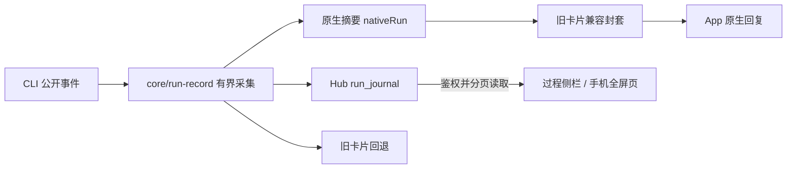

# App 原生运行过程

第一版、第二版共用一条数据链路。主回复显示真实当前动作、必要说明、最终结果和轻量过程入口；桌面在右侧查看过程，手机打开带安全区和返回按钮的全屏页面。原来的卡片仍用于旧客户端回退。

## 交互与状态

- 优先使用 CLI 明确提供的文件名、命令动作或描述；无法判断意图时显示“执行命令”。不从脚本内容猜测目的。
- 工具回执成功只完成该步骤；回复和附件交付结束后才完成整个运行。
- 主回复的过程入口只显示动作数，不汇总历史失败次数。失败尝试与重试结果仍分别保留在过程详情、搜索和导出中；任务本身的失败、中断和交付异常继续按真实状态显示，不自动认定历史报错已解决。
- 等待授权、等待回答、交付中、停止待确认、已停止、失败和重启中断分别显示。断线时停止动画，显示最后确认状态；重连读取 Hub 的同一份数据。
- 详情按事件顺序显示公开思考文本、Bot 说明、计划和动作。没有公开文本时不会补写思考。缺少明确父子关系时保持普通列表，不推测并行树。
- 文件修改展示 CLI 提供的 diff，或明确的旧文本/新文本参数；区分请求参数中的修改与工具返回的实际差异，不读取路径、不冒充磁盘验收。
- 搜索只链接实际返回的 HTTP(S) 来源，拒绝含凭据 URL。命令显示公开输出、实际退出码和可用耗时；未提供退出码时不猜测。
- 已发送的文件、图片、音视频关联到现有预览器，来源必须是同会话、同 Bot、同输入消息和运行时间区间内的真实消息回执。
- 支持搜索、逐步复制和 JSON 导出。翻页、搜索词、展开项和滚动位置在当前 App 会话中按主机、设备、会话、运行隔离保存，最多 64 份位置；重新启动 App 后重置位置。原始日志不放入全局 UI 缓存。
- 手机返回头、工具栏和分页按钮保持固定；详情滚动不会移动输入框。遵循减少动态效果偏好。

## 过程入口修正（2026-10-15）

过程入口调整仅影响桌面与移动端共用的展示组件，不改变运行记录、协议或主机行为，CLI 无需新增命令。五引擎浏览器矩阵覆盖失败尝试后重试成功、完成后入口只显示动作数，以及刷新后仍能查看原始失败和成功回执。

本轮验证：7 个相关测试文件的 165 项测试、14 项 Chromium 桌面/手机布局回归，以及主机和客户端构建通过。包含 Claude 子代理回报、原请求关联和问题提交反馈。未更新安装包，未作手机真机或真实 Claude 生成验收。

## 阅读背景修正（2026-10-14）

原生运行回复与旧卡片共用 `--raised` 卡片背景，
白色主题下均为白底，深色与其他配色继续遵循各自的卡片颜色。
五种引擎共用此展示组件，运行过程、状态与协议不变；这是纯界面修正，CLI 无须改动。
客户端生产构建通过；本机 Chrome 的 AGY 桌面、手机两项运行过程回归通过，
当时的五种配色检查只覆盖独立卡片表面，没有覆盖完整 `.message` 中的主题覆盖规则。
后续[排版审计](reply-formatting-2026-10-14.md)补齐了 CLI、Pixel、Mono 主题适配，
并在真实消息容器中核对全部 13 种配色的浅色、深色；白色系列保持白底，
其他主题保留旧卡片本身的设计。
此记录不代表新版安装包已发布或手机真机已更新。

## 数据所有权与兼容

`src/client-protocol/run.ts` 定义版本 1 schema。`runs.v1` 由 Hub 在实例握手中宣布。Gateway 将摘要放入 `card.extra.nativeRun`，旧客户端忽略该可选字段并读取卡片；旧 Hub 不接收 `run.write`。内部 `appRun` 永不作为卡片传出。旧的通用 `run` 块不改变语义，避免破坏历史数据。

`run.write` 是实例认证 RPC，按步骤序号和修订号幂等更新；每次只写改变的记录。摘要不携带命令、输出或思考全文，详情不受旧卡片的短文本截断。写入失败不吞掉最终回复，会标记详情未同步，下次正常更新重试。

`GET /api/messages/:id/run?after=&q=` 需要有效设备会话；检查消息会话成员、当前 canonical 消息及 run ID，并在返回前再次校验设备。撤回删除详情；转发剥离原始 run 引用，不能跨会话借用详情权限。重启恢复保留原有记录并标记中断，不重放停止或批准动作。

## 上限、清理与备份

- 每次运行最多 2,000 条记录、8 MiB。单段公开文本/参数各 32,768 字符，输出 65,536 字符；结构化差异合计 32,768 字符，最多 20 个文件；来源最多 30 项。触顶明确提示截短，不声称无限完整。
- 每页最多 40 条，响应按约 512 KiB 控制（单条有界记录可能略超）；搜索最多 200 字符。导出也受相同采集上限约束。运行中的导出带有起止时间和 live 标记，表示读取期间已经同步的记录；需要固定终态记录时应在完成后导出。
- 详情在运行结束/最后确认后 30 天不可读取；过期记录在写入和每日维护时删除。摘要、正文和文件消息独立保留。旧卡片兼容内容可能包含部分历史过程摘录，不能将详情清理宣传成清除所有副本。
- Hub schema 13 新增 `run_journal`。详情随现有数据库/全量备份保留；自动备份保留最近 7 份，手工备份独立管理，因此备份可能留有较早详情。
- 升级前使用现有备份功能。旧 Hub 不能直接打开 schema 13；回退需恢复升级前备份，不手工降低 schema 号。

## 验证范围

覆盖公开事件关联、乱序/重复/无 ID 并行结果、长输出限额、Codex 开始/进度/完成事件、命令退出码与实际 diff、计划、定时任务共享入口、分页搜索、转发/撤回/权限撤销、重启、备份以及旧 Hub 回退。浏览器模拟使用真实 Hub、Gateway 与共享运行控制器，CLI 输出由明确的测试夹具提供。

桌面/手机 Chromium 与 WebKit 检查当前动作、展开位置、中文草稿、断线重连、双设备同步、停止回执、导出、文件预览及安全区。浏览器通过不等于 Android、Windows 或 macOS 安装包真机验收；本轮不发布新安装包、不替换正在运行的主机服务。

本轮验证记录：独立 App 全量套件 241 个文件、3,066 项通过（1 项跳过）；之后新增的公开退出状态、交付期停止和 MCP 错误用例也通过针对性检查。旧卡片、定时任务和 goal 兼容套件 122 项通过。Chromium / WebKit 分别覆盖 15 项桌面与手机交互回归；停止状态文案更新后的测试已复测通过。后端与客户端生产构建均通过。真实 CLI / 物理设备用例仍需显式开启，不计入上述通过数。

## 五引擎覆盖补充

共享 `client-protocol/run-tools.ts` 负责原生工具名和参数字段的语义映射，摘要与详情使用同一规则。保留原始名称/参数；不会从 Bash 脚本猜测动作。`TodoWrite`、`SetTodoList`、`todo_write` 及计划更新都进入计划视图，计划回执按 ID 关联，失败不会变成一条无名“成功工具”。

| 引擎 | 原生事件与专门展示 | 信息边界 |
| --- | --- | --- |
| Codex | app-server 公开摘要、命令动作、进度、计划、结构化退出码/耗时、文件差异、MCP 错误 | 只展示实际返回的摘要与回执 |
| Claude | stream-json 公开思考/文本增量；`tool_use_result.structuredPatch` 与搜索来源、耗时；计划回执 | 单结果才继承外层元数据；暂存修改不当作实际差异；SDK 未给退出码时不解析 stdout 猜测 |
| AGY | 持续 worker 和单次 goal 两条入口；`view_file` / `run_command` 等名称和大写参数；去重后的工具输出快照增量 | 未公开的思考、退出码不补造；重复完成不再产生新的步骤 |
| Kimi Code | ACP 思考、计划、晚到参数、工具进度和 diff；关联原生 terminal 的输出/退出回执 | 终端释放后保留有界回执；原生截短标志透传；stdout JSON 不能冒充输入或退出码 |
| DeepSeek | reasoning/text、`todo_write`、`str_replace_editor`、`tool/result.meta.diffs` 实际差异、逐块调用 ID | 普通轮次与 goal 使用同一结果转换；多结果不共享外层差异元数据；不把打印的退出提示当结构化退出码 |

`EngineStreamEvent.tool_result.truncated` 是可选内部字段，进入已有 RunEntry 截短标记，不改变持久化版本或能力协商。结果详情中的“工具返回的差异”只描述 CLI 的公开证据，不等同于 App 独立核验文件落盘。单个工具成功、计划更新成功也不等于整个任务完成。

新增回归直接将真实适配器处理协议夹具后产生的事件送入 App 运行采集器，覆盖五种命名、计划/回执、晚到输入、重复快照、失败、真实 diff 与来源元数据。Kimi 终端用受控本机子进程验证输出/退出码与释放次序。浏览器矩阵逐一使用五引擎配置和各自工具形状，覆盖桌面/手机、断线恢复、双设备同步、停止确认、展开、搜索、导出、文件预览、草稿和安全区。它们不冒充付费真实模型调用或物理安装包验收。

2026-10-14 补充验收：全量独立 App 测试 242 个文件、3,087 项通过（1 项跳过）；旧卡片/定时任务/goal 122 项通过。Chromium、WebKit 各通过五引擎 × 桌面/手机的 10 项交互检查，DeepSeek 原生编辑器和差异元数据补丁另复测两端。前后端生产构建通过。额外全仓 `tsc --noEmit` 仍有既存测试夹具类型错误，未作为通过项；生产源码与客户端类型检查由各自构建执行。
