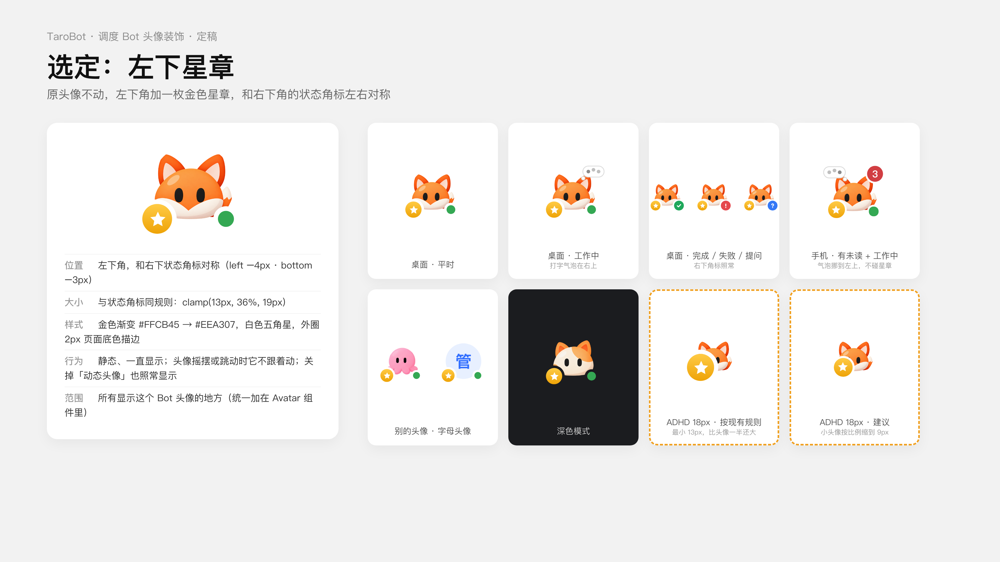
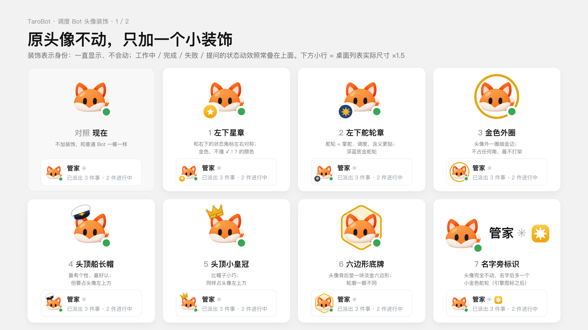
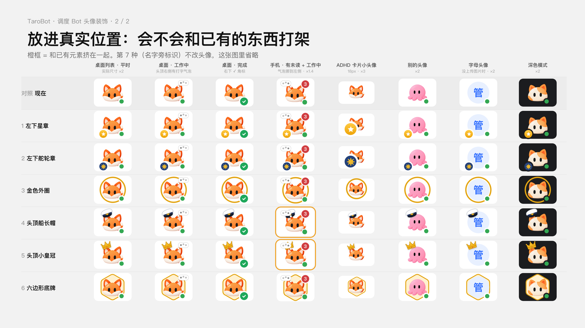
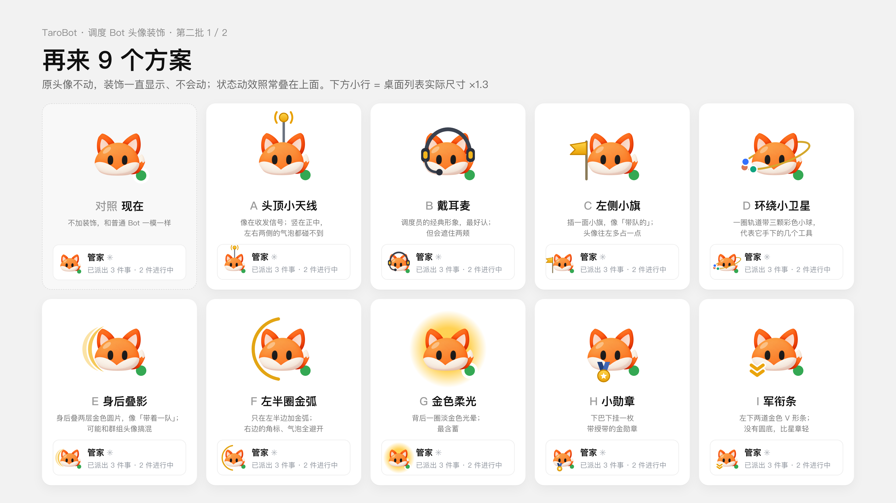
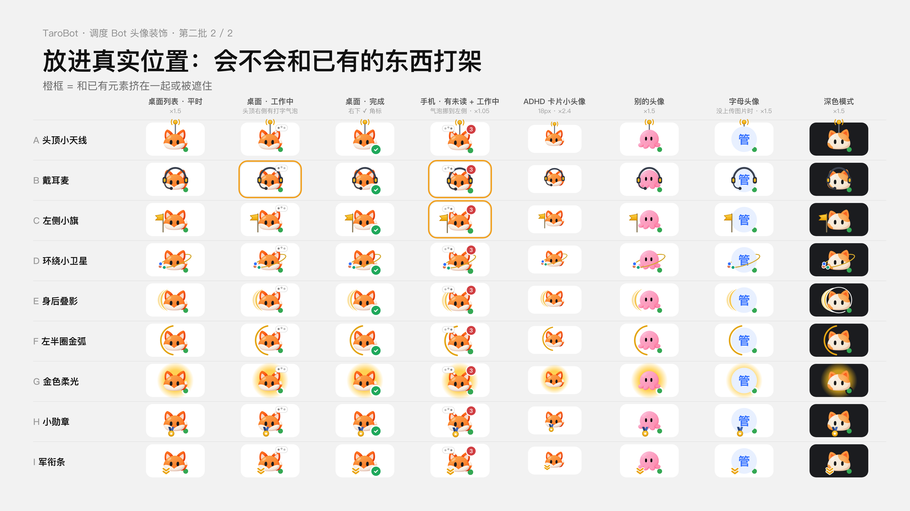

# 幕僚长（Chancellor）设计草案

> 状态：讨论稿，2026-11-01。根据 TaroBot 主人与开发 Bot 的讨论整理。
> 名称已定：中文「幕僚长」，英文「Chancellor」（2026-11-01）。正文沿用讨论时的暂称「调度 Bot」。

> 实现说明（2026-11-01）：实现时没有直接搬入 dsh-superagent 的核心代码，改为按 TaroBot 现有结构自写工单账本。按主人决定，调度 Bot 直接使用本机已安装的 CLI，不需要另建 Bot：主机为每个用到的 CLI 自动开一个隐藏的执行通道。实现细节见 [dispatcher-bot-2026-11-01](../../client/dispatcher-bot-2026-11-01.md)。

---

## 1. 目标

在 TaroBot 里增加一种特殊的 Bot：**调度 Bot**。

- 你只需要跟它一个对话说要做什么。它负责拆分任务，派给本机已装的各个 AI 命令行工具和现有 Bot 去做，并跟进到底。
- 它只在出结果、需要你决定或验收、做不下去时找你，平时不打扰。
- 它**不绑定任何单一平台**（比如 GitHub）。GitHub 只是以后可接入的来源之一。
- 它要用起本机已装好、已登录的工具，不另起一套体系。
- 某个工具额度用完、订阅过期或没登录时，它自动换别的工具接着做，**不让工单因此失败**（见 5.3）。

参考了 DeepSeek 开源的研究原型 `deepseek-ai/dsh-superagent-prototype`（MIT 许可）的设计思路，见第 10 节。

---

## 2. 核心概念

| 概念 | 说明 |
|---|---|
| 调度 Bot | 一个特殊身份的 Bot，只在新建时选定。有自己的**主 session**，主 session 用的引擎、模型和 effort 由用户设定，**固定不变** |
| 工单 | 交给调度 Bot 的每一件事都开一张工单，是"一件事"的基本单位 |
| 工单账本 | 存在主机数据库里的结构化记录：来源、状态、派给了谁、用什么配置、执行到哪一步。**真正"记事"的地方** |
| 执行会话 | 每张工单单独开一个会话，用按这张工单选定的 CLI、模型和 effort 来执行，互不串上下文 |
| 通知 | 执行会话完成、提问、失败时，系统把事件作为一条消息送回调度 Bot 的主 session，"叫醒"它处理下一步 |
| 来源 | 活从哪里进来，做成插件，可开可关 |

**原则：上下文只负责"想"，账本负责"记"。**
主 session 会越用越长，可能被压缩或重开，主机也可能重启。工单状态一律以账本为准。新开的 session 读一遍账本就能接着干。

---

## 3. 创建入口与身份规则

- **入口**：在「新建 Bot」弹窗里，在"推理强度（effort）"下面、"高级设置"上面加一个勾选框：
  > ☐ 作为调度 Bot（名称待定）
  > 勾选后，你只需要跟它说要做什么。它会自己拆分任务，派给其他 Bot 和本机已装的工具去做；过程不占对话列表，只在需要你决定或验收时提醒你。
- 勾选后，上面的引擎、模型和 effort 变成"调度 Bot 自己用来思考的配置"，说明文字随之调整。
- 勾选后，下方出现一块默认折叠的「调度设置」（见第 8 节）。创建后可在 Bot 设置里修改。
- **只能新建，不能转换。** 现有普通 Bot 不能改成调度 Bot：它们下面有很多对话和上下文，转换会让这些对话"失去主人"。调度 Bot 也不能改回普通 Bot，不需要时可以删除，工单记录按规则保留。
- **调度 Bot 只有一个对话**，不显示"新建对话"按钮。
- **调度 Bot 不接管其他 Bot 的对话**，也不修改它们的设置。用户与普通 Bot 的日常对话完全不受影响。
- 手机端新建 Bot 页面提供同样的勾选框。命令行创建 Bot 也提供对应参数，与 App 一致。

---

## 4. 工作流程（5 步）

1. **接活**：从来源收进一件事。主要来源是调度 Bot 的对话，支持文字、语音、图片和文件。
2. **判断**：调度 Bot 决定自己处理、派给谁、拆成几步，还是先问你。信息不够时，只问一个具体问题。按规则（第 8 节）决定是否需要先征求你同意。
3. **开工单**：在账本里记一张工单。
4. **派活**：按工单选定的 CLI、模型和 effort 开执行会话去干。可以多个并行，或前后接力。
5. **汇报**：只在出结果、需要你决定或验收、做不下去时，在调度 Bot 的对话里简短汇报。接活时确认一次，干活过程中不打扰。

---

## 5. 派活与执行

### 5.1 按工单选择 CLI、模型和 effort

- 调度 Bot 主 session 的配置固定。**派出去的每张工单，可以各自选择用哪个 CLI、哪个模型、多大 effort。**
- 每张工单单独开执行会话，用完结束。**不修改任何 Bot 的默认模型和 effort 设置**，也不影响用户和那些 Bot 的日常对话。
- 多张工单可以同时用不同的配置运行，互不干扰。
- 工单里记录实际使用的配置。用户能查看，也能在派出前修改。
- 选择方式：有一张用户可编辑的规则表，调度 Bot 在规则范围内自行判断。例如：
  - 简单查询、整理：便宜快的模型 + 低 effort；
  - 写代码、改架构：强模型 + 高 effort；
  - 长文、研究：Claude 等。
- 很贵或很慢的选择（例如 ultra 档）先问用户。

### 5.2 本机现有的 CLI（2026-11-01 实测）

| 工具 | 本机命令 | 对应的 Bot |
|---|---|---|
| Codex | `codex` | Codex Bot |
| Claude | `claude` | Claude Bot |
| Kimi | `kimi` | Kimi Bot |
| DeepSeek | `dsh` | DeepSeek Bot |
| Antigravity | `agy` | Antigravity Bot |

当时 Codex 可选的模型有 gpt-6-astra、gpt-6.1-sol、gpt-6-sol、gpt-6-luna、gpt-5.6-sol/terra/luna 等，effort 从 low 到 ultra（部分模型最高到 max）。

### 5.3 可用性检查与自动换用（回补）

**核心原则：装了不等于能用。** 电脑上可能装着很多 CLI，但订阅过期、额度用完、没登录或被限流时，命令照样还在。调度 Bot **不能因为某一个工具用不了，就让工单失败**，而要及时换一个能用的接着做。

**三个时机**

1. **派活前**：检查目标工具是否已安装、已登录、额度是否还有、是否正处在"冷却"中。不可用就直接跳过，派给别的。
2. **执行中出错**：按出错原因决定重试、换用，还是找用户（见下表）。
3. **平时**：维护一张**工具状态表**，记住每个工具最近一次的状态。下次派活直接避开不可用的，不必每次都撞一遍。

**按出错原因处理（建议）**

TaroBot 现在已经能识别引擎错误的类别（`src/runtime/error-classification.ts` 里的 `classifyFailure`，额度用完时还能尽量读出重置时间 `extractQuotaResetHint`），可以直接用来判断。

| 出错原因 | 现有分类 | 建议处理 |
|---|---|---|
| 额度用完、订阅过期 | `engine-quota` | **换用**。该工具标记"冷却到重置时间"；读不到重置时间就过几个小时再试探一次 |
| 没登录、登录失效 | `auth` | **换用**。该工具标记"需要登录"，直到用户重新登录；调度 Bot 不能代登录，只提醒一次 |
| 被限流 | `engine-rate-limit` | 稍等后重试同一个工具；多次仍被限流再换用 |
| 服务端临时故障、CLI 崩溃 | `engine-backend` / `engine-cli` | 重试一次，不行再换用 |
| 模型或 effort 不支持 | `engine-settings` | 同一工具换一个支持的模型，或换工具 |
| 内容被模型拒绝 | `engine-content-policy` | 不自动换工具绕过，告诉用户 |
| 任务本身做不下去（需求不清、代码报错等） | — | 不换工具，按"待你回答"或"卡住"处理 |

**换用时的规则**

- **换用顺序**：在用户允许的工具范围内，先找能力和价位相近的。如果只能换到更贵、更慢的配置，仍按 5.1 的规则先问用户。默认换用顺序可以在「调度设置」里调整。
- **接力，不重来**：执行到一半才换用时，把已有进度交给新工具接着做，包括改过的文件、做到哪一步、中间结论。如果前一个工具可能已经动过东西但结果不确定（现有分类里的 `engine-incomplete`），不盲目重跑，先核对现场或问用户。
- **工单上留痕**：记录原计划用什么、为什么换、换成了什么。汇报时一句话带过，例如"Kimi 额度用完，改用 Codex 完成"。
- **全部不可用才算卡住**：只有所有允许的工具都用不了，工单才进入"卡住"，并列出每个工具的原因和恢复时间，例如"Kimi 额度 18:00 重置；Claude 未登录"。可选：额度恢复后自动重试。
- **同一问题只提醒一次**：某个工具订阅过期，不要每张工单都提醒一遍。
- **用户看得见、管得了**：「调度设置」里显示工具状态表（可用 / 冷却到几点 / 需要登录 / 未安装）。用户也可以手动停用某个工具，例如订阅不续了但还没卸载。

### 5.4 需要新做的关键能力

- 现在 TaroBot 的模型和 effort 是**整个 Bot 统一设置**，不支持"单次任务临时指定"。要新增按工单指定 CLI、模型和 effort 的执行会话。
- 五个引擎各自如何传模型和 effort、能否单次指定，需要**逐个核实、分别对接**。
- 工具状态表和自动换用逻辑（5.3）。错误识别复用现有的 `classifyFailure`。现有 Agent Bus 把额度用完标为"不可重试"，这对同一个工具是对的；调度 Bot 这里要改成"换个工具继续"。
- 各 CLI 能否不跑任务就查到登录和额度状态，需要逐个核实。查不到的，就只能靠最近一次出错来判断。

---

## 6. 工单状态

| 状态 | 含义 |
|---|---|
| 排队 | 已接下，还没开始执行 |
| 进行中 | 执行会话正在运行 |
| 待你回答 | 执行中遇到问题，需要用户决定 |
| 待你验收 | 已做出结果，等用户确认 |
| 卡住 / 失败 | 无法继续，附原因 |
| 完成 | 已验收或已结束 |

- 用户可以随时暂停、取消某张工单，或修改要求。
- 后台运行的规则可参考 dsh-superagent：前台命令超过一定时间转后台，每张工单有时限，同时运行的数量有上限。

---

## 7. 界面

- **执行会话不进对话列表。** 它们是"内部会话"，不出现在列表里，不产生未读红点、通知或头像动效。否则交代一件事就会弹出很多临时对话。
- **对话列表里只有调度 Bot 一行。** 它的头像状态反映全局：有工单在跑就是"工作中"，有工单等你回答就显示"?"，有结果待验收时提醒。
- **排列方式和普通 Bot 完全一样。** 不单独开分区，不自动置顶，也不固定排在最前或最后。"按对话""按 Bot"和 ADHD 多对话面板里，它都按现有规则和普通 Bot 一起排。它本身就是"一个 Bot、一个对话"，所以在"按对话"里也就是普通的一行。和别的 Bot 的区别只靠头像装饰（7.1）。想让它显眼，用现有的「全局置顶」「分组置顶」手动置顶即可。
- **在调度 Bot 里查看细节。** 对话里提供工单列表，点开某张工单可以看到执行会话的完整过程，并可插话、修改要求、暂停、取消。
- **历史保留。** 已完成的工单和执行记录可在调度 Bot 内搜索，按规则定期清理。
- **调试开关**：「在列表里显示工单对话」，默认关闭。
- **命令行一致**：`tarobot` 列对话时，把这些会话标记为内部会话，默认不列出。
- 「需要我处理」汇总视图：可以基于 ADHD 面板或列表实现，列出所有等用户回答或验收的工单。
- 现有"普通 Bot 调用别的 Bot 时弹出临时对话"的行为，这次不改；以后可以单独改为折叠到发起的对话下面。

### 7.1 头像装饰：一眼认出调度 Bot

调度 Bot 的头像要和普通 Bot 有区别，但**不重新画头像**：用户原来的头像不变，只加一个小装饰，表示它是调度 Bot。

- **装饰是身份，不是状态。** 它一直显示，而且是静态的；关掉「动态头像」后也照样显示。工作中、完成、失败、提问这些状态动效照常叠加在上面。
- **所有出现 Bot 头像的地方都带上。** 包括对话列表、聊天顶部、Bot 设置、群成员、转发选择等。这些地方大多走同一个 `Avatar` 组件（`client/src/Avatar.tsx`，约 30 处调用），在组件里统一加，不用逐处改。
- **新建时就能看到。** 在「新建 Bot」里勾选调度 Bot 后，预览头像立刻带上装饰。
- **不能和已有元素打架。** 头像周围已经有这些元素：
  - 右下角的状态角标（✓ ! ?）和在线点；
  - 工作中头顶右侧的打字气泡（手机上有未读数时，气泡挪到左侧）；
  - 完成时的小火花。
  装饰的位置和大小要避开这些元素。
- **适配各种头像。** 透明抠图的角色、方形照片、默认字母头像都要好看，小尺寸（列表里）也要认得出。
- **已选定：左下星章**（2026-11-01 确定）。原头像不动，左下角加一枚金色星章，和右下角的状态角标左右对称。
  - 位置：左下角（left −4px，bottom −3px），和右下状态角标镜像对称。
  - 大小：和状态角标用同一套规则 `clamp(13px, 36%, 19px)`。
  - 样式：金色渐变 #FFCB45 → #EEA307，白色五角星，外圈 2px 页面底色描边；深色模式下描边跟着变成深色底色。
  - 行为：静态、一直显示；头像摇摆或跳动时它不跟着动；关掉「动态头像」也照常显示。
  - 不打架：右下的 ✓ ! ? 角标和在线点、右上的打字气泡、手机上的未读数都碰不到它。手机上有未读数时气泡会挪到左上，也碰不到左下角。
  - 待定：ADHD 卡片的头像只有 18px，按现有规则星章最小 13px，比头像的一半还大。建议小于 24px 的头像按比例缩小，例如缩到 9px。

其他候选方案（第一批 7 种、第二批 9 种，及放进真实位置的检查）

- 动手前先出一段动态视频，叠上工作中、完成等状态，确认后再单独开 PR。

---

## 8. 规则与权限（「调度设置」）

- **能调用哪些 Bot 和工具**：默认是所有已登录、可用的。
- **派活方式**：先问我再派（默认），或直接派、事后汇报。建议先用默认，熟悉后再放开。
- **同时最多做几件事。**
- 模型选择规则表（见 5.1）。

---

## 9. 来源插件

- **主入口：调度 Bot 的对话**，包括文字、语音、图片和文件。
- **定时任务**：例如每天早上自动做某件事。
- 以后按需逐个增加，每个都可开可关：
  - 某个文件夹里有新文件；
  - 邮件、日历（需要授权）；
  - GitHub（用本机 `gh` 命令行，在 issue 里点名或打标签就接活，做完提 PR）；
  - 其他。
- 典型工作内容：科普视频、配音、出图；股票和研报投研；文案和小红书、公众号发布；文档和 PPT；TaroBot 自身开发（这时才用到 GitHub）。

---

## 10. 借鉴 dsh-superagent 的代码

仓库：`deepseek-ai/dsh-superagent-prototype`（MIT 许可，2026-10-31 开源。README 写明是研究原型、不是正式产品、可能还有 bug）。它是 DeepSeek Harness 的扩展包，设计为一个代理负责一个 GitHub 仓库。

| 部分 | 规模 | 能否复用 |
|---|---|---|
| `src/core`（判断流程、去重、同一话题同时只判断一次、工单状态流转、重试与恢复） | 15 个文件，约 2100 行，**不依赖 DeepSeek Harness** | **可直接搬**，连同约 21 个针对核心的测试 |
| GitHub 接入（调用本机 `gh`）、后台任务规则、提示词与技能文件 | — | 参考后改写 |
| 流程衔接、执行层、来源接入、管理面板 UI | 约 1.1 万行，依赖 20 多个 `@deepseek-ai/dsh-*` 测试版包 | 不搬，用 TaroBot 自己的实现 |

- 核心采用"核心逻辑 + 插口"的结构。插口与 TaroBot 的对应关系：
  - 来源：对话、定时任务……
  - 判断：调度 Bot；
  - 执行：按工单开的执行会话、现有 Bot、Agent Bus 和跨 Bot 消息；
  - 发消息：TaroBot 对话；
  - 存储：主机数据库。
- 需要扩展的地方：原型是"一个代理守一个仓库"，我们是"一个调度 Bot 指挥多个 CLI 和 Bot"。"派给谁、用什么配置、同时几个"这一层需要新写。
- 搬入的代码保留 MIT 版权声明（与 TaroBot 的 AGPL 兼容），并补充我们自己的测试。

---

## 11. 与现有功能的关系

- **Agent Bus、跨 Bot 消息**：已有的派活通道，可作为执行插口的一部分。
- **排队队列**：#104 每条加暂停/开始，工单的暂停可以复用这套思路。
- **头像状态动效**（#98、#100、#101、#105）：调度 Bot 一行的状态显示直接复用，身份装饰（7.1）叠加在上面。
- **人设**（#102）：调度 Bot 的做事风格可以写进它的人设。
- **定时任务**：作为来源之一。

---

## 12. 分阶段计划

0. **试验 PR**：把 `src/core` 和它的测试原样搬进来、跑通；接一个最简单的执行插口（派给一个 CLI），在测试里跑通"交代 → 开工单 → 派活 → 回报"。
1. **最小可用**：新建时勾选调度 Bot；对话 → 判断 → 按工单选择 CLI、模型和 effort 派活 → 汇报；工单账本与状态；执行会话不进列表；额度用完、没登录时自动换用。
2. **规则和面板**：头像身份装饰：左下星章（7.1）；调度设置（可调用范围、派活方式、并发上限、模型规则表、换用顺序）；派活前可用性检查和工具状态表；「需要我处理」视图；接入定时任务。
3. **更多来源插件**：文件夹、邮件和日历、GitHub 等，每个单独做、可开可关。

每一步单独开 PR，先出演示或截图，确认后再合并。

---

## 13. 待定问题

- 派活方式的默认值（倾向"先问我"）。
- 默认可调用的 Bot 和 CLI 范围。
- 同时执行的工单数上限。
- 工单与执行记录的保留时长。
- 五个引擎"按单次任务指定模型和 effort"的支持情况，需逐个核实。
- ADHD 卡片 18px 小头像上星章的大小（建议按比例缩到约 9px）。
- 默认换用顺序；额度恢复后是否自动重试；读不到重置时间时隔多久再试探。
- 一台主机是否允许多个调度 Bot（例如按项目分开）——还没讨论。
- 除主机主人外，别人能否给它派活——还没讨论。

