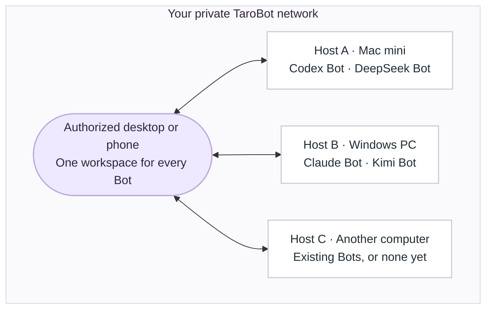
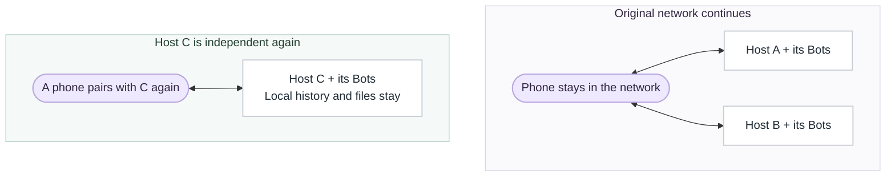
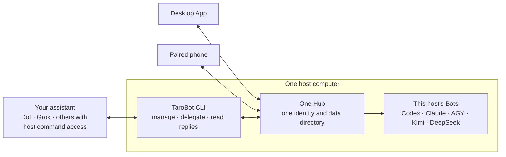
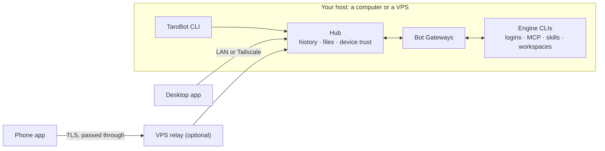

# TaroBot details

[中文](details.zh-CN.md) · [Back to README](../README.md) · [Documentation index](README.en.md)

The README keeps the overview; the detailed sections that used to live there are collected here.

[Features](#features) · [Engines and permissions](#engines-and-permissions) · [Private network](#private-network) · [Bot-to-Bot tasks](#bot-to-bot-tasks-across-hosts) · [TaroBot CLI](#run-a-host-without-a-desktop-window) · [Replies and queues](#live-replies-and-pending-prompts) · [Isolation and sharing](#bot-isolation-and-sharing) · [Architecture](#architecture) · [Where data goes](#where-your-data-goes) · [Updating](#updating-an-existing-installation) · [Build from source](#build-from-source) · [Project status](#project-status) · [Naming](#naming-and-compatibility)

## Features

| Area | Current capabilities |
| :--- | :--- |
| **Chats and organization** | Independent direct conversations, multi-Bot groups and topics; searchable history, quotes, forwarding, drafts and archives. Personal deletion and multi-select sync across your own devices. Custom folders with manual ordering; optional host grouping. Folders can be pinned and stay in sync across devices. |
| **Side conversations · desktop direct chats** | Temporary questions beside the main chat, using supported native paths in Codex, Claude and Kimi; closing clears the context. Open with the button, `/side` or ⌘⇧K. Excluded from ADHD and mobile. [Usage and boundaries](client/side-conversations-2026-10-22.md). Voice recorded in a side conversation is transcribed by the host before it reaches the model. |
| **ADHD · desktop only** | [Several conversations on one board](../README.md#adhd-workspace), with independent drafts and inputs. Up to 12 panes, automatic or 2–6-column layout, and separate text size. Reuses existing chats across connected hosts. |
| **Native run presentation** | Streaming Markdown, code blocks, tables, plans and engine-exposed reasoning/tool events. Expand the process to inspect commands, output and available file changes; answer questions and approvals in the chat. During a Claude Code run you can add input directly, and `/tasks` lists background tasks with individual stop controls. |
| **Model and effort** | Switch model and effort beside the desktop direct-chat composer, with quick selections; ADHD panes use Bot settings. |
| **Interactive replies and review** | [Inline charts and local filters](../README.md#conversation-features), with expansion, history and a text fallback. Per-run recorded file edits; desktop line comments sent back as a follow-up. |
| **Group discussion modes** | Ordinary addressed chat, independent parallel replies to you, ordered roundtable and independent first-round review; configurable order, round limits and explicit pause/resume/end controls. |
| **Pending prompts** | Desktop queue panel with drag-and-drop or move buttons; full-screen phone queue with move, edit and cancel. Execution order stays separate from the chronological chat. |
| **Bots and collaboration** | Create and configure Bots on online hosts; owner-controlled deletion of managed Bots retains history and files. [Visual Agent Bus on desktop](../README.md#agent-bus-workspace) saves workflows with per-step tasks and progress beside member conversations. Agent Bus, including `/ask`, `/fan`, `/chain`, `/verify` and research crews, stays within one host. Same-host direct-message permissions are managed in **Settings → Bot message permissions**. |
| **Cross-host Bot messages** | An authorized Bot sends text and files to a specific Bot conversation on the same or another host, then waits for its reply and files. Dedicated collaboration chats by default, durable queues and visible source identity. [Usage](#bot-to-bot-tasks-across-hosts). |
| **Files** | Combined text and attachments, file-type icons, preview and downloads; default 512 MiB per file, resumable transfer and integrity checks. Text/code, PDF, Word, Excel, audio and video previews; desktop reveal-in-folder; phone save/share/open actions. A full-screen image viewer supports copying from its context menu; videos show real covers in their original aspect ratio. |
| **Connections** | LAN, Tailscale and up to eight VPS relay routes can coexist, with automatic selection of the most stable, responsive route; host addresses and ports can be viewed and copied. [Connection options](../README.md#connection-options). |
| **Scheduled work** | One-time, daily, weekday, weekly or Cron tasks with timezone and destination chat. The selected Bot host must stay online; clients can close. |
| **Management** | Bot activity and reported usage, run history, audit logs, File Center, Skills/MCP inventory, host diagnostics, backup/restore and CLI runtime updates. Discovered Skills/MCP configuration does not prove a live connection. Automatic backup retention is configurable, with a one-day default. |
| **Personalization** | English/Chinese, light/dark/system, Porcelain/classic/Monochrome/Terminal CLI/Pixel themes. Compact/Standard/Spacious density; new phone preferences default to Compact, desktop to Standard. Separate conversation, Bot, group and personal avatars. **Interface animations** can be turned off per device. |
| **Optional integrations** | Host-wide local/cloud/automatic voice routing, search MCP and background phone notifications. These need additional host/account setup; the installer does not provision models, keys or push services. [Integration setup](integrations.md). |


## Engines and permissions

### Engine comparison

Install and sign in to an engine on the computer that will run the Bot, under the same operating-system account as TaroBot; one engine is enough to start. TaroBot does not include AI engines, model accounts or credits, and phones or computers used only for remote control need none.

| Engine | Host command | Mid-run input | Adapter notes |
| :--- | :--- | :---: | :--- |
| Codex | `codex` | Yes | app-server sessions, native questions and scoped approvals |
| Claude Code | `claude` | Yes | Native compact; exposed reasoning, tool, subagent and background events retain their source |
| Kimi Code | `kimi` | — | ACP sessions and native compact; no per-turn usage or native goals in the current adapter |
| DeepSeek Harness | `dsh` | Yes | Native goals and token budgets; no dollar-cost reporting |
| Antigravity | `agy` | — | Host/account model discovery, including Gemini 4 Argon when available; no manual compact |

Before creating a Bot, run a simple request with the chosen CLI in the host's terminal. Detecting an executable does not prove sign-in, quota or model access, and an engine installed on one host is not installed on other hosts or relays.

### Models, effort and permissions

Models and effort levels depend on the target host, account and CLI version. App creation and `tarobot bots catalog` use that host's catalog. AGY's verified Argon variants are **Low, Medium and High**; new App Bots prefer Argon Medium only when the host advertises it. Existing Bot choices are preserved. The current Argon catalog does not offer xhigh/max. [Argon selection details](host-cli.md#agy-的-gemini-4-argon).

Effort, model, persona, permissions and default workspace belong to the **Bot**, so a change can affect all its conversations, groups and topics. “Use defaults” removes an override; it does not disable reasoning. A conversation avatar changes only that conversation; Bot messages keep the Bot avatar.

Ordinary desktop direct-chat inputs expose model and effort controls beside Send. ADHD panes keep the compact input; use Bot settings to change those choices there.

**Default permissions are broad:** most adapters default to full access/Bypass; Kimi defaults to YOLO, which can still ask about sensitive actions. Choose the desired mode under **Permissions & approvals**. Claude Auto, Kimi Auto and AGY's whole-turn approval have different meanings; separate Bot processes are not OS sandboxes. [Permission modes](permissions.md) · [Capability map](client/capability-map.md) · [Effort settings](client/effort-settings.md).

## Private network

**Each computer joins with its own Bots, and every authorized desktop or phone can use the online Bots on every host in the network.** A computer can join before it has any Bots.



- **Join by computer.** Name the computer, pair it by QR code, then confirm adding it in **My network**. A phone joins as a controller and does not run Bots.
- **Choose where work runs.** Pick any online host when creating a Bot. The desktop combines all hosts by default, with an optional **Group by host** checkbox, and source labels show where each Bot runs.
- **Data stays with its host.** Bots, conversations, workspaces and files remain on the host that owns them; the shared view neither moves Bots nor merges host databases. A group currently contains Bots from one host.

The diagram shows a shared workspace, not a central server: clients connect directly to each Bot's host over LAN, Tailscale or an optional VPS relay, and a relay only forwards traffic.

<details>
<summary><b>When one computer leaves, the phone stays with the network</b></summary>

After member **Host C** leaves, it runs independently with its own Bots and local data. The phone stays in the network with **Hosts A and B**, even if it originally joined by scanning C. C and its Bots leave the network's active lists, and reaching C again requires fresh pairing.



Before a voluntary departure, independent phones must already have access to at least one remaining host. Removing a member revokes its host identity in the original network; rejoining requires a new host identity.

The first host coordinates membership changes, so it must be online to confirm joins and departures, and it cannot leave while other members remain. While it is offline, enrolled devices can still use the other reachable hosts. See [setup, departure rules and verification](client/private-network.md).

</details>

Use current App and host releases across participating devices. Joining a computer and pairing a controller are separate confirmations. Revoking a device affects its access across the network, but does not remove that computer as a host or delete its Bots. [Membership and revocation rules](client/private-network.md)


## Bot-to-Bot tasks across hosts

**Let a Bot hand work to another Bot, with text, files and a reply.** Ask the Bot on your Mac to send a report to the reviewer Bot on your Windows PC and bring back its comments and file. The same flow works between two Bots on one host.

**Available since App 1.0.83 / CLI 0.1.431.** Use a current matching release on both hosts and the calling CLI; the feature minimum is not a recommendation to install an older runtime. Database schema support is declared in each package and release note. Follow the [upgrade instructions](host-cli-update.md); do not open an upgraded database with the old runtime.

Same-host permissions are managed in **Settings → Bot message permissions** (phone: **Me → Settings**). Version 1.2.0 adds a **Cross-host** scope on the receiving host: choose the source host/Bot and local recipient, then allow or revoke. Its [workflow and recovery rules](client/cross-host-message-permissions.md) share the existing grant records. You can also authorize through a registered CLI terminal **on the recipient's host**:

```sh
tarobot messages allow --from "Mac mini/SOURCE_BOT_ID" --bot "Reviewer" --json
```

The grant permits listing the recipient Bot's conversation names and sending tasks to its conversations; reply access is limited to the sender's own requests. Once authorized, ask your Bot to do the handoff in chat. The Bot uses these commands:

```sh
# Find conversations by exact host and Bot name, or use their stable IDs.
tarobot conversations list --host "Windows PC" --bot "Reviewer" --json

# No conversation specified: use this sender's dedicated collaboration chat.
tarobot messages send --to "Windows PC/Reviewer" \
  --text-file ./task.txt --file ./report.pdf \
  --request-id UNIQUE_TASK_ID --context-message CURRENT_INPUT_ID --json

# Use the resolved IDs returned by send.
tarobot messages wait --to "HOST_ID/BOT_ID/CONVERSATION_ID" \
  --message MESSAGE_ID --timeout 120 --out ./replies --json
```

`CURRENT_INPUT_ID` comes from the sending Bot's current-turn instructions. In an owner's terminal, add `--source-bot LOCAL_BOT_ID` to **all three commands** and omit `--context-message`. Add a third segment to `--to` to select a specific conversation. Names must match exactly and uniquely; ambiguous names return candidates rather than picking a target.

Use a new `UNIQUE_TASK_ID` for each new task and retain it for any manual recovery of that same send. For a Bot, input files must exist within its permitted workspace/output paths; `--out` selects where verified reply files are saved.

- **Predictable delivery:** tasks enter the recipient's existing durable queue. They do not interrupt a run or answer a question/approval card. After a `wait` timeout, repeat `wait` with the same message and target IDs. If `send` disconnects without a receipt, check its outcome and recover only with the same request ID, target and content; do not automatically resend or switch to a new ID.
- **Visible and controlled:** the recipient sees the source host, Bot and forwarding depth. Explicit grants, revocation, a three-hop limit, rate limits and audit records bound the exchange.
- **Agent Bus stays local:** `/ask`, `/fan`, `/chain` and `/verify` retain their current host-local behavior. Cross-host messages are ordinary tasks, not remote control commands.

Real Mac mini ↔ Windows text/file/reply round trips and same-host Bot-to-Bot delivery passed using isolated Hubs and real Codex Bots. This verifies the transport, not every engine or a new installer. [Design, receipts and remaining verification](client/cross-host-bot-messages-2026-10-17.md#验证记录).

## Run a host without a desktop window

**TaroBot CLI runs your Bot host without opening the desktop App.** Keep it running on a computer or server, then use an authorized phone or desktop to send tasks, answer approvals and receive results and files.

[Installation and commands (中文)](host-cli.md) · [Upgrade and rollback](host-cli-update.md) · [Earlier audit: 2026-10-14](host-cli-audit-2026-10-14.md)

**One host, multiple entry points.** With compatible versions, the desktop and TaroBot CLI use the same host identity, Bots, history and files. The CLI manages the local host; the AI engine CLIs execute its Bot tasks. Installing the TaroBot CLI does not install or sign in to Codex, Claude, Antigravity, Kimi or DeepSeek.

### An assistant for your assistant

An assistant with command access to your TaroBot host can use `tarobot bots list`, `conversations list`, `messages send` and `messages wait` to find Bots, hand off work and bring back their replies. JSON output lets it read the results, while you can follow the same conversations in the App.

For example, tell your assistant: **“Ask the Codex Bot in TaroBot to implement this change, have the Claude Bot review it, then bring me the result.”** The same pattern works for research, writing and file processing. Dot, Grok and other assistants can act as the entry point when equipped with host command access; TaroBot supplies the Bots they can call.

Task delegation uses the existing [Bot messaging permissions](#bot-to-bot-tasks-across-hosts). External terminal callers select a local source Bot with `--source-bot`; the recipient's owner grants access first. See the [CLI command guide](host-cli.md#跨主机-bot-消息) for the complete flow.



| How you want to use it | What to run |
| :--- | :--- |
| Desktop and phone | The desktop installer includes the Hub. The separate TaroBot CLI is optional. |
| Phone, with no desktop App on the host | Install the TaroBot CLI and the AI engine CLIs you need on the host. Pair the phone with that host. |
| Desktop and command-line management | Connect both to the same host. Only one process owns its data directory; do not run two Hubs against it. Check desktop compatibility before changing the service owner. |

The CLI provides Bot management, device pairing/revocation, private-network membership, status/logs/diagnostics, updates/rollback and backup/restore. Each computer still keeps its own Bots and data when joining or leaving the private network; a phone remains an independent member. The CLI does not create another network or copy the desktop host.

<details>
<summary><b>Install and start a new headless host</b></summary>

Install Node.js 22.12 or later (official Node 24 recommended), and prepare at least one [AI engine CLI](../README.md#supported-engines) under the same system account. On macOS, service installation also needs Xcode Command Line Tools for runtime verification (`xcode-select -p` checks availability). Download the matching standalone CLI archive from [Releases](https://github.com/cloveric/tarobird/releases), then run from its directory, replacing `VERSION` with the version in the actual filename:

```sh
npm install -g ./tarobird-VERSION.tgz
tarobot --version
tarobot init --name "Mac mini"
tarobot doctor
tarobot service install
tarobot start
tarobot pair --lan
tarobot devices pending
tarobot devices approve 12345678
```

Replace `12345678` with the actual code displayed by your phone. `tarobot run` is the foreground alternative: closing that process stops its host. With the service installed, `tarobot start` asks the background service to run; the command can exit while the host stays online. Use `tarobot status`, `tarobot doctor` and `tarobot logs` to inspect it.

These are current-user services, normally started at login. The computer must stay awake and reachable; shutdown or logout affects availability. Away-from-home access needs reachable Tailscale or an already configured VPS relay. Pairing commands do not deploy a relay.

</details>

**Existing desktop host:** retain its original identity and local data directory. Use compatible desktop and CLI versions, stop the original host normally, then follow the [service ownership guide](host-cli.md) before switching startup methods. Do not let an older desktop App and a new service compete to start it. Do not copy a running host's state to another computer or share its state directory through a network/sync drive.

**Commands, not a second host implementation:** `tarobot bots`, `devices`, `network`, `queue`, `status`, `doctor`, `logs` and `update` manage the selected local host. A remote computer's Bots remain owned by that computer. Host features use the same APIs and rules as the Apps; visual-only features need no terminal equivalent. This is a [project maintenance rule](../AGENTS.md#desktop-mobile-and-cli-evolve-together), including publishing the CLI alongside host-affecting App releases.

## Live replies and pending prompts

**The chat is a timeline; the queue controls what runs next.** A Bot reply can sit between several user messages without changing their execution order.

| Action | Where and what it changes |
| :--- | :--- |
| Move the next prompt earlier/later | Open **Pending** near the composer. Desktop supports dragging and move buttons; phone uses a full-screen page with move buttons. History bubbles stay where they were sent. |
| Edit or cancel | Only ordinary messages still held by the host can be changed. Editing keeps attachments and quotes; cancellation keeps the history and does not stop the current task. Dispatched items are locked. |
| Add to the running task | Codex and DeepSeek Harness use the separate **Steer** action. In Claude Code, ordinary text sent during a run supplements the current turn, while **Send as next turn** queues it (from 1.0.106). None of these reorder the queue. |
| Answer a question or approval | Submit in its card. Sending a new ordinary chat message queues another task; it is not guessed to be the answer. |
| Check which prompt was answered | A quiet marker beside the user-message time shows replying, replied or reply failure. Waiting, stopped, interrupted and unconfirmed states remain distinct. No reliable reply evidence means no marker. |

Queue controls require a compatible host and worker, and currently apply to **direct conversations**, not groups/topics. All five engines can use this host-held queue; it is not a mirror of their native CLI queues. `tarobot queue list/move/edit/cancel` uses the same state and conflict checks. [Queue behavior](client/prompt-queue-2026-10-14.md) · [Reply markers](client/user-reply-status-2026-10-16.md).

Run cards keep the final answer readable and the process expandable. Tool errors remain visible in the process, but a failed tool attempt alone does not label the whole task failed. Claude background/subagent events keep their own scope rather than becoming a reply to an unrelated prompt. Reasoning shows only what the engine actually exposes, never a fabricated private thought process or progress percentage. [Claude event coverage](client/claude-scoped-process-2026-10-15.md).

### Phone notifications

The intended system notifications are **reply completed, file received, and attention needed**. They require a configured host push service, a compatible App build, device registration and OS notification permission. Turning on the setting alone is insufficient. Production background/lock-screen delivery was **not verified for this release**. [Setup and delivery gates](client/message-notifications-2026-10-14.md).

## Bot isolation and sharing

**One Bot can have many independent conversations while keeping the same persona.** Conversation context, Bot settings and files have different scopes:

| When you… | What stays separate or is shared |
| :--- | :--- |
| Open another chat with the same Bot | The new chat has its own engine session by default. Both chats use the Bot's persona, engine, model, effort, permission settings and default workspace. Changing those Bot settings affects all its chats, groups and topics. |
| Create another Bot | It has its own Bot configuration, persona file, session store and supervised process. Leaving its workspace unset creates a separate folder. Another Bot's private transcript is not automatically added to its prompts. |
| Use groups or topics | Each Bot has its own session in each conversation or topic. The group shares the messages routed to its Bots according to recipients and reply mode; it does not import their separate private chats. |
| Point Bots at the same project folder | They read and edit the same files, including project instructions and any memory files they discover. TaroBot does not create a separate Git branch or file copy for each chat or Bot. Concurrent work can touch the same files. |
| Continue an existing session | An explicit `/resume` or **Continue an existing session** selection reuses that engine context. Chats bound to the same session share context, and their turns are serialized. The selection applies when the next message is processed. |
| Switch devices or hosts | Devices paired with the same Hub see the same conversations. Different Hubs keep separate Bots, histories and settings; connecting both in one app does not merge them. |

**Persona and memory.** The owner can edit the Bot's persona from **Bot settings → Persona** or the Bot section of conversation details. It applies to subsequent work with that Bot; a new chat does not create a new persona. Memory files persist independently of chat sessions and are read according to the engine's rules or your instructions. TaroBot does not automatically put every earlier chat into every new prompt. A new chat or `/reset` starts fresh context without deleting the persona or workspace files; `/reset` also keeps the visible chat history.

**Sharing on purpose.** Forwarding content or using enabled Bot delegation passes the selected content or task to another Bot. These are explicit ways to collaborate across conversations, alongside shared files and session recovery.

**Access boundary.** Separate Bot processes and sessions are not operating-system sandboxes. Native engine logins and user-level configuration, Skills, MCP servers or memory may be shared with other Bots and your normal CLI. File access follows the host account and the engine's permission mode; a separate workspace folder alone does not prohibit access outside it. See [shared engine-home boundaries](security-boundaries.md#6-shared-or-linked-engine-home-boundary) and [permission modes](permissions.md).

## Architecture



- **The Hub is the system of record.** It holds history, attachments, device trust, read state and Bot metadata. Devices cache what they have seen, remain readable offline and send queued text once they reconnect.
- **Engines run on the host,** using that host's logins, files and tools; nothing about an engine is installed on the phone. Every Bot created in the App runs as its own supervised process.
- **A relay only forwards.** It passes encrypted traffic through and keeps no chat or file cache. The Hub stores history and files on its own host, so a Hub on a VPS keeps your data on that VPS.
- **Several hosts mean several Hubs.** Their histories are never merged, and Bots, groups, sessions, workspaces and settings stay with the host that owns them.

| Where the Bots run | How devices reach them | What must stay online |
| :--- | :--- | :--- |
| Your own computer | LAN HTTPS, Tailscale or a VPS relay | That computer, plus at least one relay if you use relays |
| A VPS, reached directly | HTTPS to the VPS | The VPS |
| A VPS, behind other relay VPSs | Through one or more relays | The host VPS and at least one relay |

VPS routes need no VPN on the phone. For each host, a device can keep one direct address and up to eight VPS routes: it fails over when a route drops and returns to the preferred route once it is stable. Backup routes lead to the **same** Hub rather than a standby copy, so when the host is down, every route is down.


## Where your data goes

- **History and files:** the owning Hub stores them on its host; paired devices keep a local cache. The durable attachment library is separate from Bot workspace copies in `.tarobot-files` and generated output in `.tarobot-out`.
- **Model requests:** prompts and files used by an engine may go to its model provider. A self-hosted Hub does not make a cloud model local.
- **Voice:** local transcription requires the configured ASR runtime and model. All-cloud mode uploads every recording; automatic mode uploads those meeting the duration threshold. Models and private credentials are not bundled. [Integration requirements](integrations.md).
- **Links:** preview fetches go through the Hub without browser login cookies; private-network targets are blocked.
- **Transport:** remote connections use TLS. Native clients bind the TLS certificate to the trusted Hub identity; browser preview does not provide the same binding and is for trusted development use. Application-layer end-to-end encryption is not implemented. [Security model](client/security.md).

## Updating an existing installation

**App and bundled/standalone CLI use the same product version from 1.1.0.** See [versioning](versioning.md). Current packages are in [Releases](https://github.com/cloveric/tarobird/releases). Clients still using the historical repository need a one-time manual upgrade; see [migration](repository-migration.md). Android through 1.1.1 also needs one manual download of the TaroBird-named APK, installed over the existing App with the same signing key; do not uninstall it. Phone delivery also requires a configured host, system permission and device registration. Updating a phone does not upgrade a remote host. Mac (from 1.0.85), Windows (from 1.0.86) and Android (from 1.0.89) install signed in-app updates after GitHub sign-in; earlier versions need one manual upgrade first. Publishing a package does not restart installed software.

| Installation | Update path |
| :--- | :--- |
| Mac desktop-managed host | From 1.0.85, use **Settings → General → App updates** and sign in to GitHub. Older versions need one bootstrap DMG upgrade. The updater waits for active work and preserves application data. |
| Windows desktop-managed host | From 1.0.86, use **Settings → General → App updates** and sign in to GitHub. Earlier versions need one manual install of the new package, preserving application data. Let active work finish before restarting. |
| Android | Install 1.0.89 once using the same-signer APK. Subsequent updates are available in **Me → Settings → General → App updates** after GitHub sign-in; Android asks for installation confirmation. Do not uninstall merely to upgrade. |
| CLI-managed host | Install the new CLI, stage its complete standalone package with production dependencies, inspect `update status` and `update apply REVISION --dry-run`, then apply the selected revision. Follow the [upgrade guide](host-cli-update.md). |
| Private network | Update the participating Apps and the hosts providing the features. Keep host identities and pairing; an upgrade is not a reason to create a new network. |

Installing a new CLI command does **not** switch an already frozen background runtime. Updates and rollback check ownership and schema compatibility and wait for active tasks; a timeout is not permission to kill them. The upgrade recovery copy excludes workspaces—use a full backup when you need them. Never point an older executable at a newer database without a supported rollback path.

## Build from source

Source development targets Node.js 24 (`.nvmrc`) and npm. The published CLI's broader Node range is a compatibility floor, not the client build requirement. You also need repository access and an authenticated AI CLI on the Bot host.

```sh
git clone https://github.com/cloveric/tarobird.git
cd tarobot
npm ci
npm ci --prefix client
npm run build
npm run build --prefix client

# Separate development state; binds only to loopback
node dist/src/index.js init --name "Development" --state-dir "$HOME/.tarobot-dev/hub"
node dist/src/index.js hub run --state-dir "$HOME/.tarobot-dev/hub"
```

Open the local address printed by the host, name the device and request pairing. Approve its actual code from another terminal:

```sh
node dist/src/index.js hub devices approve '<code-on-screen>' --state-dir "$HOME/.tarobot-dev/hub"
```

Do not use production state for development. Other devices cannot reach the host through `127.0.0.1`; follow [Getting started](getting-started.en.md) for remote listeners.

| Task | Command / requirements |
| :--- | :--- |
| Host regression | `npm test`; build with `npm run build` |
| Client validation | `npm run build --prefix client` (translations, TypeScript, production assets) |
| Browser regression | In `client/`, run `npx playwright install chromium`, then `npm run test:e2e`; run macOS WebKit only on [isolated CI](client/playwright-keychain-isolation.md) |
| Desktop development | `npm run desktop:dev --prefix client`; Rust and platform build tools required |
| Android/iOS project sync | `npm run mobile:sync --prefix client`, then `android:open` / `ios:open`; Android SDK/JDK or Xcode required |
| Standalone distribution | `npm run pack:standalone`; use the [release checklist](release-checklist.md) for launcher/native toolchains, dependencies and packaging |

Project sync and cross-compilation are not device acceptance. Desktop/mobile packaging has platform-specific tools and signing prerequisites; the Node source setup alone is not a full release environment.

### Standalone distribution and optional integrations

The standalone host includes the shared client, Hub, Gateway, engine helpers and relay runtime. The retired Feishu/Telegram transports and SDK package are no longer included in the repository. Shared App/CLI regressions and existing-data compatibility are retained; Bot-chosen business Skills/MCP tools remain independent of App transport. [Retirement scope](adapter-retirement-2026-10-21.md). [Module boundaries](standalone-core.md) · [Search and voice setup](integrations.md).

## Project status

Current downloads, English release notes and platform-specific validation are recorded in [Releases](https://github.com/cloveric/tarobird/releases) and the [release verification records](releases/). Check the record for the exact version: source tests, signed packages, store processing and physical-device acceptance are separate evidence. Historical validation does not certify a newer package. [Acceptance gates](client/acceptance-gates.md)

## Naming and compatibility

**TaroBird** is the product; the active repository is `cloveric/tarobird`. New installers use TaroBird names. New working attachments and generated files use `.tarobot-files` / `.tarobot-out`; shared configuration uses neutral names such as `bot.env`. Existing paths, session IDs and stored data remain readable. Native bundle IDs, URL schemes, keychain entries and existing state roots retain compatibility names such as `tarocub`; changing their labels is not a data migration. Existing persisted protocol fields keep their compatible identifiers; owner-selected external integrations retain their actual platform names. [Naming contract](neutral-naming.md).

Credentials, chat databases, private attachments and raw local acceptance data stay out of source control. Release installers are published as release assets; curated demo images and sanitized verification summaries are included in the repository.
