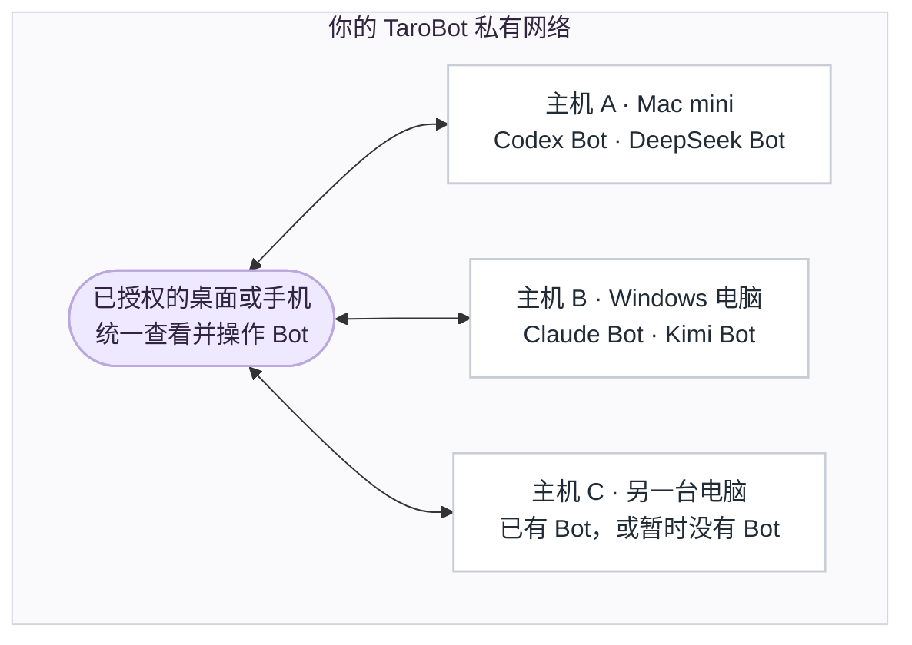
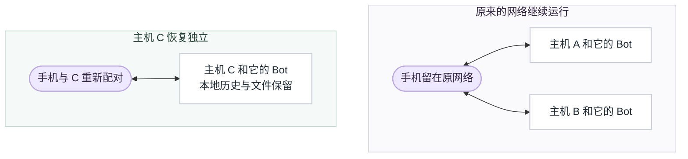
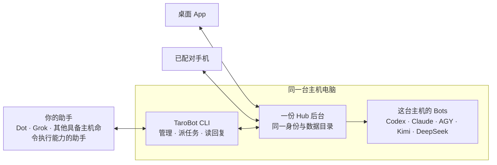
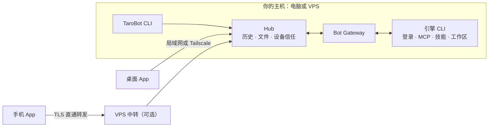

# TaroBot 详细说明

[English](details.md) · [返回首页](../README.zh-CN.md) · [文档导航](README.md)

首页只保留概览，原来首页上的详细说明集中放在这里。

[功能清单](#功能清单) · [引擎与权限](#引擎与权限) · [私有网络](#私有网络) · [Bot 间派任务](#bot-给-bot-派任务支持跨主机) · [TaroBot CLI](#不开桌面窗口也可以运行主机) · [回复与排队](#回复过程与排队消息) · [隔离与共享](#bot-隔离与共享) · [系统架构](#系统架构) · [数据去向](#数据会去哪里) · [升级](#已有安装如何升级) · [源码构建](#从源码构建) · [开发状态](#开发状态) · [名称与兼容](#名称与兼容)

## 功能清单

| 方面 | 当前能力 |
| :--- | :--- |
| **对话与整理** | 独立私聊、多 Bot 群组及群内话题；搜索、引用、转发、草稿和归档。个人消息删除与多选同步自己的设备。自定义分组可手动排序，也可选择按主机分组。 分组可置顶，并在各设备间同步。 |
| **侧边对话 · 仅桌面单聊** | 主对话右侧的临时问答，支持 Codex、Claude、Kimi 已接入的原生路径；关闭后清理。入口按钮、`/side` 或 ⌘⇧K；ADHD 与手机不显示。[使用与边界](client/side-conversations-2026-10-22.md)。 侧边对话中的语音先经主机转写，再发送给模型。 |
| **ADHD · 仅限桌面端** | [多个对话同屏展开](../README.zh-CN.md#adhd-workspace)，各自保留草稿与输入框。最多 12 个面板，自动或每行 2–6 列，独立设置字号；复用已连接主机上的原有对话。 |
| **原生执行过程** | 流式 Markdown、代码块、表格、计划，以及引擎公开的思考和工具事件。展开过程可查看命令、输出及实际可用的文件变更；在对话中回答问题、处理审批。 Claude Code 运行中可直接补充输入，并可通过 `/tasks` 查看、单独停止后台任务。 |
| **模型与 effort** | 桌面私聊输入框旁可直接切换模型与 effort，并提供快捷选项；ADHD 面板通过 Bot 设置调整。 |
| **可视化回复与审阅** | [聊天内图表和本地筛选](../README.zh-CN.md#conversation-features)，支持放大、历史恢复和文字摘要；保存每轮文件编辑，桌面行内批注可作为后续消息发回 Bot。 |
| **群聊讨论方式** | 普通指定回应、全员各自回复你、按顺序轮流讨论、首轮独立评议；可设置发言顺序和轮数，主动暂停、恢复或结束。 |
| **待执行消息** | 桌面队列面板支持拖动或按钮移动；手机全屏队列支持移动、编辑、取消。执行顺序与按时间排列的聊天记录分开。 |
| **Bot 与协作** | 在在线主机上创建、配置 Bot；拥有者可删除受管 Bot，保留历史和文件。[桌面可视化 Agent Bus](../README.zh-CN.md#agent-bus-workspace) 可保存协作流程、逐环节设置任务，并在成员对话旁跟进进度。Agent Bus（包括 `/ask`、`/fan`、`/chain`、`/verify` 与研究团队）仍限于同一主机。 同一主机内的 Bot 直接消息授权可在「设置 → Bot 消息授权」中管理。 |
| **跨主机 Bot 消息** | 已授权 Bot 可向同机或另一台主机上的指定 Bot 对话发送文字、文件，等待并取回回复及文件。默认使用独立协作对话，遵守持久队列，界面显示来源。[用法与发布边界](#bot-给-bot-派任务支持跨主机)。 |
| **文件** | 文字与附件同条发送，文件类型图标、预览、下载；单文件默认 512 MiB，支持断点传输与完整性校验。文本/代码、PDF、Word、Excel、音视频预览；桌面打开文件位置，手机保存、分享或用其他应用打开。 全屏图片查看器支持右键复制；视频显示真实封面并保持原始比例。 |
| **连接** | 局域网、Tailscale 与最多 8 条 VPS 中转线路可同时保留，自动选择稳定、响应更快的线路；可查看、复制主机地址与端口。[联机方式](../README.zh-CN.md#联机方式)。 |
| **定时任务** | 一次性、每日、工作日、每周或 Cron，指定时区与结果对话。所选 Bot 主机需在线，客户端可以关闭。 |
| **管理** | Bot 活动和已上报用量、运行记录、审计日志、文件中心、Skills/MCP 清单、主机诊断、备份恢复及 CLI 运行时更新。发现配置不等于已确认连接成功。 自动备份的保留时长可设置，默认 1 天。 |
| **外观** | 中英文、浅色/深色/跟随系统、白瓷/经典/黑白/终端 CLI/像素主题。紧凑/标准/宽松三种密度；手机未保存偏好时默认紧凑，桌面默认标准。对话、Bot、群组和个人头像分别设置。 可按设备关闭「界面动画」。 |
| **可选集成** | 主机统一管理本地／云端／自动语音路由，另支持搜索 MCP 和手机后台通知。需要额外的主机或账号配置；安装包不会自动准备模型、密钥或推送服务。[集成说明](integrations.md)。 |


## 引擎与权限

### 引擎对照

请在实际运行 Bot 的电脑上，以运行 TaroBot 的同一系统账户安装并登录引擎，安装其中一种即可开始使用。TaroBot 不附带 AI 引擎、模型账号或额度；手机以及仅用于远程操作的电脑无需安装。

| 引擎 | 主机命令 | 执行中追加指令 | 适配说明 |
| :--- | :--- | :---: | :--- |
| Codex | `codex` | 支持 | app-server 会话、原生提问与分级审批 |
| Claude Code | `claude` | 支持 | 原生 compact；思考、工具、子代理与后台事件保留各自来源 |
| Kimi Code | `kimi` | — | ACP 会话与原生 compact；暂不提供逐轮用量与原生 goal |
| DeepSeek Harness | `dsh` | 支持 | 原生 goal 与 token 预算；不提供美元费用统计 |
| Antigravity | `agy` | — | 按主机与账号发现模型，可用时包含 Gemini 4 Argon；不支持手动 compact |

创建 Bot 前，请先在主机终端用所选 CLI 完成一次简单请求。检测到程序并不代表已登录、有额度或有模型权限；引擎只安装在当前主机，不会同步到其他主机或中转服务器。

### 模型、effort 与权限

模型与 effort 档位以目标主机、账号和 CLI 版本为准；App 新建 Bot 与 `tarobot bots catalog` 使用该主机的目录。已核实的 AGY Argon 档位为 **Low、Medium、High**；只有主机实际列出 Argon Medium 时，App 新建 Bot 才优先选择它。已有 Bot 的模型不变，当前 Argon 目录不提供 xhigh/max。[Argon 选择说明](host-cli.md#agy-的-gemini-4-argon)。

effort、模型、人设、权限和默认工作区属于 **Bot**，修改可能影响使用它的所有对话、群组和话题。“跟随默认”只是取消覆盖，不等于关闭思考。对话头像只影响对应对话，Bot 发言仍用 Bot 头像。

普通桌面私聊的模型与 effort 入口位于输入框右侧、发送按钮旁。ADHD 面板保留紧凑输入，通过 Bot 设置调整这些选项。

**默认权限较宽**：多数适配器默认完全访问/Bypass；Kimi 默认 YOLO，敏感操作仍可能询问。在**权限与批准**中选择需要的模式。Claude Auto、Kimi Auto 与 AGY 的整轮审批含义不同；独立 Bot 进程不等于操作系统沙箱。[权限模式](permissions.md) · [能力对照](client/capability-map.md) · [effort 说明](client/effort-settings.md)。

## 私有网络

**每台电脑携带自己的 Bot 加入网络；任何已授权的桌面或手机，都能使用网络中所有在线主机上的 Bot。** 尚未创建 Bot 的电脑也可以先行加入。



- **以电脑为单位加入。** 为电脑命名、扫码完成配对，再在「我的网络」中确认加入。手机以控制端身份加入，不运行 Bot。
- **自由选择运行位置。** 新建 Bot 时选择任一在线主机。桌面端默认合并展示所有主机，也可勾选「按主机分组」；来源标识会注明 Bot 所在的主机。
- **数据各归其主。** Bot、对话、工作区与文件始终保存在所属主机，统一视图不会迁移 Bot，也不会合并各主机的数据库。目前一个群组中的 Bot 需来自同一台主机。

图中展示的是统一工作台，而非中央服务器：各端直接连接 Bot 所属的主机，可经由局域网、Tailscale 或可选的 VPS 中转，中转仅负责转发。

<details>
<summary><b>一台电脑退出后，手机仍留在原网络</b></summary>

成员**主机 C** 退出后，将携带自己的 Bot 与本地数据独立运行。手机继续留在**主机 A、B** 所在的网络中，即使它最初扫描的是 C 的二维码。C 及其 Bot 会从原网络的活跃列表中移除；如需再次访问 C，需要重新配对。



主动退出前，独立的手机需已获得至少一台保留主机的访问权限。移除成员会撤销该主机在原网络中的身份；再次加入需要使用新的主机身份。

第一台主机负责确认成员变更，成员加入或退出时需要它在线；仍有其他成员时，它自身不能退出。它离线期间，已授权的设备仍可正常使用其他可达的主机。详见[组网设置、退出规则与验证范围](client/private-network.md)。

</details>

参与组网的设备与主机请使用最新的发布版本。电脑加入网络与控制端配对是两次独立的确认。撤销设备授权会影响它在整个网络中的访问，但不会让电脑退出网络，也不会删除 Bot。[成员与撤销规则](client/private-network.md)


## Bot 给 Bot 派任务，支持跨主机

**让一个 Bot 把任务、文字和文件交给另一个 Bot，再取回回复。** 在聊天中告诉 Mac 上的 Bot：“把报告交给 Windows 电脑的审阅助手，再取回意见和文件。”同一台主机上的两个 Bot 也可以这样协作。

**自 App 1.0.83 / CLI 0.1.431 起提供。** 两端主机与调用方 CLI 请使用当前匹配的发布版本，功能最低版本并非推荐安装的版本。请遵循[升级流程](host-cli-update.md)，不要让旧程序打开升级后的数据库。

同机权限在 **设置 → Bot 消息授权** 中管理（手机：**我的 → 设置**）。当前源码已新增接收主机上的 **跨主机** 页：选择来源主机/Bot 和本机接收 Bot，再允许或撤销。该 App 界面待下一版发布，[操作与恢复说明](client/cross-host-message-permissions.md)沿用现有授权记录。已发布版本仍可由拥有者在**接收方主机**已登记的 CLI 终端授权：

```sh
tarobot messages allow --from "Mac mini/SOURCE_BOT_ID" --bot "审阅助手" --json
```

这项授权允许来源 Bot 列出目标 Bot 的对话名称，并向它的对话发任务；回复读取仅限来源自己的请求。授权后，在聊天里让 Bot 完成委托即可。Bot 使用以下命令：

```sh
# 用精确的主机名、Bot 名查找对话，也可以直接使用稳定 ID。
tarobot conversations list --host "Windows 电脑" --bot "审阅助手" --json

# 不指定对话：使用为当前来源 Bot 单独建立的协作对话。
tarobot messages send --to "Windows 电脑/审阅助手" \
  --text-file ./task.txt --file ./report.pdf \
  --request-id UNIQUE_TASK_ID --context-message CURRENT_INPUT_ID --json

# 使用 send 返回的主机、Bot、对话和消息 ID。
tarobot messages wait --to "HOST_ID/BOT_ID/CONVERSATION_ID" \
  --message MESSAGE_ID --timeout 120 --out ./replies --json
```

`CURRENT_INPUT_ID` 来自发送 Bot 本轮的附加提示。在拥有者的普通终端中，**三条命令都加上** `--source-bot LOCAL_BOT_ID`，不传 `--context-message`。`--to` 加上第三段即可指定对话；名称必须精确且唯一，重名会返回候选，不会替你猜一个目标。

每个新任务使用新的 `UNIQUE_TASK_ID`，手动恢复同一次发送时保留原编号。由 Bot 发送时，输入文件必须已存在于它允许访问的工作区或输出路径中；`--out` 指定验哈希后的回复文件保存位置。

- **按队列执行**：任务进入目标现有的持久队列，不打断正在运行的任务，不会被当成问题卡答案或审批。`wait` 超时后，用相同消息和目标 ID 再次等待。`send` 断线且未收到回执时，先核对结果，只能用相同请求编号、目标和内容恢复这次发送；不自动重发，也不换新编号。
- **来源清楚、权限可控**：接收界面显示来源主机、Bot 和转发层数；支持明确授权和撤销，最多转发 3 层，并有限流及审计记录。
- **Agent Bus 仍在本机**：`/ask`、`/fan`、`/chain`、`/verify` 的范围不变。跨主机消息作为普通任务投递，不作为远程控制命令。

真实 Mac mini ↔ Windows 的文字、文件和回复双向往返，以及同机 Bot 间投递均已通过。验收使用隔离 Hub 和真实 Codex Bot，不代表所有引擎或新安装包都已验收。[设计、回执与验证边界](client/cross-host-bot-messages-2026-10-17.md#验证记录)。

## 不开桌面窗口，也可以运行主机

**TaroBot CLI 可以在不打开桌面 App 的情况下运行 Bot 主机**。 让电脑或服务器上的主机保持在线，就能从已授权的手机或桌面发送任务、回应审批、接收结果和文件。

[安装与命令说明](host-cli.md) · [升级与回滚](host-cli-update.md) · [历史 CLI 审计（2026-10-14）](host-cli-audit-2026-10-14.md)

**一台主机，多个操作入口**。 版本兼容时，桌面与 TaroBot CLI 共用同一个主机身份、Bot、历史和文件。TaroBot CLI 管理本机，AI 引擎 CLI 执行 Bot 的任务；安装 TaroBot CLI 不会替你安装或登录 Codex、Claude、Antigravity、Kimi、DeepSeek。

### 助手的助手

能在 TaroBot 主机上执行命令的助手，可以通过 `tarobot bots list`、`conversations list`、`messages send` 和 `messages wait` 查找 Bot、派发任务，再把回复带回来。CLI 的 JSON 输出方便助手读取结果，你也能在 App 里跟进同一段对话。

例如，你可以对自己的助手说：**“让 TaroBot 里的 Codex 改代码，再交给 Claude 复核，把结果带回来。”** 研究、写作和文件处理也可以这样分工。Dot、Grok 等助手接入主机命令执行能力后，就能作为你的交互入口，调用 TaroBot 里的 Bot 一起完成任务。

任务派发沿用现有的 [Bot 消息授权](#bot-给-bot-派任务支持跨主机)。外部终端调用方通过 `--source-bot` 指定本机来源 Bot，由接收方拥有者先授予访问权限。完整步骤见 [CLI 命令说明](host-cli.md#跨主机-bot-消息)。



| 你想怎么使用 | 需要运行什么 |
| :--- | :--- |
| 使用桌面和手机 | 桌面安装包已包含 Hub，不必另装 TaroBot CLI。 |
| 主机不装桌面 App，只用手机操作 | 在主机安装 TaroBot CLI 和需要的 AI 引擎 CLI，再让手机配对这台主机。 |
| 同时用桌面和命令行管理 | 两个入口连接同一份后台；同一数据目录只由一个 Hub 进程运行。切换后台启动方式前先核对桌面版本兼容性。 |

CLI 支持 Bot 管理、设备配对与撤销、私有组网、状态/日志/诊断、升级/回滚和备份/恢复。电脑加入或退出组网时，仍带着自己的 Bot 和数据；手机仍是独立成员。使用 CLI 不会另建一个网络，也不会复制桌面主机。

<details>
<summary><b>安装并启动一台新的无界面主机</b></summary>

准备 Node.js 22.12 或以上（建议官方 Node 24），并在同一系统账户下配置至少一种 [AI 引擎 CLI](../README.zh-CN.md#支持的引擎)。macOS 安装后台服务还需 Xcode Command Line Tools 检查运行时（用 `xcode-select -p` 检查是否可用）。新仓库暂未发布 Release；现有独立 CLI 压缩包保留在[私有历史档案](https://github.com/cloveric/tarobot/releases)，在下载目录执行以下命令，并将 `VERSION` 替换为文件名中的实际版本：

```sh
npm install -g ./tarobot-VERSION.tgz
tarobot --version
tarobot init --name "Mac mini"
tarobot doctor
tarobot service install
tarobot start
tarobot pair --lan
tarobot devices pending
tarobot devices approve 12345678
```

将 `12345678` 换成手机实际显示的配对码。也可以用 `tarobot run` 在终端前台运行，关闭该进程就会停止主机。安装服务后，`tarobot start` 会启动后台服务，命令结束后主机继续在线。用 `tarobot status`、`tarobot doctor`、`tarobot logs` 查看状态与排查问题。

当前用户服务通常在用户登录后启动；电脑需要保持唤醒和网络可达，关机或退出登录会影响在线状态。跨网连接仍需可达的 Tailscale 或已配置的 VPS 中转，配对命令不会自动部署中转。

</details>

**已有桌面主机**：保留原身份和本地数据目录，使用兼容的桌面与 CLI 版本。先正常停止原主机，再按[后台归属说明](host-cli.md)切换启动方式，避免旧 App 与新服务争抢启动。不要复制运行中的主机状态到另一台电脑，也不要让多台电脑通过网络盘或同步盘共用状态目录。

**CLI 共用主机实现**：`tarobot bots`、`devices`、`network`、`queue`、`status`、`doctor`、`logs`、`update` 管理选定的本机主机；另一台电脑的 Bot 仍由它自己管理。主机功能与 App 共用 API 和业务规则，纯视觉功能无需生搬到终端。这已写入[项目维护规则](../AGENTS.md#desktop-mobile-and-cli-evolve-together)，包括影响主机功能时同步发布 CLI。

## 回复过程与排队消息

**聊天记录按时间排列，队列控制接下来执行哪一条**。 Bot 回复穿插在几条用户消息之间，不会改变它们的执行顺序。

| 你想做什么 | 入口与效果 |
| :--- | :--- |
| 把下一条 prompt 提前或延后 | 打开输入区附近的**待执行**。桌面可拖动或用按钮移动；手机打开全屏页面，用按钮移动。历史气泡仍留在原来的发送位置。 |
| 编辑或取消 | 只能修改主机尚未下发的普通消息。编辑保留附件和引用；取消保留历史，也不会停止当前任务。已经下发的条目锁定。 |
| 补充正在执行的任务 | Codex 与 DeepSeek Harness 使用独立的**引导**入口；Claude Code 运行中直接发送的普通消息会补充到当前轮次，选择**作为下一轮发送**则进入队列（1.0.106 起）。这些都不同于调整任务顺序。 |
| 回答提问或批准请求 | 在对应卡片里提交。输入栏另发的普通消息是下一条任务，不会被猜成答案。 |
| 看哪条 prompt 已被回复 | 用户消息时间旁的小标识显示回复中、已回复或回复失败；等待、已停止、中断、未确认状态分别表达。没有可靠回复记录时不加标记。 |

队列管理要求主机与 worker 版本支持，目前用于**私聊**，不用于群聊或话题。五种引擎都可使用这份主机待执行队列；它不是 CLI 原生队列的镜像。`tarobot queue list/move/edit/cancel` 共用相同状态和冲突检查。[队列行为](client/prompt-queue-2026-10-14.md) · [回复标识](client/user-reply-status-2026-10-16.md)。

运行卡片保留清晰的最终结果，过程可展开。工具执行错误仍留在过程记录里，但某次工具失败不会直接把整个任务判为失败。Claude 的后台/子代理事件保留自己的归属，不会作为无关 prompt 的回复。思考只展示引擎实际公开的内容，不编造私有推理或进度百分比。[Claude 事件覆盖](client/claude-scoped-process-2026-10-15.md)。

### 手机系统通知

提醒对象是**回复完成、收到文件、需要处理**。真正送达需要主机推送服务、匹配配置的 App、设备注册和系统通知权限，单独打开开关还不够。**本次发布未完成生产后台/锁屏通知验收**。[配置与送达要求](client/message-notifications-2026-10-14.md)。

## Bot 隔离与共享

**一个 Bot 可以有多个独立对话，同时沿用同一人设**。 对话上下文、Bot 设置和文件的共享范围不同：

| 使用方式 | 隔离和共享范围 |
| :--- | :--- |
| 同一 Bot 新开对话 | 默认建立独立的引擎会话；各对话共用这个 Bot 的人设、引擎、模型、effort、权限设置和默认工作区。修改这些 Bot 设置，会影响它的所有私聊、群组和话题。 |
| 新建另一个 Bot | Bot 配置、人设文件、会话存储和运行进程各自独立；不指定工作区时，会创建单独的文件夹。其他 Bot 的私聊记录不会自动加入它的提示词。 |
| 使用群组或话题 | 每个 Bot 在每段对话或话题中有自己的会话。群内消息按接收 Bot 和回复模式传递，不会把各 Bot 的独立私聊自动带进群里。 |
| 多个 Bot 指向同一项目目录 | 共用并读写同一批文件，包括项目指令和引擎发现的记忆文件。TaroBot 不会为每个对话或 Bot 自动创建 Git 分支或文件副本；并行任务可能修改同一文件。 |
| 继续已有会话 | 显式使用 `/resume` 或“继续已有会话”会复用该引擎上下文。绑定到同一会话的对话会共享上下文，任务串行执行；选择在下一条消息处理时生效。 |
| 换设备或换主机 | 配对同一个 Hub 的设备查看同一批对话。不同 Hub 各自保存 Bot、历史和设置，在 App 中同时连接也不会自动合并。 |

**人设与记忆**。 主机所有者可在“Bot 设置 → 人设”或对话详情的 Bot 区域编辑人设，后续任务沿用修改后的配置；新开对话不会另建一份人设。记忆文件独立于聊天会话保存，由引擎按自身规则或你的指示读取。TaroBot 不会把所有旧对话自动塞入每个新提示词。新建对话或 `/reset` 会开启新的上下文，但不删除人设和工作区文件；`/reset` 也会保留界面中的聊天记录。

**主动共享**。 转发内容，或使用已启用的 Bot 委托功能，会把所选内容或任务交给另一个 Bot。它们与共用文件、恢复已有会话一样，都是明确的协作方式。

**访问边界**。 独立 Bot 进程和会话不等于操作系统沙箱。原生引擎的登录、用户级配置、Skills、MCP 或记忆可能与其他 Bot 和你平时使用的 CLI 共享。文件访问范围由主机账户和引擎权限模式决定；单独的工作区文件夹本身不会禁止访问目录外的文件。详见[引擎全局目录的共享边界](security-boundaries.md#6-shared-or-linked-engine-home-boundary)和[权限模式](permissions.md)。

## 系统架构



- **Hub 是唯一的数据源。** 它保存历史记录、附件、设备信任、已读状态与 Bot 信息。各设备缓存已浏览的内容，离线时仍可查看；文字消息会在重新联网后自动发送。
- **引擎运行在主机上。** 引擎使用主机自身的登录、文件与工具，手机端无需安装任何引擎。App 中创建的每个 Bot 都作为独立的受监管进程运行。
- **中转只负责转发。** 中转服务仅转发加密流量，不缓存任何聊天或文件。历史与文件由 Hub 保存在其所在主机；若 Hub 部署在 VPS 上，数据即保存在该 VPS。
- **多台主机即多个 Hub。** 各主机的历史互不合并，Bot、群组、会话、工作区与设置都保留在所属主机。

| Bot 运行位置 | 设备连接方式 | 需保持在线 |
| :--- | :--- | :--- |
| 你自己的电脑 | 局域网 HTTPS、Tailscale 或 VPS 中转 | 这台电脑；使用中转时另需至少一台中转 |
| VPS，直接连接 | 通过 HTTPS 连接 VPS | 这台 VPS |
| VPS，经其他 VPS 中转 | 经由一台或多台中转 | 主机 VPS 与至少一台中转 |

使用 VPS 线路时，手机无需安装 VPN。每台设备可为每台主机保存一个直连地址与最多 8 条 VPS 线路：当前线路中断时自动切换，首选线路恢复稳定后自动切回。备用线路连接的是**同一个** Hub，而非 Hub 的副本；主机停机时，所有线路都将不可用。


## 数据会去哪里

- **历史与文件**：由所属 Hub 保存在主机，已配对设备保留本地缓存。正式附件库与 Bot 工作区里的 `.tarobot-files` 工作副本、`.tarobot-out` 生成输出分开。
- **模型请求**：引擎使用的提示词和文件可能发送给对应模型服务商。自建 Hub 不会让云端模型变成本地模型。
- **语音**：本地转写需要配置 ASR 运行环境和模型；全部云端会上传每段音频，自动模式会上传达到时长门槛的音频。模型和私有凭据不随包分发。[集成要求](integrations.md)。
- **链接**：预览由 Hub 抓取，不携带浏览器登录 cookie，并拒绝私有网络目标。
- **传输**：远程连接使用 TLS；原生客户端将证书绑定到可信 Hub 身份。浏览器预览没有相同的绑定，只适合可信开发环境。尚未实现应用层端到端加密。[安全模型](client/security.md)。

## 已有安装如何升级

**从 1.1.0 起，App 与内置/独立 CLI 采用统一产品版本号**，见[版本规则](versioning.md)。新仓库暂未发布 Release，现有安装包与验收记录保留在[私有历史档案](https://github.com/cloveric/tarobot/releases)。下次发版前需核验新库访问权限和首次安装升级路径，见[迁库说明](repository-migration.md)。手机通知还需要主机发送配置、系统权限和设备注册。更新手机不会替远程主机升级。Mac（1.0.85 起）、Windows（1.0.86 起）与 Android（1.0.89 起）均支持登录 GitHub 后在 App 内安装签名更新；更早版本需先手动升级一次。发布安装包本身不会重启已安装的程序。

| 现有安装 | 升级方式 |
| :--- | :--- |
| Mac 桌面管理主机 | 从 1.0.85 起，在 **设置 → 通用 → 应用更新** 登录 GitHub 后更新；更早版本需先用 DMG 引导升级一次。更新会等待任务收尾并保留应用数据。 |
| Windows 桌面管理主机 | 从 1.0.86 起，在 **设置 → 通用 → 应用更新** 登录 GitHub 后更新；更早版本需先手动安装一次新版，保留原应用数据。重启前让正在执行的任务完成。 |
| Android | 先用原签名 APK 覆盖安装一次 1.0.89，以后在 **我的 → 设置 → 通用 → 应用更新** 登录 GitHub 后更新；由系统确认安装。不必卸载旧 App。 |
| CLI 管理主机 | 安装新版 CLI，暂存已装好生产依赖的完整独立包；检查 `update status` 与 `update apply REVISION --dry-run` 后再切换。按[升级指南](host-cli-update.md)操作。 |
| 私有组网 | 更新参与使用的 App 和提供相应功能的主机；保留原主机身份与配对，不必为升级重建网络。 |

安装新 CLI 命令**不会自动切换已冻结的后台运行时**。升级与回滚会检查进程归属、数据库兼容性并等待任务收尾，超时不会直接强杀。升级恢复副本不含工作区，需要工作区时另做完整备份；不能把旧程序直接指向新数据库来回退。

## 从源码构建

源码开发使用 Node.js 24（`.nvmrc`）和 npm。发布 CLI 的较宽 Node 范围是兼容下限，不是客户端构建要求。还需仓库访问权限，以及 Bot 主机上已登录的 AI CLI。

```sh
git clone https://github.com/cloveric/tarobird.git
cd tarobot
npm ci
npm ci --prefix client
npm run build
npm run build --prefix client

# 独立开发数据，仅监听本机回环地址
node dist/src/index.js init --name "Development" --state-dir "$HOME/.tarobot-dev/hub"
node dist/src/index.js hub run --state-dir "$HOME/.tarobot-dev/hub"
```

打开主机启动日志打印的本机地址，给设备命名并申请配对，在另一终端批准屏幕上的真实配对码：

```sh
node dist/src/index.js hub devices approve '<屏幕上的配对码>' --state-dir "$HOME/.tarobot-dev/hub"
```

开发时不要使用生产主机的数据目录。其他设备不能通过 `127.0.0.1` 连接这台主机，远程监听见[开始使用](getting-started.md)。

| 任务 | 命令与前提 |
| :--- | :--- |
| 主机回归 | `npm test`；用 `npm run build` 构建 |
| 客户端检查 | `npm run build --prefix client`，包含翻译、TypeScript 和生产资源构建 |
| 浏览器回归 | 在 `client/` 中先运行 `npx playwright install chromium webkit`，再运行 `npm run test:e2e` / `npm run test:webkit` |
| 桌面开发 | `npm run desktop:dev --prefix client`，需要 Rust 和平台构建工具 |
| Android/iOS 工程同步 | `npm run mobile:sync --prefix client`，再执行 `android:open` / `ios:open`；需要 Android SDK/JDK 或 Xcode |
| 独立分发包 | `npm run pack:standalone`；启动器、原生工具链、依赖和打包前提见[发布清单](release-checklist.md) |

工程同步、交叉编译不等于设备验收。桌面/手机打包需要各平台工具和签名前提，仅完成 Node 源码环境还不够。

### 独立分发与可选集成

独立主机包含共享客户端、Hub、Gateway、引擎辅助程序和中转运行时。仓库已移除停用的飞书／Telegram 通道和 SDK 包，保留 App／CLI 共享回归及存量数据兼容。[清理范围](adapter-retirement-2026-10-21.md)。Bot 自己使用的业务 Skills/MCP 与 App 传输独立。[模块边界](standalone-core.md) · [搜索与语音配置](integrations.md)。

## 开发状态

**当前为开发预览版。** 源码产品版本为 **1.1.0**，此版本此前已在[私有历史档案](https://github.com/cloveric/tarobot/releases)发布。新仓库暂未发布 Release；迁库不代表新安装包或真机验收通过。后续 Release 标题与说明统一使用英文，见[迁库边界](repository-migration.md)。

| 范围 | 本次验证 | 尚未覆盖 |
| :--- | :--- | :--- |
| 主机 / CLI 0.1.453 | 465 个测试文件、6,318 项测试通过（5 项跳过），77 项原生 Rust 测试；全新安装及 0.1.452 → 0.1.453 升级保留身份与数据；真实 Codex、Claude 各 5 项端到端检查 | 后续客户端修复后未重跑全量测试，以定向回归为准 |
| macOS 1.0.106 | Developer ID 签名，App 与 DMG 已公证并通过 Gatekeeper；本机生产环境升级后身份与历史完整保留 | 仅核对了部分界面，未做全量原生 UI 回归 |
| Windows 1.0.106 | 安装包内容、内嵌界面、886 个共享主机文件与更新签名校验 | 未做 Authenticode 签名；未在 Windows 真机安装验收 |
| Android 1.0.106 | 签名证书与上一版一致；构建、39 项单元测试与 lint 通过 | 真机升级与 FCM 推送 |
| iOS 1.0.106 | 模拟器构建、签名、上传与 TestFlight 内部测试分发 | 真机安装与 APNs 推送 |
| 远程连接 | 主机地址与端口的显示与只读刷新 | 真实 tailnet、蜂窝网络、P2P/DERP、多主机与持续重连的完整验收 |

所有发布资产均已重新下载，并与本地包、GitHub 摘要及 SHA256SUMS 核对一致。GitHub Actions 因账户付费额度限制未能启动，本地检查通过不等同于云端 CI 通过。[1.0.106 审计处置](client/release-audit-1.0.106-2026-10-23.md) · [验收门槛](client/acceptance-gates.md)

## 名称与兼容

**TaroBot** 是产品和仓库名称。新的附件工作副本、生成输出使用 `.tarobot-files` / `.tarobot-out`，共享配置使用 `bot.env` 等中性名称；旧路径、会话标识和存量数据继续兼容。原生应用 ID、URL scheme、钥匙串和已有状态目录保留 `tarocub` 等兼容标识，改显示名称不等于迁移数据。现有存储协议字段保留兼容标识；用户自行选择的外部集成仍使用其真实平台名称。[命名与兼容约定](neutral-naming.md)。

凭据、聊天数据库、私有附件和原始本地验收数据不进入源码仓库。安装包通过 Release 资产分发；仓库包含选定的演示图片和脱敏验证摘要。
