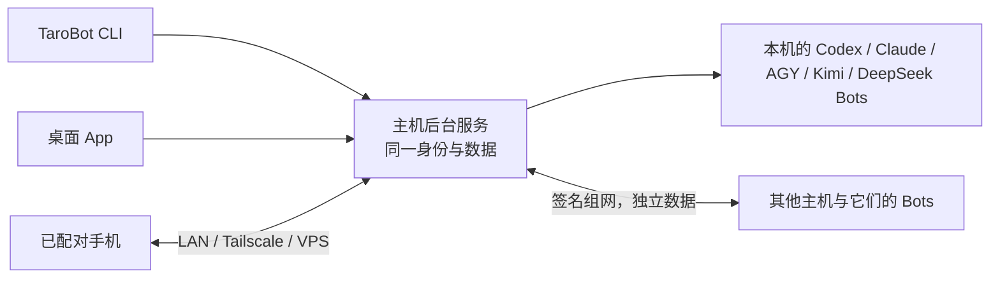

# TaroBot host CLI

TaroBot can run as a headless host. You can close its desktop window and use a paired phone to create Bots, send tasks, respond to approvals and receive files. The host computer still needs to be awake and reachable. TaroBot's CLI manages the host; the installed AI CLIs execute the work.

## Bot 人设小节（源码新增）

`tarobot bots persona BOT_ID --json` 读取当前人设和 `revision`。
保存时准备 UTF-8 JSON 文件，例如 `{"revision":"刚读取的版本","text":"用中文回答，先说结论。"}`，
执行 `tarobot bots persona BOT_ID --from PATCH.json --json`。`text` 为空字符串时清空人设。
App 和 CLI 共用 owner 权限、保存冲突检查及 Bot 专用 `workspace/AGENTS.md`，
只更新人设小节，保留其他工作规则。保存不会启动对话、自动重启引擎或声称已应用。
需要当前会话读取新版时，在对话中让 Bot 重新读取自己的 AGENTS.md。
回执不确定或发生冲突时重新读取核对，不自动覆盖其他设备的更新。
详见[人设文件与迁移](client/persona-agents-2026-11-04.md)。

## 个人分组置顶（源码新增）

`tarobot folders list --json` 查看当前用户在此主机的分组、`pinnedFolderIds`、
`order` 和 `revision`。`order` 中的 `null` 表示“未分组”。
`tarobot folders pin FOLDER_ID --enabled on --revision N --json` 置顶；
`--enabled off` 取消置顶。操作“未分组”时用 `--unfiled` 替代 `FOLDER_ID`。
取消置顶恢复置顶前的普通分组位置；置顶期间调整普通分组顺序仍然生效。
旧版留下的置顶若没有原位置记录，取消后放到普通分组末尾。已经取消的分组
不会因升级被自动移动；可在 App 的“管理分组”中重新排序。
每次修改都使用刚读取的 revision；冲突或回执不确定时先重新 list，不自动重试。
与 App 使用同一用户分组 API、权限和同步规则；需支持
`conversation-folders.pin.v1` 的主机。参见[分组置顶](client/folder-pinning-2026-10-22.md)。

## 批量整理对话（源码新增）

需支持 `conversations.batch.v1` 的主机：

```sh
tarobot conversations local --json
tarobot conversations archive --ids CHAT_A,CHAT_B --yes --request-id cleanup_1 --json
tarobot conversations restore --ids CONVERSATION_ID --yes --request-id RESTORE_ID
tarobot folders list --json
tarobot conversations move --ids CHAT_A,CHAT_B --folder FOLDER_ID --revision N --request-id move_1 --json
# 或使用 --unfiled / --new-folder NAME，三种目标不能同时传入。
```

一次最多 100 项，同一主机、同一事务，全部成功或失败。删除是可恢复归档，
保留历史和草稿；当前回复继续，自动群讨论在当前发言后暂停。话题跟随所属群组
分组，不能单独移动。回执不确定时保留原请求编号和原参数：重试会执行尚未执行
的原操作，已经执行过的不会重复。新操作不要复用旧编号。旧的跨 Bot 命令
`conversations list --host HOST --bot BOT` 保持原样。
详见[批量整理与恢复](client/conversation-multiselect-2026-10-24.md)。

`conversations restore` 另外需要主机支持 `conversations.restore.v1`；旧主机
会在发送请求前被拒绝。恢复群组不会恢复此前单独归档的话题；要恢复这些话题，
请显式选中，并先恢复所属群组，或将群组与话题放在同一批次。恢复保留 Bot
会话，不重启 Bot，也不自动继续群讨论。丢失回执后用原编号、原参数重试，
不会覆盖之后的再次归档。

`bots create` 会在发送前输出操作编号；结果不确定时，用该 `--request-id`
和原参数核对重试。重复的单值参数会报错，只有支持多附件的命令接受重复 `--file`。

## 安装与第一次启动

使用项目发布的独立主机 npm 包，在运行 Bot 的同一个系统用户下安装；将下方 `VERSION` 替换为下载包的实际版本号：

```sh
# Download the matching CLI archive and SHA256SUMS from the same release.
# macOS/Linux: shasum -a 256 tarobird-VERSION.tgz
# Windows PowerShell: Get-FileHash tarobird-VERSION.tgz -Algorithm SHA256
# Compare with SHA256SUMS before installing (checksum is not a signature).
npm install -g ./tarobird-VERSION.tgz
tarobot --version
tarobot init --name "Mac mini"
tarobot doctor
tarobot service install
tarobot start
```

安装包从 [GitHub Releases](https://github.com/cloveric/tarobird/releases) 下载。不向 npm 公共仓库发布；这里是本地安装下载的包。需要兼容 Node（Node 22.12+；建议使用官方 Node 24）。安装该归档后可以直接执行上面的服务命令，无需从源码重新打包。后台服务会把经过验证的包和 Node 固定到专属运行时目录，不依赖源码目录或 App 自更新后的路径。

**源码开发**：执行 `npm ci`、`npm run build`、`node dist/src/index.js --help`。要从源码安装服务，先按[发布清单](release-checklist.md)运行 `npm run pack:standalone` 生成完整的 `dist/standalone-package`，在该目录安装生产依赖，再从其中启动 CLI。

**版本边界（2026-10-19）**：App 1.0.94 与 CLI 0.1.442 使用 schema 19。跨主机 Bot 消息从 App 1.0.83 / CLI 0.1.431（schema 17）开始提供；这是功能最低版本，不是升级目标。两端主机和调用方 CLI 都需升级，按[运行时切换与恢复流程](host-cli-update.md)保留身份与数据，不能把旧程序指向升级后的数据库。

第一次必须命名。若已经在桌面端建立主机，沿用原目录和原名称即可；不需要新建 Bot 或重新配对手机。安装服务前先停止旧主机，并使用包含本次 CLI 支持的桌面主机代码。旧版桌面自动启动不认识新服务所有权，不能同时管理后台进程；实例锁仍阻止两份 Hub 同时写入。更新后不要让旧 App 的自动启动与新服务争抢。

全新安装的默认目录与桌面相同：

| 系统 | 主机目录 | 用户服务 |
| --- | --- | --- |
| macOS | `~/Library/Application Support/com.tarobot.client/host` | launchd 用户 LaunchAgent |
| Windows | `%APPDATA%\com.tarobot.client\host` | 当前用户登录计划任务 |
| Linux | `$XDG_DATA_HOME/com.tarobot.client/host`，默认 `~/.local/share/...` | systemd 用户服务 |

若原来 `com.tarocub.client/host` 目录已存在，App 与 CLI 都继续使用原目录，保留主机身份、数据库和 Bot 工作区的绝对路径，不自动移动或复制。新旧两个主机目录同时存在时会停止并提示冲突；须明确选择。原有服务注册名称保留，不会因品牌修改另建一台主机。

`--state-dir PATH` 显式选另一台独立主机；也支持 `TAROBOT_HOST_DIR`。若发现旧 `~/.cctb/hub`，必须明确选择，绝不自动合并身份。不要通过复制整个状态目录到另一台在线电脑来加入组网。

主机状态目录应使用支持私有文件权限、可靠文件锁和符号链接的本地文件系统（例如 macOS 的 APFS），不要把 exFAT 当成受支持的主机状态盘；代码和普通构建产物是另一回事。主机状态目录应放在该电脑的本地文件系统，不能让多个电脑通过网络盘或同步盘共同读写。文件锁不支持这类共享目录，`doctor` 也没有全面识别所有网络/同步盘。若管理操作报告锁等待超时，先根据其中的 PID、主机和启动标识确认占用者；不要直接删除仍在使用的锁。新旧运行时不能同时操作同一份状态。

安装后台服务期间会独占该主机目录，其他前台启动需等安装完成。已确认来自上次系统启动的遗留锁会自动恢复；仍有运行中的主机时，必须先正常停止，不能通过删除锁强行接管。

用户服务不是机器开机前的系统服务：macOS/Windows 通常在登录后启动；Linux 依赖用户服务管理器是否持续运行。休眠、关机、注销都会影响在线状态。安装命令不修改系统电源策略或扩大文件权限。

**群组功能的源码边界（2026-10-22）**：当前源码使用 schema 21，提供 `groups.discussion.v1` 与 `groups.parallel.v1`；尚未改变上面的已发布版本说明。群组模式、课题文件与控制命令见[群组讨论说明](client/group-discussion-2026-10-20.md)。新增[并行回复](client/group-parallel-replies-2026-10-22.md)：通过 `groups update` 保存 `policy.mode: "parallel"`，未 @ 时全员独立回复用户，指定时只投递给被点名的 Bot。发版时 App 与独立 CLI 必须来自同一修订。

## Windows 数据目录检查与离线恢复

Windows 启动会同时核对真实进程的 MSIX 包身份和系统 Known Folder，不能仅凭 `%APPDATA%` 字符串相同认定是同一份数据。商店应用的重定向上下文、活动隔离副本、两份数据冲突或缺失的原身份都会阻止启动；不会自动新建替代身份。请从开始菜单或普通非打包终端运行。

```sh
tarobot directory plan --json
tarobot directory verify --from <离线原目录> --state-dir <恢复副本> --json
```

两条命令均只读。`plan` 分类目录及后台服务状态；`verify` 对完整离线副本做 SHA-256 对照，差异返回非零退出码，不复制、覆盖或合并。实际恢复需停机、备份、校验、原子切换并保留回滚副本，见 [Windows Host 恢复说明](client/windows-host-directory-2026-10-19.md)。已经恢复并正常连接的机器无需再次迁移。

## 同一个主机，两种入口



`tarobot run` 在当前终端前台运行；关闭该进程会停止主机。`start` 在后台启动；安装服务后由系统管理器接管。`status`、`logs`、`doctor` 查看状态。`stop`、`restart` 和更新默认等待任务收尾，未开始的消息保留。`--wait 600` 调整等待秒数；`stop --force` 或 `restart --force` 才明确中断。超时不会强制杀掉任务。`drain-cancel` 恢复接收工作。

`run` 收到中断后会等待它启动的主机实际退出，包括只向 CLI 主进程发送中断的情况；不会把同目录中另一个主机进程当成自己的子进程关闭。

当前源码补强了连接恢复：已启用的局域网／Tailscale 监听会随网络地址恢复，无需重启主机；Bot 连续异常退出后转为 1–5 分钟慢速重试。桌面 App 打开时会定期尝试恢复意外退出的本机主机，尊重已停用的主机与后台服务。需要不依赖桌面 App 长期运行时，仍应安装系统后台服务，`doctor` 会提示未安装的情况。这些恢复不重新提交状态不明的模型任务，也不改变配对、主机身份或组网归属。电脑睡眠、关机或尚未登录时，后台服务不能保证可用。

`service uninstall --yes` 停止并卸载服务，保留 Bot、对话和文件。若状态目录已被移走，卸载会清理这一路径对应的残留注册，不创建新主机。

`drain` 是短期收尾请求：CLI 等待期间持续续约，命令结束后租约会在 30 秒内到期并恢复接收任务。需要持续停机请使用 `stop`，不要用 `drain` 代替。SSH 断开或 CLI 意外退出不会让主机永久停在收尾状态。

任务结束后遗留的普通选择卡不会阻止收尾；原生审批和异步问答仍需要用户处理，因为它们的回调尚不能跨进程恢复。等待超时会列出 Bot、会话、等待类型和数量，收尾期间也可用 `status --json` 查看 `drainBlockers`。当前原因使用稳定的 Bot ID 和会话 key；可先通过 `bots list` 核对名称，再在 App 打开对应会话处理。另一条命令持有收尾租约时，会立即提示到期时间及 `drain-cancel` 用法。

`service uninstall --yes` 只卸载已登记的后台服务；没有安装服务时，不会停止另行运行的前台主机。更新原本未运行、但启用了登录启动的主机，会保留这个意图而不立即启动。

当前源码统一了桌面主机、前台 `run` 和未安装系统服务时的后台 `start` / `restart` 的 CLI 搜索位置：随包 Node 所在目录、用户的 `.local/bin`、`.npm-global/bin`、`.kimi-code/bin`，以及平台的常见安装目录和继承的 `PATH`。这解决 macOS GUI 环境只提供系统路径时，终端已安装 CLI 但 Bot 启动报告 `spawn codex ENOENT` 的问题；显式引擎路径、登录配置与组网身份仍沿用原设置。`ENOENT` 也可能表示 Bot 工作目录或解释器不存在，须先核对具体日志，不能直接归因为额度不足或建议清空对话。这项修正需由包含它的主机运行时生效，源码更新本身不会替换已经安装的 App。

后台服务会保存明确配置的引擎路径、`CODEX_HOME`、`CLAUDE_CONFIG_DIR`、`DSH_HOME`、`KIMI_CODE_HOME` 和代理变量；不会复制整个终端环境。`doctor` 提示终端与服务环境的不同变量名，不打印代理凭据。调整后在停止主机的状态下重新 `service install`，再启动。

保存了这些额外配置的服务，不能直接回滚到不支持它们的旧版（如 0.1.420）；命令会在停机前拒绝，并保留当前服务。没有额外配置的服务仍可正常回滚。Windows 的 `stop --force` 仅在已确认所属后台任务、普通停止等待超时后才允许强制结束；正常收尾、更新和无法确认归属的进程不会被强杀。

`start --json` 的 `running` 表示主机状态，`cliController.ready` 表示本机管理控制器是否登记成功。主机已启动但登记失败时，已授权手机仍可连接；根据错误执行 `enroll` 或明确撤销遗留控制器，不要反复重启主机。

启动、重启和调整配对监听前先检查所选运行时与数据库的兼容性。未冻结的新版 CLI 不会静默迁移旧数据：请先暂存完整安装包，再使用 `update apply`，由它制作恢复副本并切换。`backup` 只读导出原 schema；旧式 `hub` 离线维护命令必须显式指定已有的 `--state-dir`。

`pair --lan` / `--tailscale` 只为本次配对选择线路，不修改组网共享线路。需要新增或替换组网线路时，明确使用 `network routes --from FILE --yes`。对话、Bot 所属主机和手机独立成员身份不变。

更新前可用 `update apply REVISION --dry-run` 查看容量、排除的工作区和未完成任务；升级恢复副本不含工作区，完整备份仍用 `backup`。清理旧版本使用 `update prune --revision ID` 或 `--receipt ID`，先预览，再追加 `--yes`。详见[更新与恢复边界](host-cli-update.md)。

默认停止会在主机内原子核对收尾租约、进程和身份后才进入停机。旧运行时不支持这项校验时，请先等任务完成，再通过它原有的入口正常停止；CLI 不会把“不支持”当成许可直接强停。若主机刚在启动、控制接口尚未就绪，会拒绝不确定的停止操作，待启动完成后重试。

运行时切换前发生失败，只在能够确认原冻结版本和主机身份都未改变时恢复原服务；不自动还原数据库。损坏的版本会在 `update status` 单独列出，仍可选择其他完整、兼容的版本。Windows 服务要求包内包含 x64 后台启动器，安装命令会在冻结运行时之前验证它；Linux 和 Windows 的系统服务仍需在目标系统完成实机验收，不能以跨编译或单元测试代替。

macOS 冻结 Node 时使用 `/usr/bin/otool` 检查动态库，因此需要可用的 Xcode Command Line Tools。用 `xcode-select -p` 检查，未安装时运行 `xcode-select --install`；检查工具不可用时会拒绝冻结并提示修复，不会跳过依赖验证。

新安装的服务保存定义文件的 SHA-256 和模板版本，CLI 升级后按保存的哈希验证原定义。旧服务记录没有哈希时仍要求匹配当前 CLI 可识别的模板；若模板已变更，需先使用原版本正常停止和卸载服务，再安装新版。手工改动过的定义文件不会被自动执行、覆盖或删除；先恢复原定义，再停止、重装或卸载服务，勿删除归属记录来绕过检查。

运行时刷新中断后，CLI 先核验整组服务文件。若全部已匹配刷新后的记录，只完成回执与系统注册；若模板版本已变、文件和主记录仍全部处于刷新前状态，则放弃未完成的刷新回执，保留原服务。模板变化且文件处于新旧混合状态时仍拒绝自动恢复，需使用生成该回执的 CLI 版本完成恢复；哈希无法重建缺失的旧模板字节。无哈希的早期回执仍严格比较模板，不会接受未知文件。

## 调整待执行消息

新版主机提供与手机、桌面相同的队列操作。先查看所选对话的 `revision` 和消息 ID，再提交修改；只管理主机尚未下发的消息，不能改变正在执行的任务。

主机与 worker 同时支持 `prompt-queue.pull.v1` 时，普通消息直到取得执行位置才下发。因此，问题卡片的后续处理仍在运行时，第一条待执行消息也可以编辑、重排和取消；App 与 CLI 共享这个边界。已下发或结果不确定的输入仍不能重新编辑，详见[统一待执行队列](client/unified-pending-queue-2026-10-22.md)。

```sh
tarobot queue list CONVERSATION_ID --bot BOT_ID
tarobot queue move CONVERSATION_ID --bot BOT_ID --message MESSAGE_ID --before OTHER_MESSAGE_ID --revision REV
tarobot queue move CONVERSATION_ID --bot BOT_ID --message MESSAGE_ID --last --revision REV
tarobot queue edit CONVERSATION_ID --bot BOT_ID --message MESSAGE_ID --text-file prompt.txt --revision REV
tarobot queue pause CONVERSATION_ID --bot BOT_ID --message MESSAGE_ID --revision REV
tarobot queue resume CONVERSATION_ID --bot BOT_ID --message MESSAGE_ID --revision REV
tarobot queue cancel CONVERSATION_ID --bot BOT_ID --message MESSAGE_ID --revision REV
```

`pause` 只暂停指定的尚未下发消息，保留原位置；后面未暂停的消息继续执行。
`resume`（App 中的「开始」）按保留的位置恢复排队，不抢占当前运行任务。
暂停期间仍可编辑、移动和取消。`queue list` 的 `paused`、`canPause`、`canResume`
和 `capabilities.pause` 来自所选主机，与手机、桌面同步，重启及备份恢复后保留。
此能力使用 Hub schema 25；旧版 Host 不能直接打开该数据库，降级需恢复升级前备份。
旧主机未声明 `capabilities.pause` 时，App 不显示暂停入口；CLI 不会绕过主机校验。

也可用 `--text "新文字"` 编辑。文字文件按 UTF-8 读取，保留换行；附件与引用不会因文字编辑被删除。修改前会在 stderr 输出请求编号；响应未确认时保留原参数和原 `--revision`，追加相同 `--request-id ID` 重试并核对结果（原请求未执行且版本仍匹配时，会执行该操作），不自动取得新版队列覆盖别人修改。明确收到拒绝后，核对最新队列并使用新的请求编号提交修订；旧编号的拒绝记录会保留，迟到请求不能重新生效。取消保留历史，取消排队与 `stop` 当前任务是两种操作。

旧主机/worker、未知引擎、群聊和话题子对话不支持此队列管理。能力来自目标主机，不能仅凭本机 CLI 版本推断。详见[能力核对与状态边界](client/prompt-queue-2026-10-14.md)。

## 临时侧边提问

对已有的单聊上下文提问，复用桌面侧边模式的权限、预算和清理规则：

```sh
tarobot side status CONVERSATION_ID --bot BOT_ID --json
tarobot side ask CONVERSATION_ID --bot BOT_ID --text '解释上一条回复' --json
tarobot side ask CONVERSATION_ID --bot BOT_ID --text-file question.txt --timeout 180 --json
tarobot side ask CONVERSATION_ID --bot BOT_ID --text '对比这两个文件' --file notes.md --file chart.png --json
```

新版 CLI 自动协商工具能力：Codex 侧边可以联网、搜索并调用已配置的工具，
也能执行你在这次侧边明确要求的操作。文件访问范围跟随 Bot，侧边可联网，且不单独
请求审批。旧主机保留原有模式，
Claude 与 Kimi 按其原生侧边能力提供工具。侧边不会继续主对话里的未完成任务。

`status` 核对目标 worker 的原生能力。`ask` 打开临时上下文、等待一次回答，
并在结束、取消或出错时关闭；返回 `text` 和 `closeConfirmed`，不向主对话
发送消息。问题文件须为 UTF-8 普通文件，问题最多 16,000 字符。
支持 Codex app-server、Claude Code stream-json 和 Kimi ACP；Kimi 需要在
主对话空闲时打开。桌面面板可继续追问，CLI 每次调用独立打开并关闭。
`--file` 可重复（最多 8 个），先经普通可续传上传进入该对话，再以附件提问；
带附件时可省略问题文字，JSON 另返回 `attachments`。主机或引擎不支持时在上传前拒绝；
Codex 可读图片、文本和二进制文档；Kimi 可读图片和文本，不接受二进制文件；Claude 只接受 UTF-8 文本。
侧边关闭只删除 worker 私有副本，不删除或回收 Hub 上传。
引擎限制、临时状态和验证边界见[侧边对话说明](client/side-conversations-2026-10-22.md)。

## Agent Bus 协作工作区

CLI 与桌面端共用本机 Hub 的 Agent Bus 工作区、权限、版本和运行记录。以下命令只连接已运行的本机主机，输出 JSON；命令自身不启动第二个 Hub 或常驻进程。协作由现有主机排队执行，并使用独立会话，不读取成员所选记录对话的历史。先用 `bots list` 取得明确的 Bot ID，同一个 Bot 可担任多个角色，但各步骤须绑定不同的对话。工作区与运行也必须使用返回的 ID，不按名称猜测目标。

```sh
tarobot bus list
tarobot bus show WORKSPACE_ID
tarobot bus create --from bus.json --request-id CREATE_REQUEST_ID
tarobot bus update WORKSPACE_ID --from bus.json --revision REV
tarobot bus run WORKSPACE_ID --text-file task.txt --revision REV --request-id RUN_REQUEST_ID
tarobot bus stop WORKSPACE_ID --run RUN_ID --request-id STOP_REQUEST_ID
tarobot bus delete WORKSPACE_ID --revision REV --yes
tarobot bus permissions BOT_ID
tarobot bus prepare --coordinator COORDINATOR_BOT_ID --members MEMBER_ID,OTHER_MEMBER_ID --yes --request-id PREPARE_REQUEST_ID
```

`bus.json` 只包含配置，例如：

```json
{
  "name": "设计评审",
  "mode": "verify",
  "coordinator": { "botId": "COORDINATOR_BOT_ID", "instruction": "提出方案，说明依据" },
  "members": [{ "botId": "REVIEWER_BOT_ID", "instruction": "核对数据、边界条件和遗漏" }],
  "maxResearchQuestions": 5,
  "maxRevisionRounds": 1
}
```

模式为 `ask`、`fan`、`chain`、`verify` 或 `crew`；`ask` 和 `verify` 需一个成员，`crew` 需四个成员，其余模式需一至十一个成员，成员数量不包含发起者这一栏，但成员的 Bot 可以与发起者或其他成员相同。每个成员可显式指定 `conversationId`；未指定时为该步骤创建或复用独立的专用对话。重复使用同一对话会被拒绝；重新排序时连同 `botId`、`conversationId` 一起移动。配置必须是非空普通 UTF-8 JSON 文件，最大 512 KiB；任务文件必须是非空普通 UTF-8 文件，内容最大 48,000 个字符。文件末端符号链接、设备文件、读取期间变化、重复命令行选项及未知配置字段都会被拒绝。

例如串联中同一 Bot 执行两步，可将 `members` 写为：

```json
[
  { "botId": "REVIEWER_BOT_ID", "conversationId": "DRAFT_CHAT_ID" },
  { "botId": "REVIEWER_BOT_ID", "conversationId": "REVIEW_CHAT_ID" }
]
```

每个成员可保存 `instruction`（最多 8,000 个字符），作为该环节的任务模板；`run --text-file` 是每次运行的共同目标，仍必填。步骤指令连同成员和对话一起移动、保存在不可变运行快照中。串联中每一步还会收到上一步的结果。留空保留原有执行方式。

`ask` / `chain` 的发起者负责发起与汇报，不自动执行一个步骤，也不能设置发起者指令。若要“研究 Bot → 估值 Bot”，将两者都按顺序放入 `members`；研究 Bot 可以同时是发起者，但两个槽位须使用不同的记录对话。桌面端的“让发起者执行第 1 步”会显式添加这个成员。`fan` / `verify` / `crew` 的发起者本身有执行工作，可设置自己的 `instruction`；团队成员的指令补充原有角色约束，不改变研究、撰写、复核流程。

执行状态、阶段结果和历史快照均以 Bot + 对话定位。需要支持
`agent-bus.runs.v3` 的主机工作进程；旧工作进程会明确拒绝任务，不会按旧规则误投递。

创建、运行、停止支持 `--request-id`，省略时生成唯一编号并在发送前写入 stderr。断线或超时不会自动重发。保留编号、文件内容和原 `revision`，用 `bus list` / `bus show ID` 检查；需要核对同一请求时使用相同编号和原参数，不能换新编号重复启动。更新、运行、删除必须填写刚读取的 `revision`；冲突时重新查看并核对配置，不自动覆盖其他设备的修改。`stop` 指定已有运行，`delete --yes` 删除协作工作区并保留关联对话。

`permissions BOT_ID` 查看该 Bot 的协作权限、成员和服务状态。`prepare --yes` 接受重复 Bot ID，先按 Bot 去重并排除发起者自身；只有本地角色时不启用网络协作、不改权限、不重启。与桌面授权准备使用同一算法：先读取全部参与方，保留已生效的权限和配置，只添加协调 Bot 与各所选成员之间的双向关系；不会把成员互相授权，也不会新增 `*` 通配权限。已启用的通配权限会保留；若关闭的协作配置中留有 `*` 或超出该 Bot 本次所选双向关系的成员，准备会拒绝将其启用，需先在协作设置中核对具体授权成员。任一成员不可读、缺失、版本格式无效或服务状态未知时，准备在写入前停止。保存响应也须确认提交的权限；版本冲突或确认失败时保留已确认的修改，不回滚覆盖其他设备，也不继续准备或重启服务。

准备操作不发送任务；在线服务不重启，离线协作服务仅调用主机现有的空闲重启接口。JSON 中的 `permissionsPrepared` 表示权限已保存，`restarts[].accepted` 表示主机接受了重启安排，不能据此认定忙碌 Bot 已重启或协作服务已上线；执行 `permissions` 重新核对后再运行任务。准备也支持 `--request-id`，并据其及参与方派生固定的逐 Bot 重启回执。断线后保留相同编号和参与方再次准备，可核对原重启结果，不会另发新编号重启。明确拒绝后先排查原因，再使用新的请求编号；不要用更换编号绕过等待中的重启。操作没有自动重试。

## 五种引擎

| Bot engine | 主机需准备 | 可选路径变量 |
| --- | --- | --- |
| `codex` | Codex CLI | `CODEX_EXECUTABLE` |
| `claude` | Claude Code CLI | `CLAUDE_EXECUTABLE` |
| `antigravity` | `agy` 及可用的 Antigravity 后端 | `ANTIGRAVITY_EXECUTABLE` |
| `kimi` | Kimi Code CLI | `KIMI_EXECUTABLE` |
| `deepseek` | DeepSeek Harness `dsh` | `DSH_EXECUTABLE` |

先在同一系统用户下完成各引擎登录或配置。`doctor` 检查终端与后台服务的可执行文件，**找到程序不代表账号已经登录或模型额度可用**。不会擅自发起收费模型调用。

```sh
tarobot bots catalog
tarobot bots create --name "写作助手" --engine claude
tarobot bots list
tarobot bots status BOT_ID
tarobot bots model BOT_ID
tarobot bots model BOT_ID --model 'claude-opus-5-5[1m]' --revision REV --effort high
tarobot bots chrome BOT_ID --json
tarobot bots chrome BOT_ID --enabled on --revision REV --json
tarobot bots rename BOT_ID --expected-name "写作助手" --name "文稿助手"
tarobot bots delete BOT_ID --expected-name "文稿助手" --yes
```

上例的 `BOT_ID` 使用 create/list 返回的实际 ID，`REV` 使用前一条读取返回的 `revision`；模型示例针对刚创建的 Claude Bot。创建时可指定 `--model`、`--effort`、`--workspace`、`--permission`，具体选项先看 catalog；不假定五个引擎支持相同值。重复提交创建用同一个 `--request-id`。删除通过现有 Hub API 执行，保留历史和工作区。所有命令针对选定本机；另一台主机上执行相应 CLI，或用 App 选择目标主机。

已有 Bot 的模型可用 `bots model BOT_ID` 读取，返回当前模型、思考强度、
主机模型目录和 `revision`。修改时带上读到的 `--revision`；其他设备或
`/model`、`/effort` 已修改配置时会拒绝旧版本，重新读取后再提交。
省略 `--effort` 保留当前强度，不兼容时拒绝整次更新。
`--model default --effort default` 明确恢复两项默认值。

Kimi 的 `catalog` 和 `bots model BOT_ID` 会读取本机 Kimi 配置中的真实模型 ID、
名称和可用思考档位。默认模型选项的 `id` 仍为空，`label` 显示当前解析出的模型；
固定选择 `kimi-code/k3.1-pro` 与跟随默认是两个不同设置。新建 Kimi Bot 的默认
effort 为空，执行时跟随所选模型的原生默认值（目前 K3 为 high，K3.1 Pro 为 max），
不会覆盖已有 Bot 明确保存的 high/max。用刚读取的 revision 执行
`bots model BOT_ID --model kimi-code/k3.1-pro --effort default --revision REV`
即可让这个 Bot 的后续任务使用 3.1 Pro 原生档位，包括它已有的对话；不会清空历史，
也不会打断当前任务或后台子代理。缺少模型元数据的旧 Kimi 配置仍交由 ACP 决定，
不能保证重置旧会话保存过的档位。详见 [Kimi 默认值与兼容性](client/kimi-model-defaults-2026-10-24.md)。

此入口和手机、桌面 Bot 设置使用同一个拥有者权限 API，模型与强度一起保存，
不发送聊天消息、不清空会话。正在执行的任务不打断，原生引擎在后续安全边界读取。

Claude Bot 的浏览器联动使用 `bots chrome BOT_ID` 读取当前开关和专属
`revision`，再用 `--enabled on|off --revision REV` 保存。只影响这个 Bot，
不改 Claude 全局设置；手机、桌面在「Bot 设置 → Chrome 浏览器联动」
操作同一个接口。当前任务不会中断，后续任务重建原生进程并续用原会话；
仍有后台任务时等待它们结束。关闭会显式传入 `--no-chrome`。
开启不等于扩展已连接，主机仍需安装 Claude in Chrome 并完成账号登录。
详见[浏览器联动设计与验证](client/claude-chrome-2026-10-17.md)。

### AGY 的 Gemini 4 Argon

2026-10-16 在 AGY 1.3.6 核对，`agy models` 返回
`gemini-4-argon-low`、`gemini-4-argon-medium`、`gemini-4-argon-high`。
App 的新建 Bot 菜单显示 CLI 提供的名称；仅当目标主机账号实际列出
Argon Medium 时，才默认选中它。未发现时继续跟随引擎默认，不虚构可用模型，
也不迁移已有 Bot 的模型设置。账号可用性以该主机的实时目录为准；
[官方发布说明](https://www.antigravity.google/blog/gemini-4-argon-in-google-antigravity)。

桌面、手机和 `tarobot bots catalog` 使用同一份主机目录。CLI 无需新增命令：

```sh
tarobot bots catalog
tarobot bots create --name "Argon 助手" --engine antigravity --model gemini-4-argon-medium
```

CLI 省略 `--model` 仍表示跟随 AGY 默认；上面的显式参数固定为 Argon Medium。
可按目录选择 Low 或 High。Argon 当前只提供 low / medium / high，不提供 xhigh / max。
模型 ID 中已包含档位；不传 `--effort` 时使用该模型变体的默认强度。

## 手机配对与远程连接

```sh
tarobot pair --lan
# 多个网卡地址时按命令列出的候选指定手机可达的地址：
# tarobot pair --lan --address 192.168.1.2
# 或 tarobot pair --tailscale
tarobot devices invites          # 本 CLI 签发的限时邀请；不输出凭证
tarobot devices revoke-invite INVITE_ID
tarobot devices pending
tarobot devices approve 12345678
tarobot devices list
tarobot devices rename DEVICE_ID --name "MacBook Pro"
tarobot devices revoke DEVICE_ID --yes
```

本机桌面端共用主机名称：使用 `tarobot name "example-mac"`，设备列表里的本机桌面记录也会同步，无需再次改名。旧桌面记录在 App 通过本机密钥验证重新连接后自动关联；`devices list` 的 `nameSource: "host"` 表示已关联。对这类记录调用 `devices rename` 会拒绝，避免产生两个名称。CLI 控制端仍名为 `TaroBot CLI`。

其他访问设备可以用 `devices rename` 单独命名，不修改主机名称，也不改变授权。设备撤销若涉及组网成员，会同步到整个网络；这与主机退出网络是两个动作。撤销前按设备 ID 核对，不能仅凭同名设备判断。

组网导入的设备通过已验证的成员身份跟随来源名称，旧“这台电脑”等默认名会在同步时修正；手机仍使用自己的名称。`devices rename` 保存的是此主机上的独立别名，之后不会被来源改名覆盖。目前没有恢复自动跟随的入口。历史自定义名称、没有可信身份关联的独立配对不会被猜测替换。参见[跨主机设备名称同步](client/network-device-name-sync-2026-10-19.md)。

`pair` 需要已运行的新版 Host 和已登记的本机 CLI 控制器；缺少控制器时先执行 `tarobot enroll`。CLI 已更新而后台仍是旧进程时，请在任务结束后执行 `tarobot restart`。每次 `pair` 都创建一份新邀请；短时间申请过多时，可用 `devices invites` 核对并撤销未使用的邀请。`--json`、`--out` 和终端二维码均含有效邀请，不能贴到公共日志或提交到仓库。

新手机或电脑可以扫描终端二维码，也可以复制 `tarobot pair` 输出的完整连接信息，在 App 的「粘贴连接信息」入口导入。核对主机，再用新设备显示的真实 8 位码批准。已有配对手机时，直接打开手机「我的 › 设备与网络 › 输入配对码确认」输入该码即可，无需回到 CLI 主机旁，也无需启动主机的桌面 App。`--lan` 建立局域网 HTTPS 入口；`--tailscale` 使用已有 Tailscale 网络接口。Tailscale 双栈默认选唯一 IPv4，也可通过 `--address IPv6地址` 显式选择 IPv6；仅有一个 IPv6 时直接使用它。多个局域网地址、多个 Tailscale IPv4，或没有 IPv4 但有多个 IPv6 时，命令列出候选并要求 `--address IP`。只有监听器或证书需要重启时才等待任务收尾；已有可用监听器可直接配对。二维码包含主机公钥、连接线路和一次性限时邀请，不包含私钥或会话 token。邀请有效期为 5 分钟，仅允许一台新设备发起申请；同一申请重试不会重复登记，拿到 8 位码后仍需人工确认。过期后重新运行 `tarobot pair` 生成新邀请，或用 `devices revoke-invite ID` 提前撤销；撤销不取消已经准入的待确认申请。`pair --json` 返回 `inviteId`、`expiresAt` 和 `serverTime`；`--out FILE` 仍以仅当前用户可读写的权限导出。新设备必须使用支持限时邀请的新版 App 和 Host，旧版 App、静态旧码或只手填地址不能发起首次配对；已经配对的设备正常重连。

配对需要重启时，会在等待任务收尾期间保留桌面启动锁，避免其他启动同时改写监听配置。此时另一条 `init`、桌面启动或恢复操作可能等待同一把锁；macOS/Linux 等无法核实进程创建时间的情况默认最多等待 300 秒，超时提示 `file_mutex_wait_timeout` 和 `desktop-start.lock`。`pair --wait` 更长时也不会延长其他命令的锁等待上限。先处理配对命令提示的待确认任务，待配对完成或取消后重试；不要删除仍由运行中进程持有的锁。Windows 能核实同一主机、同一进程创建时间时，默认继续等待所有者释放锁。

`tarobot network local [--json] [--tailscale]` 只读显示本机共享线路、额外的局域网/Tailscale 线路和监听状态。已配对的拥有者手机在线时会自动收到这些额外线路，无需重新扫码；成员设备不会自动更新。首个无歧义入口可立即提供给已授权客户端；后续地址变化需连续两次观察，并距前次变化至少 5 分钟。局域网替换还需同一网卡来源证明；多个候选且没有原选择时，不会自动选取，歧义会保留到用户明确选择。`--tailscale` 只运行 `tailscale status --json --peers=false`（3 秒超时），报告本机状态和地址归属，不列出其他设备，也不代表手机已连通。参见[线路同步与边界](client/tailscale-route-sync-2026-10-21.md)。

跨网连接需要两端能访问同一 Tailscale 网络，或已经部署并配置好的 VPS 中转。`pair --routes routes.json` 只分享配置，不部署服务器。线路格式与 App 相同，例如 `[{"name":"Direct","url":"https://host.example:8788"}]`；自签证书还需可信 CA，VPS 线路需实际 relay 参数。不要把 `localhost` 当手机可访问地址。

## 大组网：电脑带着 Bot 加入

CLI 沿用 App 的签名成员协议：A/B/C 各自拥有 Bot 和数据库；手机是独立设备。手机配对不自动将另一台电脑变成成员，成员加入需要双方明确批准。

在 A 建立网络并导出邀请信息：

```sh
tarobot network create --name "家庭网络"
tarobot network offer --out offer.json
```

把文件交给 B，在 B 生成加入提议：

```sh
tarobot network inspect --from offer.json
tarobot network propose --from offer.json --out proposal.json --yes
```

把提议交回 A 核对并批准，再把批准文件交回 B：

```sh
# A
tarobot network inspect --from proposal.json
tarobot network admit --from proposal.json --out admission.json --yes
# B
tarobot network inspect --from admission.json
tarobot network join --from admission.json --yes
```

文件均有签名和绑定身份的 nonce；接收方验证来源与成员内容。每个变更先保留本机操作记录；输出失败可用 `network recover --from RECEIPT --out NEW_FILE` 导出已确认结果，不重发变更。状态不确定时先检查 `network status`，不要盲目重试。

`network routes --from routes.json --yes` 更新本机分享线路。`network leave --yes` 让本机带着自己的 Bot 独立，原网络手机继续留在其他主机。退出前若手机还没有在其他主机完成独立登记，会拒绝退出；先让手机连接其余成员。CLI 自身没有替手机签名登记的权限。协调主机仍有成员时不能退出，成员变化需协调主机可达；这与 App 一致。

本机 CLI 是 host scope 控制器；手机是 network scope 控制器。删除 CLI 身份文件不会悄悄生成并放行另一把密钥。确认旧 CLI 设备已撤销后才使用 `enroll --reset --yes`；本机 OS 所有者可以显式重新登记本机控制器。

## 更新、备份与恢复

自动数据库快照默认保留 **1 天**。App 的「设置 → 数据与备份」和以下命令使用同一主机设置：

```sh
tarobot backups status --json
tarobot backups configure --days 3 --json
tarobot backups configure --days 0 --json
```

`--days` 接受 0–3650 的整数；0 关闭自动备份并清理已有自动快照。
保留期按 UTC 日期计算，1 天保留当天快照。主机通常在下一分钟的维护检查应用修改，
无需重启；新快照保存成功后才会清理过期快照（设为 0 时除外）。
`status` 显示当前策略、自动快照数量、大小与最近日期。
可用 `--revision` 防止覆盖其他设备的修改，`--request-id` 标识同一次保存；
结果不明确时先执行 `backups status --request-id ID` 核对，不要换编号反复提交。

每日快照包含聊天、设备授权、Bot 记录、网络配置等数据库状态；
**不包含附件原文件、工作区、引擎登录信息或主机身份密钥**，不能代替完整备份。
策略只清理 `backups/auto-YYYY-MM-DD.sqlite` 普通文件；手动备份、旧格式导出、
符号链接和升级恢复副本不受影响，也不会删除聊天记录本身。
旧主机没有显式策略时，同样采用新的 1 天默认值。

```sh
tarobot update stage --from /path/to/installed-standalone-package
tarobot update status
tarobot update apply REVISION_ID --yes
tarobot update rollback --yes
tarobot stop
tarobot backup /path/to/new-backup-directory
```

暂存校验依赖、原生 SQLite、平台与数据格式。切换前等待任务、停服务、锁定主机与 Bot，并建立离线快照；原数据不自动降级。`rollback` 只在旧运行时可读当前数据格式时切回程序；不会把新消息抹掉。详见[更新契约](host-cli-update.md)。

完整备份与更新快照是不同格式。普通备份保留主机身份、Bot、历史和工作区；排除机器服务注册、CLI 本地密钥、运行日志和 socket。引擎在 `~/.claude`、`~/.codex` 等目录中的会话/登录状态、外部工作区需另外备份。

恢复必须显式指定原目录，并且该目录不存在；若仍有系统服务注册，先卸载该路径对应的服务。命令不会覆盖、合并已有状态：

```sh
tarobot restore /path/to/backup --state-dir /original/host/path
```

恢复后检查身份、外部路径、引擎登录，再登记 CLI 和安装服务。`--json` 提供结构化输出；错误返回非零退出码，操作记录不表示端到端手机连接成功。

备份不含 CLI 私钥，但数据库会保留原 CLI 设备记录。若恢复后提示 `cli_controller_orphaned_revoke_explicitly`，先核对错误列出的 CLI 设备 ID；可通过仍获授权的 App 撤销它。纯命令行环境下，先 `tarobot stop`，再对明确的旧 CLI ID 执行 `tarobot hub devices revoke CLI_ID --state-dir /original/host/path`，随后 `tarobot start` 重新登记。该离线操作会取得主机锁；不猜测或自动撤销桌面/手机设备。

## 验收边界

自动化覆盖 CLI 管理、设备签名、三主机加入/退出、手机归属、服务所有权、离线备份、更新和收尾。目标系统的用户服务需要单独实测；macOS 验收不能替代 Windows 登录/注销、Linux lingering 或手机锁屏网络测试。当前 CLI 修改不会自动升级已安装的手机 App 或旧桌面 App。

### 删除自己的消息记录

`tarobot messages list CONVERSATION --json` 按新到旧读取当前用户的消息，
每页最多 50 条；使用返回的 `nextBefore` 继续 `--before ID`。
`tarobot messages delete CONVERSATION --ids ID1,ID2 --yes` 一次删除最多 100 条。
这与 App 的单条删除、长按/右键多选使用同一个认证 API：只从当前用户的历史
中移除并同步自己的设备，不改变其他成员的记录，不撤回已下发给 Bot 的输入，
不停止正在执行或排队的任务。不会物理删除共享附件或 Bot 工作区文件。
重试相同 ID 是幂等的；混入不存在、其他对话或无权限的 ID 会整体失败。

主机 schema 16 保存个人删除记录；旧主机不得打开或降级这个数据库。

### 清理整个对话的 App 记录，保留模型 session

`tarobot messages clear CONVERSATION --json` 只统计当前用户可见记录，返回
`count` 和固定范围编号 `throughId`，不写入。确认该范围后执行：

```sh
tarobot messages clear CONVERSATION --through MESSAGE_ID --yes --json
```

也可用 `tarobot messages clear CONVERSATION --yes` 当场统计并清理。每次请求
最多处理 100 条；只清理当前用户的 App 历史并同步自己的设备，不影响其他成员、
模型 session、上下文、Bot 人设或已保存的文件。不执行 `/reset`、`/compact`，
也不物理删除主机数据库和事件日志。

清理遇到运行中的任务、未回答的问题或审批时会暂停，该批次不写入，先前批次
仍然有效。先处理这些任务/卡片，再用原来的 `--through MESSAGE_ID --yes` 继续。
若确认残留的问题/审批卡片已经失效，可用现有单条删除隐藏它后继续。
断线、超时或丢失回执同样保留原编号重试；后来的新消息不在这个范围中。
`cleared` 是本次命令收到成功回执的清理条数，不含丢失回执或其他设备已清理的条数。
新 Host 通过 `messages.clear.v1` 声明支持；此源码变更本身不会升级已安装 App/CLI。


## 跨主机 Bot 消息

**从 CLI 0.1.431 与 App 1.0.83 开始提供。请使用当前匹配的 App/CLI 发行包。** 两端主机与调用方 CLI 都需包含这项功能；命令不会替你升级或启动主机。

`conversations list --host HOST --bot BOT`、`messages send --to HOST/BOT[/CONVERSATION] --text-file FILE [--file FILE]...` 和 `messages wait --to HOST_ID/BOT_ID/CONVERSATION_ID --message ID` 均为一次性命令，支持 `--json`，只连接已运行的本机 Hub。操作员额外传 `--source-bot LOCAL_BOT_ID`；运行中的 App Bot 自动使用自身身份。目标默认使用来源专属协作对话，精确名称有歧义时返回候选，不选择第一个。

App Bot 发送时使用本轮附加提示提供的 `--context-message CURRENT_INPUT_ID`，不要复制历史消息 ID。普通终端操作员在 **list、send、wait 三条命令上都加** `--source-bot LOCAL_BOT_ID`，不传 `--context-message`。这不是让 Bot 申请操作员权限的入口。

目标主机所有者可在普通终端执行 `messages allow --from SOURCE_HOST/SOURCE_BOT_ID --bot TARGET_BOT` 授权，撤销使用 `messages revoke`。来源主机已离网/被移出网络，或接收 Bot 已删除时，`messages revoke` 仍可撤销残留授权，请使用准确的 `hub_…` 主机 ID 与 Bot ID（名称只匹配当前成员表中仍列出的主机和未删除的 Bot）；没有现存授权时不新建记录。从 1.2.0 起，也可以在 App 的该主机「设置 → Bot 消息授权 → 跨主机」中按方向允许或撤销，包括已离网来源或已删除目标的残留授权；1.2.0 CLI 还新增 `messages grants --cross-host --json`，与 App 查看同一份记录。原 `messages grants` 继续只查看本机授权。Bot 不能自行授权。`wait` 超时后，用返回的 messageId 和主机/Bot/对话 ID 再次等待；`send` 断线且没有回执时，只能用相同 requestId、目标和内容核对恢复，不自动重发或换新编号。完整例子、队列语义与验收边界见[跨主机消息 MVP](client/cross-host-bot-messages-2026-10-17.md)。

Bot 间的新任务、审阅结果和后续补充都使用 `messages send`，收件方正在执行时也如此；这些消息进入持久队列。不要为了跟进正在运行的 Bot 而改用 `steer send`。后者只针对指定当前轮次，轮次结束就拒绝，且不进入下一轮。

`steer send` 仍可用于有意限定某一轮的补充。`steer send` / `send-now` / `cancel` 返回的 JSON 格式不变；已知拒绝、未采纳、撤回或结果待确认时，CLI 在 stderr 解释原因并以退出码 1 结束。`status` 查询成功仍退出 0；`steer send` 退出 0 仅表示当前回执证明接收，不代表任务完成。之后核对原请求时，若已有“未进入模型”或“不确定”的原生回执，会以较新的证据为准。即使 HTTP 为 200，也必须检查回执；旧 CLI 的退出码不能证明投递成功。

原生控制操作返回 `accepted / nothing_waiting` 时是幂等空操作，仍退出 0，但 stderr 明确说明“本次未改变任务”。它不能单独证明模型已接收原消息；JSON 回执保持不变，不会自动重发。

确定未投递时，先核对内容是否仍有效，再明确发起新的普通协作消息；绑定变化需先核对目标会话。结果不确定时，只能用原请求编号、原目标和原内容核对，不得切成普通消息或换编号重发。参见[投递诊断与验证](client/bot-delivery-receipts-2026-10-30.md)。

## 本轮改动与工作区改动（只读）

查看某条 Bot 回复当时保存的修改：

```sh
tarobot changes list CONVERSATION_ID --bot BOT_ID --message MESSAGE_ID --json
tarobot changes show CONVERSATION_ID --bot BOT_ID --message MESSAGE_ID --path FILE_KEY --json
tarobot changes show CONVERSATION_ID --bot BOT_ID --message MESSAGE_ID --path FILE_KEY --operation 3-0 --json
```

`--path` 接受列表中的原路径或文件 key。重名时使用 key；`--operation` 使用
返回的修改步骤 ID。同一文件多次修改按步骤分别查看，增删统计为已保存步骤累计，
不是最后文件的净变化。无需 Git 仓库，不读取当前磁盘内容；旧记录缺失、过期或
本轮尚未结束时会明确说明。手机与 CLI 只读，桌面可批注并按原消息队列发送。
权限、保留期限与引擎边界见[本轮改动说明](client/run-diff-2026-10-20.md)。

不传 `--message` 时保留原有的实时工作区查看：

```sh
tarobot changes list CONVERSATION_ID --bot BOT_ID --json
tarobot changes show CONVERSATION_ID --bot BOT_ID --path src/app.ts --json
tarobot changes show CONVERSATION_ID --bot BOT_ID --path large.txt --preview --json
```

复用已运行本机 Hub 的 owner、对话成员和 Bot 权限检查，不启动第二个 Hub。
返回结构化文件列表或单文件差异，含 HEAD、行号、增删统计与截断说明。
比较的是 Bot 配置工作区当前相对 HEAD 的未提交改动，包含未忽略的新文件，
不是某个历史轮次的快照。大文件默认仅返回元数据，`--preview` 明确请求前 200 行
文本预览，不代表完整差异。无能力的旧主机会提示升级；不支持编辑、暂存、提交
或推送。具体安全、资源与验证边界见[设计说明](client/diff-viewer-2026-10-19.md)。


### Local speech integration

`tarobot integrations asr status --json` reports service/model/readiness, memory,
watchdog and the latest durable installation job. `tarobot integrations asr install
--yes --json` downloads dependencies/model and enables the current OS user's service;
`--request-id ID` deduplicates explicit retries. This account-level operation rejects
`--state-dir`, does not require or start a Hub, and shares the packaged installer with
the App. Python 3.12 and ffmpeg/ffprobe are prerequisites. macOS launchd and Linux
systemd user services are supported; native Windows automatic registration is not.
See [options, recovery and limitations](../integrations/qwen3-asr/README.md).

### Interactive visuals

Use HTML components by default, including ordinary charts, comparisons, tables and
timelines. Use the structured `report` format only when the user explicitly requests
it. This policy is shared by native `app_show_widget`, `send.widget`,
`widgets publish` and `workbench publish`; existing report messages remain readable.

The host-wide generation switch is shared with **Settings → General → Visual replies**:
`tarobot widgets status --json`, then `tarobot widgets set --enabled on|off --revision REV --request-id ID --json`.
The default is on. Off omits guidance on subsequent turns and blocks new native,
compatibility and CLI publications. Existing reports/history remain available;
existing Codex tool schemas cannot be removed from resumed sessions. Use
`widgets status --request-id ID` to reconcile an uncertain save. See
[scope, prompt costs and acceptance](client/widget-settings-2026-10-22.md).

`tarobot widgets publish CONVERSATION --html-file /absolute/report.html --title TITLE --summary TEXT --request-id ID --json`
publishes a self-contained HTML/CSS/JavaScript report using the same widget format
as Bot replies. The authenticated user remains the author; this does not trigger
Bots. Use a stable request ID to reconcile retries. Conversation membership and
archival rules apply. The CLI validates size and script syntax before publication;
`messages list` reads the saved source and summary. See
[inline widgets](client/inline-widgets-2026-10-22.md) for sandbox limits and native
compatibility. Older Apps retain the readable summary.

For an explicit structured-report request, use `widgets publish CONVERSATION --report-file /absolute/report.json
--title TITLE --summary TEXT --request-id ID --json` (one command line). Choose
exactly one of `--html-file` and `--report-file`. The same Host switch and receipt
apply. Typed data is rendered by App-owned components, without generated scripts.
See the [report format and execution contract](client/inline-widgets-cpu-containment-2026-10-22.md).
